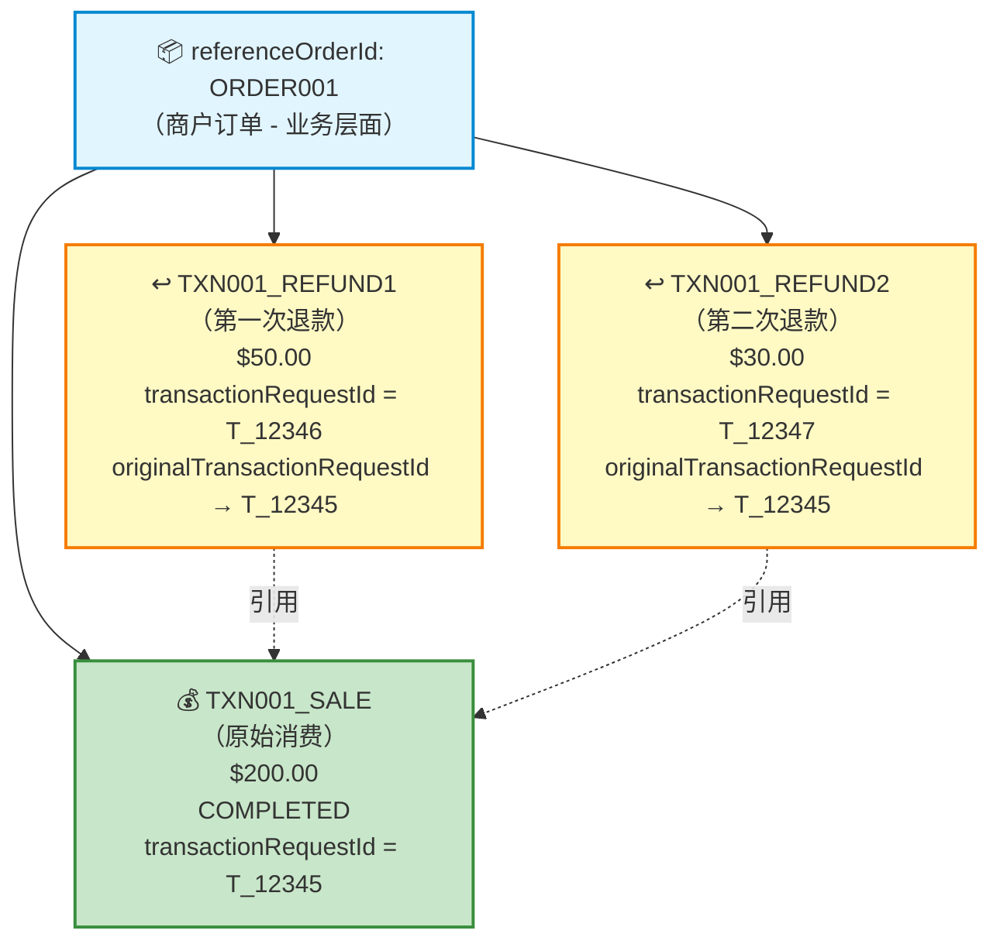
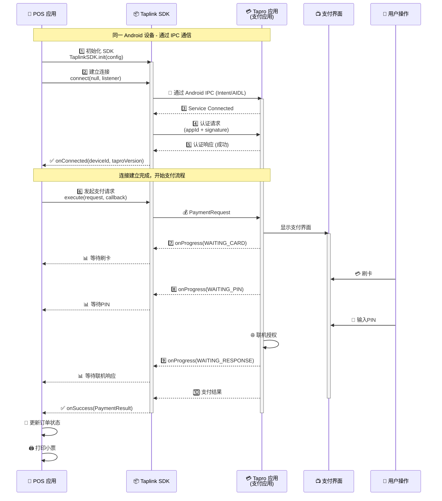

# Sunbay Taplink SDK for Android - 集成指南

---

## 概述

本文档主要介绍线下支付场景中的半集成解决方案，利用SUNBAY产品线中的Tapro支付应用及Nexus的支付网关的开放接口，为第三方ISV的POS应用提供支付能力。

**方案特色：**

*   **快速集成**：通过Taplink SDK（设备端集成），或者Nexus SDK（云端集成）简化接入流程
    
*   **灵活部署**：POS应用只需要集成一套SDK，可同时满足同设备和跨设备的调用场景
    
*   **结构统一**：本地模式与云端模式保持数据结构一致
    

### SUNBAY 半集成方案总图


---

注：本文内容只涵盖Taplink的本地半集成方案，Nexus的云端半集成方案会提供单独文档

## 核心概念

在开始集成之前，请先理解以下核心概念，这将帮助你更好地使用 SDK。

### 2.1 集成类型

Taplink SDK 支持两种集成类型：

| **集成类型** | **连接模式** | **适用场景** | **延迟** |
| --- | --- | --- | --- |
| **同设备集成** | 应用间（App-to-App）模式 | POS 应用和 Tapro 在同一 Android 设备 | 毫秒级 |
| **跨设备集成** | **线缆模式**<br>通过 USB/串口线缆连接（点对点） | 传统 POS + 独立支付终端 | < 1秒 |
|  | **局域网模式**<br>通过有线/无线局域网连接 | POS 设备 + 独立支付终端 | 1-3秒 |

**选择建议：**

*   Android 一体机/平板 → 应用间模式
    
*   传统 POS + 支付终端 → 线缆模式或局域网模式
    

---

### 2.2 订单与交易关系

**一句话说明：**

*   **referenceOrderId**: 商户订单号（1个订单可包含多笔交易）
    
*   **transactionRequestId**: 交易请求ID（每笔交易唯一）
    

**关系图：**



**对比表：**

|  | **referenceOrderId** | **transactionRequestId** |
| --- | --- | --- |
| **含义** | 商户订单号 | 交易请求ID |
| **唯一性** | 商户系统内唯一 | 全局唯一 |
| **数量关系** | 1个订单 | 可包含多个交易 |
| **用途** | 业务对账、订单追踪 | 交易幂等性、去重 |
| **后续交易** | 保持不变 | 必须使用新ID |
| **重试场景** | 保持不变 | 临时性错误可用相同ID |

**代码示例：**

```kotlin
// 正确：一个订单，多笔交易
val orderId = "ORDER001"

// 消费交易
val saleRequest = PaymentRequest()
    .setReferenceOrderId(orderId)           // 相同
    .setTransactionRequestId("TXN001_SALE") // 不同
    .setAction("SALE")
    // ...

// 退款交易（同一订单）
val refundRequest = PaymentRequest()
    .setReferenceOrderId(orderId)              // 相同
    .setTransactionRequestId("TXN001_REFUND")  // 不同
    .setAction("REFUND")
    .setOriginalTransactionId(originalTxnId)   // 引用原交易
    // ...

```

**重要提示：**

*   不要将 referenceOrderId 直接用作 transactionRequestId
    
*   为每笔交易生成独立的 transactionRequestId
    
*   建议格式：`{订单号}_{交易类型}_{时间戳}`
    

---

### 2.3 错误处理策略

**错误分类：**

| 错误类型 | 错误码示例 | 处理策略 |
| --- | --- | --- |
| **通用系统错误** | 201, 202, 203, 204, 209 | 检查配置，修复后重试 |
| **连接错误** | 211, 212, 213, 214, 215, 231, 232, 251, 271, 281, 283, 286, 291, 294 | 检查连接状态，重试连接 |
| **认证错误** | 221 | 检查认证参数，重新建立连接 |
| **参数验证错误（交易处理）** | 311, 312, 313, 314, 315, 316 | 检查参数，修复后重试 |
| **数据传输错误（交易处理）** | 321, 322, 323 | 检查网络连接，重试数据发送 |
| **交易业务逻辑错误（交易处理）** | 331, 332, 333, 334, 335, 336 | 等待后重试或查询状态（注意：333、334需使用新ID） |

**处理流程：**

```plaintext
收到错误
  ├─ 检查错误码
  ├─ 判断错误类型
  ├─ 临时性错误 → 查询交易状态 → 重试（相同ID）
  ├─ 明确失败 → 提示用户 → 重试（新ID）
  └─ 配置错误 → 检查配置 → 修复后重试

```
---

### 2.4 幂等性机制

#### 核心概念

幂等性是支付系统中的关键安全机制，确保相同的交易请求不会被重复处理，避免重复扣款。在 Taplink SDK 中，通过 `transactionRequestId` 实现幂等性控制。

**核心原则：**

*   每个交易请求必须有唯一的 `transactionRequestId`
    
*   相同的 `transactionRequestId` 在系统中只会被处理一次
    
*   **特殊错误码**（332、333、334、000）重试时，必须使用**新的** `transactionRequestId`
    
*   **其他错误码**重试时，可以使用**相同的** `transactionRequestId`
    
*   修改金额或订单后，必须使用新的 `transactionRequestId`
    

---

#### 决策规则

**何时使用相同ID？**

**核心原则：** 除了以下特殊错误码外，其他所有错误码都可以使用**相同的** `transactionRequestId` 重试：

| **错误码** | **说明** | **处理方式** |
| --- | --- | --- |
| **333** | host交易拒绝 | 必须使用**新** `transactionRequestId` |
| **334** | Host交易处理中 | 必须使用**新** `transactionRequestId` |
| **000** | 交易成功 | 无需重试 |

**特殊处理：响应超时（332）**

| **错误码** | **说明** | **处理方式** |
| --- | --- | --- |
| **332** | Tapro响应超时 | 先查询交易状态，确认结果后再使用**相同** `transactionRequestId` 重试 |

**可以使用相同ID的错误码示例：**

| **错误码类型** | **典型错误码** | **说明** |
| --- | --- | --- |
| **响应超时** | 332 | 先查询交易状态，确认结果后可使用相同ID重试 |
| **交易锁定** | 331, 209 | 系统正在处理其他交易，可使用相同ID重试 |
| **连接错误** | 213, 212, 232, 251, 271 | 连接问题，可使用相同ID重试 |
| **初始化错误** | 201, 231, 202 | 配置问题修复后，可使用相同ID重试 |
| **参数错误** | 311, 312, 313, 314, 315, 316 | 参数错误修复后，可使用相同ID重试 |
| **其他错误** | 除333/334/000外的所有错误码 | 可使用相同ID重试 |

**何时使用新ID？**

当遇到以下情况时，必须使用**新的** `transactionRequestId`：

| **场景** | **原因** | **典型错误码** |
| --- | --- | --- |
| **host交易拒绝** | 交易被host明确拒绝 | 333 |
| **Host交易处理中** | Host正在处理，需要查询状态 | 334 |
| **交易成功** | 交易已成功完成 | 000 |
| **修改金额** | 交易参数已变化 | \- |
| **修改订单** | 不同的业务订单 | \- |

**特殊处理：响应超时（332）**

| **场景** | **原因** | **处理方式** |
| --- | --- | --- |
| **响应超时** | 交易状态未知，可能已处理 | 先查询交易状态，确认结果后再使用**相同** `transactionRequestId` 重试 |

---

**代码示例：**

```kotlin
class PaymentManager {
    // 保存当前请求用于重试
    private var currentRequest: PaymentRequest? = null
    
    fun processPayment(amount: BigDecimal) {
        val txnReqId = "TXN_${System.currentTimeMillis()}"
        
        currentRequest = PaymentRequest()
            .setAction("SALE")
            .setReferenceOrderId("ORDER_${System.currentTimeMillis()}")
            .setTransactionRequestId(txnReqId)  // 保存ID
            .setAmount(AmountInfo()
                .setOrderAmount(amount)
                .setPricingCurrency("USD"))
            .setDescription("商品购买")
        
        TaplinkSDK.execute(currentRequest!!, callback)
    }
    
    fun retryPayment(error: PaymentError) {
        if (canRetryWithSameId(error.code)) {
            // 可以使用相同ID：使用相同请求重试
            TaplinkSDK.execute(currentRequest!!, callback)
        } else {
            // 特殊错误码（332、333、334、000）：必须创建新交易
            processPayment(100.0)  // 生成新ID
        }
    }
    
    /**
     * 判断是否可以使用相同的 transactionRequestId 重试
     * 
     * 特殊错误码（332、333、334、000）必须使用新ID
     * 其他所有错误码都可以使用相同ID
     */
    private fun canRetryWithSameId(code: String): Boolean {
        // 332、333、334、000 不能使用相同ID（332需要先查询状态）
        return code !in listOf("332", "333", "334", "000")
    }
}

```
---

### 2.5 连接认证

所有连接模式在建立连接后都需要进行认证，以确保：

*   POS 应用身份合法性
    
*   应用具有访问权限
    
*   防止未授权访问和中间人攻击
    

**重要：** 认证由 SDK 自动处理，开发者只需：

1.  在初始化时提供正确的 `appId` 和 `secretKey`
    
2.  调用 `connect()` 方法
    
3.  通过 `ConnectionListener` 监听认证结果
    

**认证流程（SDK自动处理）：**

```plaintext
1. 应用调用 connect()
2. SDK 建立物理连接
3. SDK 生成认证签名
4. SDK 向 Tapro 发送认证请求
5. Tapro 与 Nexus 平台验证
6. SDK 接收认证结果
7. 通过 ConnectionListener 通知应用

```

**常见认证错误：**

| **错误码** | **说明** | **解决方案** |
| --- | --- | --- |
| 201 | SDK未初始化 | 调用TaplinkSDK.init()初始化SDK |
| 231 | Tapro应用未安装 | 安装Tapro应用到设备 |
| 221 | 连接认证失败 | 检查认证参数（appId、secretKey等），重新建立连接 |
| 212 | 未建立连接 | 先调用connect()建立连接 |

---

### 2.6 金额单位规范

#### 核心概念

SDK 中的所有金额字段都必须使用**最小货币单位**（smallest currency unit）表示，这是国际支付系统的标准做法，确保精确性和一致性。

**基本货币单位 vs 最小货币单位：**

| **货币** | **基本货币单位** | **最小货币单位** | **换算关系** |
| --- | --- | --- | --- |
| **USD（美元）** | Dollar | Cent（分） | 1 Dollar = 100 Cents |
| **EUR（欧元）** | Euro | Cent（分） | 1 Euro = 100 Cents |
| **JPY（日元）** | Yen | Yen（日元） | 1 Yen = 1 Yen |
| **CNY（人民币）** | Yuan | Fen（分） | 1 Yuan = 100 Fen |

**为什么使用最小货币单位？**

1.  **避免浮点数精度问题**：整数运算比浮点数更精确
    
2.  **国际标准兼容**：符合 ISO-4217 标准
    
3.  **系统一致性**：所有支付系统都使用相同的表示方法
    
4.  **防止舍入误差**：避免金额计算中的精度丢失
    

#### 示例：

```kotlin
正确：
// $12.34 表示为 1234 分
val amount = AmountInfo()
    .setOrderAmount(BigDecimal("1234"))  // 1234 分 = $12.34
    .setPricingCurrency("USD")

// 错误：使用基本货币单位
val wrongAmount = AmountInfo()
    .setOrderAmount(BigDecimal("12.34"))  // 错误！这会被理解为 $0.1234
    .setPricingCurrency("USD")
```

#### 常见货币换算表

| **金额显示** | **最小货币单位** | **SDK中的值** |
| --- | --- | --- |
| $1.00 | 100 cents | 100 |

**参考标准：** 各货币的小数位数详情请参考 [ISO-4217](https://www.iso.org/iso-4217-currency-codes.html) 国际标准。

---

## 快速开始

### 开始之前

**平台要求：** Android 7.1 (API 25) 及以上   **SDK 类型：** Android 原生 SDK (Kotlin/Java)

**POS 应用定义：** POS 应用是指第三方 ISV 或商户自己开发的收银和业务管理应用，负责订单、库存、会员、报表等业务逻辑，通过调用 Taplink SDK 集成支付能力。

**适用场景：**

*   需要支付集成的 Android POS 应用
    
*   Android 一体机、平板和手持终端
    
*   支持同设备集成和跨设备集成
    
*   支持多种连接模式（应用间、线缆、局域网）
    
*   仅限本地模式集成
    

**其他平台：**

*   本 SDK 专为 Android 平台设计
    
*   其他平台（Windows、iOS、Linux）请联系 SUNBAY 获取可用性信息
    
*   服务端云端模式集成请使用 Nexus SDK（SUNBAY支付网关SDK）
    

---

### 3.1 最小化示例

这是最简单的集成示例，帮助你快速验证 SDK 功能。

#### 步骤1：添加依赖

**1.1 配置 Maven 仓库**

在项目的 `settings.gradle.kts` 中添加：

```kotlin
dependencyResolutionManagement {
    repositories {
        google()
        mavenCentral()
        maven("https://repo1.maven.org/maven2/")
    }
}

```

**1.2 配置模块**

在模块的 `build.gradle.kts` 中：

```kotlin
android {
    compileSdk = 34
    
    defaultConfig {
        minSdk = 24  // 最低支持 Android 7.0
        targetSdk = 34
    }
    
    compileOptions {
        sourceCompatibility = JavaVersion.VERSION_1_8
        targetCompatibility = JavaVersion.VERSION_1_8
    }
    
    kotlinOptions {
        jvmTarget = "1.8"
    }
}

dependencies {
    implementation("com.sunmi:sunbay-taplink-sdk-android:1.0.1")
    implementation("com.google.code.gson:gson:2.13.1")
    implementation("org.java-websocket:Java-WebSocket:1.5.3")
}

```

#### 步骤2：初始化SDK

```kotlin
class MyApplication : Application() {
    override fun onCreate() {
        super.onCreate()
        
        TaplinkSDK.init(this, TaplinkConfig()
            .setAppId("your_app_id")
            .setMerchantId("your_merchant_id")
            .setSecretKey("your_secret_key")
    }
}

```

#### 步骤3：发起支付

```kotlin
class MainActivity : AppCompatActivity() {
    
    override fun onCreate(savedInstanceState: Bundle?) {
        super.onCreate(savedInstanceState)
        
        // 连接到 Tapro
        val connectionConfig = ConnectionConfig().setConnectionMode(ConnectionMode.APP_TO_APP)
        TaplinkSDK.connect(connectionConfig, object : ConnectionListener {
            override fun onConnected(deviceId: String, taproVersion: String) {
                // 连接成功，发起支付
                processPayment()
            }
            
            override fun onDisconnected(reason: String) {
                Toast.makeText(this@MainActivity, "连接失败", Toast.LENGTH_SHORT).show()
            }
            
            override fun onError(error: ConnectionError) {
                Toast.makeText(this@MainActivity, error.message, Toast.LENGTH_SHORT).show()
            }
        })
    }
    
    private fun processPayment() {
        val request = PaymentRequest()
            .setAction("SALE")
            .setReferenceOrderId("ORDER_${System.currentTimeMillis()}")
            .setTransactionRequestId("TXN_${System.currentTimeMillis()}")
            .setAmount(AmountInfo()
                .setOrderAmount(100.00)
                .setPricingCurrency("USD"))
            .setDescription("Test Payment")
        
        TaplinkSDK.execute(request, object : PaymentCallback {
            override fun onSuccess(result: PaymentResult) {
                // 支付成功
                Toast.makeText(this@MainActivity, 
                    "支付成功: ${result.transactionId}", 
                    Toast.LENGTH_SHORT).show()
            }
            
            override fun onFailure(error: PaymentError) {
                Toast.makeText(this@MainActivity, 
                    "错误: ${error.message}", 
                    Toast.LENGTH_SHORT).show()
            }
        })
    }
}

```

**完成！** 3步完成基础集成。

**提示：** 这是最简示例，生产环境请参考[最佳实践](#%E6%9C%80%E4%BD%B3%E5%AE%9E%E8%B7%B5)添加完整的错误处理。

---

### 3.2 同设备集成

**适用场景：** Android 一体机、Android 平板、Android 手持终端（POS 应用和 Tapro 在同一设备）

**配置要点：**

*   连接模式：`ConnectionMode.APP_TO_APP`
*   特殊处理：检查 Tapro 应用是否已安装（错误码 231）
    

详细说明请参考 [4.1 应用间模式](#41-%E5%BA%94%E7%94%A8%E9%97%B4%E6%A8%A1%E5%BC%8F)

**快速示例：**

```kotlin
// 1. 初始化（Application中）
TaplinkSDK.init(this, TaplinkConfig()
    .setAppId("your_app_id")
            .setMerchantId("your_merchant_id")
            .setSecretKey("your_secret_key")
    // ... 其他配置
)

// 2. 连接（Activity中）
val connectionConfig = ConnectionConfig().setConnectionMode(ConnectionMode.APP_TO_APP)
TaplinkSDK.connect(connectionConfig, connectionListener)

// 3. 发起支付
val request = PaymentRequest()
    .setAction("SALE")
    .setAmount(AmountInfo().setOrderAmount(100.00).setPricingCurrency("USD"))
    // ... 其他参数
TaplinkSDK.execute(request, paymentCallback)

```

**提示：** 完整的连接和错误处理代码请参考 [4.1 应用间模式](#41-%E5%BA%94%E7%94%A8%E9%97%B4%E6%A8%A1%E5%BC%8F)

---

### 3.3 跨设备集成

**适用场景：** 传统 POS + 独立支付终端，云端系统 + 支付终端（POS 应用和 Tapro 在不同设备）

#### 线缆模式

**配置要点：**

*   连接模式：`ConnectionMode.CABLE`
    
*   连接参数：传 `null`（自动检测线缆类型）
    
*   特殊处理：检查线缆物理连接（错误码 212）
    

详细说明请参考 [4.2 线缆模式](#42-%E7%BA%BF%E7%BC%86%E6%A8%A1%E5%BC%8F)

**快速示例：**

```kotlin
// 初始化
TaplinkSDK.init(this, TaplinkConfig()
    .setAppId("your_app_id")
    .setMerchantId("your_merchant_id")
    .setSecretKey("your_secret_key")

// 连接（自动检测USB/串口）
val connectionConfig = ConnectionConfig()
            .setConnectionMode(ConnectionMode.CABLE)
            .setCableProtocol(CableProtocol.AUTO)
TaplinkSDK.connect(connectionConfig, connectionListener)

```

#### 局域网模式

**配置要点：**

*   连接模式：`ConnectionMode.LAN`
    
*   首次连接：需提供 IP 和端口
    
*   后续连接：传 `null`（使用缓存信息）
    

详细说明请参考 [4.3 局域网模式](#43-%E5%B1%80%E5%9F%9F%E7%BD%91%E6%A8%A1%E5%BC%8F)

**快速示例：**

```kotlin
// 初始化
TaplinkSDK.init(this, TaplinkConfig()
    .setAppId("your_app_id")
    .setMerchantId("your_merchant_id")
    .setSecretKey("your_secret_key")

// 首次连接
val connectionConfig = ConnectionConfig()
            .setConnectionMode(ConnectionMode.LAN)
            .setHost(ip)
            .setPort(port)
TaplinkSDK.connect(config, connectionListener)

// 后续连接
TaplinkSDK.connect(null, connectionListener)

```

**提示：** 连接成功后，发起支付的代码与同设备集成完全相同。

---

## 集成类型详解

### 4.1 应用间模式

**当前位置：** 首页 > 集成类型详解 > 应用间模式

**定义：** POS 应用和 Tapro 运行在同一 Android 设备上，通过 Android IPC 机制通信。

**适用场景：** Android 一体机、Android 平板、Android 手持终端

**技术方案：**

*   通过 Android Intent 机制启动 Tapro 应用
    
*   使用 Taplink SDK 封装调用逻辑
    
*   进程间通信（IPC），毫秒级延迟
    

**特点：**

*   最低延迟（毫秒级）
    
*   自动检测，无需配置
    
*   用户可见 Tapro 支付界面
    
*   支持自动重连
    

**连接过程：**

```plaintext
1. POS 应用 → Taplink SDK：初始化 SDK
2. POS 应用 → Taplink SDK：调用 connect()
3. Taplink SDK：连接到 Tapro IPC 服务
4. Taplink SDK：与 Tapro 进行认证
5. Taplink SDK → POS 应用：连接就绪（onConnected 回调）

```

**同设备调用流程图：**



**配置示例：**

```kotlin
val connectionConfig = ConnectionConfig()
  .setConnectionMode(ConnectionMode.APP_TO_APP)

```

**建立连接：**

```kotlin
// 使用初始化时的 APP_TO_APP 模式

TaplinkSDK.connect(connectionConfig, object : ConnectionListener {
    override fun onConnected(deviceId: String, taproVersion: String) {
        Log.d(TAG, "已连接到 Tapro $taproVersion")
        enablePaymentButtons(true)
    }
    
    override fun onDisconnected(reason: String) {
        Log.e(TAG, "连接断开：$reason")
        enablePaymentButtons(false)
    }
    
    override fun onError(error: ConnectionError) {
        when (error.code) {
            "231" -> showInstallTaproDialog()
            "201" -> Log.e(TAG, "SDK not initialized")
            else -> Log.e(TAG, "Connection error: ${error.message}")
        }
    }
})

```

**注意：** 虽然在同一设备上，但仍需要调用 connect() 建立IPC连接。

---

### 4.2 线缆模式

**定义：** 通过 USB 或串口线缆在两个设备之间点对点直连。

**适用场景：** POS 设备通过 USB 或串口线缆连接到独立支付终端

**支持的连接类型：**

| **连接类型** | **协议** | **适用场景** | **技术特点** |
| --- | --- | --- | --- |
| USB AOA | Android Open Accessory 2.0 | Android ↔ Android | 即插即用，系统级支持 |
| USB-VSP | USB Virtual Serial Port | Windows/Linux ↔ Android | 模拟串口，波特率 115200 |
| RS232 | 标准 RS232 串行通信 | 传统 POS ↔ 支付终端 | 硬件串口，可配置波特率 |

**重要说明：** 线缆模式指通过 USB 或串口线缆点对点直连，**不包括以太网线**连接。

**特点：**

*   即插即用
    
*   高安全性（物理连接）
    
*   自动检测协议类型
    
*   设备记忆功能
    

**连接过程：**

```plaintext
1. 物理线缆连接
2. POS 应用 → SDK：调用 connect()
3. SDK：检测 USB/串口
4. SDK：识别协议类型
5. SDK：与 Tapro 发起握手
6. SDK：与 Tapro 进行认证
7. SDK → POS 应用：连接建立
8. SDK：本地缓存设备标识符

```

**配置示例：**

```kotlin
val connectionConfig = ConnectionConfig()
            .setConnectionMode(ConnectionMode.CABLE)
            .setCableProtocol(CableProtocol.AUTO)
```

**建立连接：**

**方法1：自动检测协议（推荐）**

```kotlin
// 使用初始化时的 CABLE 模式，自动检测线缆类型
TaplinkSDK.connect(connectionConfig, object : ConnectionListener {
    override fun onConnected(deviceId: String, taproVersion: String) {
        Log.d(TAG, "通过线缆连接：$deviceId")
        enablePaymentButtons(true)
    }
    
    override fun onDisconnected(reason: String) {
        Log.e(TAG, "连接断开：$reason")
    }
    
    override fun onError(error: ConnectionError) {
        when (error.code) {
            "281" -> showDialog("线缆未连接", "请连接 USB 或串口线缆")
            "291" -> showDialog("无法识别线缆协议", "请手动指定协议类型")
            else -> Log.e(TAG, "Connection error: ${error.message}")
        }
    }
})

```

**方法2：显式指定协议**

```kotlin
// 指定 USB AOA 协议
val config = ConnectionConfig()
            .setConnectionMode(ConnectionMode.CABLE)
            .setCableProtocol(CableProtocol.USB_AOA)

TaplinkSDK.connect(config, object : ConnectionListener {
    override fun onConnected(deviceId: String, taproVersion: String) {
        Log.d(TAG, "通过 USB AOA 连接到 Tapro $taproVersion")
    }
    
    override fun onDisconnected(reason: String) {
        Log.e(TAG, "USB AOA 连接失败：$reason")
    }
    
    override fun onError(error: ConnectionError) {
        // 处理错误
    }
})

```

**线缆协议枚举：**

```kotlin
enum class CableProtocol {
    AUTO,       // 自动检测（默认）
    USB_AOA,    // USB Android Open Accessory 2.0
    USB_VSP,    // USB Virtual Serial Port (CDC-ACM)
    RS232       // 标准 RS232 串行通信
}

```
---

### 4.3 局域网模式

**定义：** POS 设备通过局域网连接到独立支付终端。

**适用场景：** POS 设备通过局域网连接到独立支付终端

**协议：** WebSocket over TLS (WSS)

**网络类型：**

*   **有线局域网**：通过以太网线经网络设备（路由器/交换机）连接
    
*   **无线局域网（WiFi）**：通过 WiFi 经网络设备连接
    

**特点：**

*   支持有线和无线网络
    
*   TLS 加密传输
    
*   mDNS 自动发现
    
*   自动处理 IP 变化
    

**配置示例：**

```kotlin
val connectionConfig = ConnectionConfig()
            .setConnectionMode(ConnectionMode.LAN)
            .setHost(ip)
            .setPort(port)

```

**安全机制：**

| **安全层** | **实现** | **目的** |
| --- | --- | --- |
| 传输加密 | TLS 1.2+ | 防止局域网嗅探 |
| 设备证书 | 自签名证书 | 设备认证 |
| 端口安全 | 随机端口（8443-8453） | 减少攻击面 |
| 消息完整性 | HMAC-SHA256 签名 | 防止篡改 |
| 会话管理 | 24 小时有效期 | 限制暴露窗口 |

**首次连接：**

```kotlin
// 在支付终端的 Tapro 应用界面查看 IP 和端口
val connectionConfig = ConnectionConfig()
            .setConnectionMode(ConnectionMode.LAN)
            .setHost(ip)
            .setPort(port)

TaplinkSDK.connect(connectionConfig, object : ConnectionListener {
    override fun onConnected(deviceId: String, taproVersion: String) {
        // 连接成功，设备信息自动缓存
        Toast.makeText(context, "已连接到设备：$deviceId", Toast.LENGTH_SHORT).show()
    }
    
    override fun onDisconnected(reason: String) {
        Toast.makeText(context, "连接失败：$reason", Toast.LENGTH_LONG).show()
    }
    
    override fun onError(error: ConnectionError) {
        // 处理错误
    }
})

```

**后续自动连接：**

```kotlin
// 使用缓存的设备信息，即使 IP 地址变化也能自动更新
val connectionConfig = ConnectionConfig()
            .setConnectionMode(ConnectionMode.LAN)
            
TaplinkSDK.connect(connectionConfig, object : ConnectionListener {
    override fun onConnected(deviceId: String, taproVersion: String) {
        Log.d(TAG, "已连接到缓存的设备：$deviceId")
    }
    
    override fun onDisconnected(reason: String) {
        // 自动连接失败，提示用户重新输入 IP
        showIpInputDialog()
    }
    
    override fun onError(error: ConnectionError) {
        // 处理错误
    }
})

```

**连接状态：**

*   **在线**：正常通信
    
*   **离线**：返回错误 213
    
*   **重连中**：SDK自动处理
    
*   **IP 已更新**：通过 mDNS 自动更新
    

---

## 核心功能

### 5.1 销售交易（SALE）

最常用的支付交易类型。

**基本用法：**

```kotlin
private fun processSale() {
    val amount = AmountInfo()
        .setOrderAmount(100.00)
        .setPricingCurrency("USD")
    
    val orderId = "ORDER_${System.currentTimeMillis()}"
    
    val request = PaymentRequest()
        .setAction("SALE")
        .setReferenceOrderId(orderId)
        .setTransactionRequestId("TXN_${System.currentTimeMillis()}")  // 必须唯一
        .setAmount(amount)
        .setDescription("商品购买")
    
    TaplinkSDK.execute(request, object : PaymentCallback {
        override fun onSuccess(result: PaymentResult) {
            // 支付成功
            val transactionId = result.transactionId
            val authCode = result.authCode
            
            saveTransaction(transactionId, authCode)
            printReceipt(result)
        }
        
        override fun onFailure(error: PaymentError) {
            handlePaymentError(error)
        }
        
        override fun onProgress(event: PaymentEvent) {
            updateProgressUI(event)
        }
    })
}

```
---

### 5.2 退款交易（REFUND）

支持全额退款和部分退款。

**退款类型对比：**

| **类型** | **是否需要刷卡** | **必需参数** | **适用场景** |
| --- | --- | --- | --- |
| 有参考号退款 | 否 | `originalTransactionId` | 已知原交易ID |
| 无参考号退款 | 是 | 无 | 未知原交易ID |

**代码示例：**

```kotlin
// 有参考号退款（推荐）
val request = PaymentRequest()
    .setAction("REFUND")
    .setOriginalTransactionId("TXN20231119001")  // 关键：原交易ID
    .setTransactionRequestId("TXN_${System.currentTimeMillis()}")
    .setAmount(AmountInfo()
        .setOrderAmount(100.00)  // 可部分退款
        .setPricingCurrency("USD"))
    .setDescription("商品退货")
    .setReason("客户要求")

// 无参考号退款（需刷卡）
val request = PaymentRequest()
    .setAction("REFUND")
    .setReferenceOrderId("REFUND_${System.currentTimeMillis()}")
    .setTransactionRequestId("TXN_${System.currentTimeMillis()}")
    .setAmount(AmountInfo()
        .setOrderAmount(50.00)
        .setPricingCurrency("USD"))
    .setDescription("线下退款")
    // 注意：不设置 originalTransactionId

TaplinkSDK.execute(request, paymentCallback)

```
---

### 5.3 撤销交易（VOID）

撤销当日交易（比退款更快，无需联机）。

**限制条件：**

*   只能撤销**当日**交易
    
*   跨日交易必须使用 REFUND
    

**代码示例：**

```kotlin
val request = PaymentRequest()
    .setAction("VOID")
    .setOriginalTransactionId("TXN20231119001")  // 必需：原交易ID
    .setTransactionRequestId("TXN_${System.currentTimeMillis()}")
    .setDescription("撤销交易")
    .setReason("重复交易")

TaplinkSDK.execute(request, paymentCallback)

```

**常见错误：**

*   `333`：交易失败（具体原因，需要查看错误的信息）
    

---

### 5.4 交易查询（QUERY）

查询交易状态，特别适用于超时场景。

**查询方式：**

| **查询方式** | **参数** | **适用场景** |
| --- | --- | --- |
| 按交易ID | `transactionId` | 已知交易ID |
| 按请求ID | `transactionRequestId` | 超时场景（推荐） |

**注意：** 不支持通过 `referenceOrderId` 查询。

**代码示例：**

```kotlin
// 按交易请求ID查询（推荐）
val query = QueryRequest()
    .setTransactionRequestId("TXN20231119001")

TaplinkSDK.query(query, object : PaymentCallback {
    override fun onSuccess(result: PaymentResult) {
        when (result.transactionStatus) {
            "SUCCESS" -> handleSuccess(result)
            "FAILED" -> handleFailure(result)
            "PROCESSING" -> continuePolling()  // 继续轮询
        }
    }
    
    override fun onFailure(error: PaymentError) {
        handleError(error)
    }
})

```

**轮询查询示例：** 详见 [10.6 超时处理](#106-%E8%B6%85%E6%97%B6%E5%A4%84%E7%90%86)

---

### 5.5 预授权（AUTH）

冻结资金而不实际扣款，常用于酒店、租车等场景。

```kotlin
val request = PaymentRequest()
    .setAction("AUTH")
    .setReferenceOrderId("AUTH_${System.currentTimeMillis()}")
    .setTransactionRequestId("TXN_${System.currentTimeMillis()}")
    .setAmount(AmountInfo()
        .setOrderAmount(500.00)
        .setPricingCurrency("USD"))
    .setDescription("酒店预订")

TaplinkSDK.execute(request, paymentCallback)

```
---

### 5.6 预授权完成（POST\_AUTH）

完成授权并实际扣款。

```kotlin
val request = PaymentRequest()
    .setAction("POST_AUTH")
    .setOriginalTransactionId("TXN20231119002")  // 必需：原授权交易ID
    .setTransactionRequestId("TXN_${System.currentTimeMillis()}")
    .setAmount(AmountInfo()
        .setOrderAmount(450.00)  // 可以 ≤ 授权金额
        .setPricingCurrency("USD"))
    .setDescription("完成酒店付款")

TaplinkSDK.execute(request, paymentCallback)

```
---

### 5.7 小费调整（TIP\_ADJUST）

交易完成后调整小费金额。

```kotlin
val request = PaymentRequest()
    .setAction("TIP_ADJUST")
    .setOriginalTransactionId("TXN20231119001")  // 必需：原交易ID
    .setTransactionRequestId("TXN_${System.currentTimeMillis()}")
    .setTipAmount(15.00)  // 小费金额
    .setDescription("小费调整")

TaplinkSDK.execute(request, paymentCallback)

```
---

### 5.8 批次关闭（BATCH\_CLOSE）

日终结算，关闭当前批次。

```kotlin
val request = PaymentRequest()
    .setAction("BATCH_CLOSE")
    .setTransactionRequestId("TXN_${System.currentTimeMillis()}")
    .setDescription("批次关闭")

TaplinkSDK.execute(request, object : PaymentCallback {
    override fun onSuccess(result: PaymentResult) {
        // 批次关闭成功
        val batchCloseInfo = result.batchCloseInfo
        // 显示批次汇总信息
        showBatchSummary(
            batchNo = result.batchNo,
            totalCount = batchCloseInfo?.totalCount ?: 0,
            totalAmount = batchCloseInfo?.totalAmount ?: 0.0
        )
    }
    
    override fun onProgress(event: PaymentEvent) {
        updateProgressMessage(event.message)
    }
})


```
---

## API 参考

### 6.1 TaplinkSDK

主 SDK 类，提供所有核心功能。

#### 初始化

```kotlin
/**
 * 初始化 SDK
 * 
 * @param context Application 或 Activity 上下文
 * @param config SDK 配置对象
 */
TaplinkSDK.init(context: Context, config: TaplinkConfig)

```

**示例：**

```kotlin
class MyApplication : Application() {
    override fun onCreate() {
        super.onCreate()
        TaplinkSDK.init(this, config)
    }
}

```
---

#### 连接管理

```kotlin
/**
 * 建立连接（统一连接方法）
 * 
 * 支持所有连接模式：
 * - 应用间模式：传 null 使用初始化时的 APP_TO_APP 模式
 * - 线缆模式：传 null 使用初始化时的 CABLE 模式，自动检测线缆类型
 * - 局域网模式：首次连接指定 IP 和端口；后续连接传 null 使用缓存的设备信息
 * 
 * @param config 连接配置对象（可为 null）
 * @param listener 连接监听器
 */
TaplinkSDK.connect(config: ConnectionConfig?, listener: ConnectionListener)

// 断开连接
TaplinkSDK.disconnect()

// 检查连接状态
TaplinkSDK.isConnected(): Boolean

// 获取已连接设备ID
TaplinkSDK.getConnectedDeviceId(): String?

// 获取连接模式
TaplinkSDK.getConnectionMode(): ConnectionMode?

// 获取Tapro版本号
TaplinkSDK.getTaproVersion(): String?

```
---

#### 交易执行

```kotlin
/**
 * 执行支付交易
 * 
 * @param request 支付请求对象
 * @param callback 支付回调
 */
TaplinkSDK.execute(request: PaymentRequest, callback: PaymentCallback)

```
---

#### 交易查询

```kotlin
/**
 * 查询交易状态
 * 
 * @param request 查询请求对象
 * @param callback 支付回调
 */
TaplinkSDK.query(request: QueryRequest, callback: PaymentCallback)

```
---

#### 监听器

```kotlin
// 设置连接状态监听器
TaplinkSDK.setConnectionListener(listener: ConnectionListener)

// 移除连接状态监听器
TaplinkSDK.removeConnectionListener()

```
---

#### 实用方法

```kotlin
// 获取 SDK 版本
TaplinkSDK.getVersion(): String

// 清除缓存的设备信息
TaplinkSDK.clearDeviceCache()

```
---

### 6.2 TaplinkConfig

SDK 配置类，支持默认值以简化请求参数。

```kotlin
class TaplinkConfig {
    // ========== 必需配置 ==========
    
    // 设置 AppId（必需）
    fun setAppId(appId: String): TaplinkConfig
    
    // 设置商户 ID（必需）
    fun setMerchantId(merchantId: String): TaplinkConfig
    
    // 设置签名密钥（必需）
    fun setSecretKey(secretKey: String): TaplinkConfig

    // 设置是否启用日志
    fun setLogEnabled(enabled: Boolean): TaplinkConfig
    // 设置日志级别
    fun setLogLevel(level: LogLevel): TaplinkConfig
    // ========== 默认值配置 ==========
    // 设置默认员工信息（可选）
    fun setDefaultStaffInfo(staffInfo: StaffInfo): TaplinkConfig
}

```

**使用示例：**

```kotlin
val defaultStaffInfo = StaffInfo()
    .setOperatorId("OP001")

val config = TaplinkConfig()
    .setAppId("your_app_id")
    .setMerchantId("your_merchant_id")
    .setSecretKey("your_secret_key")
    .setDefaultStaffInfo(defaultStaffInfo)

TaplinkSDK.init(this, config)

```
---

### 6.3 ConnectionConfig

SDK 连接配置类

```kotlin
class ConnectionConfig {
    // ========== 必需配置 ==========
    
    // 设置连接模式（必需）
    fun setConnectionMode(mode: ConnectionMode): ConnectionConfig
    
    // 设置主机地址（LAN模式首次必需）
    fun setHost(host: String): ConnectionConfig
    
    // 设置端口号（LAN模式首次必需）
    fun setPort(port: Int): ConnectionConfig

    // 设置线缆协议
    fun setCableProtocol(protocol: CableProtocol): ConnectionConfig

    // 设置连接超时时间
    fun setConnectionTimeout(seconds: Int): ConnectionConfig
  
    // 设置是否启用自动重连
    fun setAutoReconnect(enabled: Boolean): ConnectionConfig

    //设置重试策略(maxRetries - 最大重试次数,delayMs - 重试延迟时间（毫秒）)
    fun setRetryPolicy(maxRetries: Int, delayMs: Long): ConnectionConfig
}

```

**使用示例：**

```kotlin
val defaultStaffInfo = StaffInfo()
    .setOperatorId("OP001")

val config = ConnectionConfig()
    .setConnectionMode(ConnectionMode.CABLE)
    .setCableProtocol(CableProtocol.AUTO)
    .setConnectionTimeout(60)
    .setAutoReconnect(true)

TaplinkSDK.connect(config,connectCallback)

```
---

### 6.3 PaymentRequest

支付请求类，具有全面的字段支持。

#### 基本字段

```kotlin
class PaymentRequest {
    // 设置交易类型（必需）
    // 值：SALE, REFUND, VOID, AUTH, POST_AUTH, INCREMENT_AUTH, 
    //     FORCED_AUTH, TIP_ADJUST, BATCH_CLOSE
    fun setAction(action: String): PaymentRequest
    
    // 设置商户订单号（必需，6-32 个字符）
    fun setReferenceOrderId(referenceOrderId: String): PaymentRequest
    
    // 设置交易请求 ID（必需，用于幂等性）
    fun setTransactionRequestId(transactionRequestId: String): PaymentRequest
    
    // 设置描述（必需）
    fun setDescription(description: String): PaymentRequest
    
    // 设置金额信息（必需）
    fun setAmount(amount: AmountInfo): PaymentRequest
    
    // 设置支付方式信息（可选）
    fun setPaymentMethod(paymentMethod: PaymentMethodInfo): PaymentRequest
    
    // 设置原始交易 ID（退款/撤销/授权完成时必需）
    fun setOriginalTransactionId(originalTransactionId: String): PaymentRequest
    
    // 设置原始交易请求 ID（originalTransactionId 的替代）
    fun setOriginalTransactionRequestId(originalTransactionRequestId: String): PaymentRequest
    
    // 设置小费金额（小费调整时必需）
    fun setTipAmount(tipAmount: BigDecimal): PaymentRequest
    
    // 设置强制授权码（强制授权时必需）
    fun setForcedAuthCode(forcedAuthCode: String): PaymentRequest
    
    // 设置退款原因（可选）
    fun setReason(reason: String): PaymentRequest
    
    // 设置附加数据（可选）
    fun setAttach(attach: String): PaymentRequest
    
    // 设置通知URL（可选）
    fun setNotifyUrl(notifyUrl: String): PaymentRequest
    
    // 设置过期时间（可选）
    fun setTimeExpire(timeExpire: String): PaymentRequest
}

```

#### 支持类

**AmountInfo - 金额信息：**

```kotlin
class AmountInfo {
    fun setOrderAmount(orderAmount: BigDecimal): AmountInfo
    fun setTipAmount(tipAmount: BigDecimal): AmountInfo
    fun setTaxAmount(taxAmount: BigDecimal): AmountInfo
    fun setSurchargeAmount(surchargeAmount: BigDecimal): AmountInfo
    fun setCashbackAmount(cashbackAmount: BigDecimal): AmountInfo
    fun setPricingCurrency(pricingCurrency: String): AmountInfo
}

```

**注意：** 所有金额字段都以**最小货币单位**返回。例如，USD以分为单位，JPY以日元为单位。

**PaymentMethodInfo - 支付方式信息：**

```kotlin
class PaymentMethodInfo {
    // 支付方式类别
    // 值：CARD, CARD-CREDIT, CARD-DEBIT, QR-MPM, QR-CPM, CASH
    fun setCategory(category: String): PaymentMethodInfo
    
    // 具体支付方式 ID
    // 二维码支付：WECHAT, ALIPAY
    fun setId(id: String): PaymentMethodInfo
}

```
---

### 6.4 QueryRequest

查询请求类。

```kotlin
class QueryRequest {
    // 设置交易 ID（与 transactionRequestId 二选一）
    fun setTransactionId(transactionId: String): QueryRequest
    
    // 设置交易请求 ID（与 transactionId 二选一）
    fun setTransactionRequestId(transactionRequestId: String): QueryRequest
}

```

**注意：** 不支持通过 `referenceOrderId` 查询。

---

### 6.5 PaymentResult

支付结果类，包含全面的交易信息。

```kotlin
class PaymentResult {
    // ========== 基本响应字段 ==========
    val code: String                    // 交易结果码，"0" 表示成功
    val message: String                 // 交易结果描述
    val traceId: String                 // 追踪 ID
    
    // ========== 交易标识符 ==========
    val transactionId: String           // 交易 ID
    val referenceOrderId: String        // 商户订单号
    val transactionRequestId: String    // 交易请求 ID
    
    // ========== 交易状态 ==========
    val transactionStatus: String       // SUCCESS, PROCESSING, FAILED
    val transactionType: String         // SALE, AUTH, REFUND, VOID 等
    
    // ========== 金额信息 ==========
    val amount: TransactionAmount       // 交易金额详情
    
    // ========== 时间字段 ==========
    val createTime: String              // 交易创建时间
    val completeTime: String            // 交易完成时间
    
    // ========== 卡信息 ==========
    val cardInfo: CardInfo?             // 卡片信息
    
    // ========== 交易凭证 ==========
    val batchNo: Int                    // 批次号
    val voucherNo: String               // 凭证号
    val stan: String                    // 系统跟踪审计号
    val rrn: String                     // 检索参考号
    val authCode: String                // 授权码
    
    // ========== 交易结果 ==========
    val transactionResultCode: String   // 通道交易结果码
    val transactionResultMsg: String    // 通道交易结果消息
    
    // ========== 其他信息 ==========
    val description: String             // 商品描述
    val attach: String?                 // 附加数据
    
    // ========== 批次关闭特定 ==========
    val batchCloseInfo: BatchCloseInfo? // 批次关闭信息
}

```

**TransactionAmount - 交易金额：**

```kotlin
class TransactionAmount {
    val priceCurrency: String           // 定价货币
    val transAmount: BigDecimal             // 交易金额
    val orderAmount: BigDecimal             // 订单金额
    val taxAmount: BigDecimal               // 税额
    val serviceFee: BigDecimal              // 服务费
    val surchargeAmount: BigDecimal         // 附加费
    val tipAmount: BigDecimal               // 小费
    val cashbackAmount: BigDecimal          // 现金返还
}

```

**注意：** 所有金额字段都以**最小货币单位**返回。例如，USD以分为单位，JPY以日元为单位。

**BatchCloseInfo - 批次关闭信息：**

```kotlin
class BatchCloseInfo {
    val totalCount: Int                 // 交易数量
    val totalAmount: BigDecimal             // 批次总金额
    val totalTip: BigDecimal                // 总小费
    val totalTax: BigDecimal                // 总税金额
    val totalSurchargeAmount: BigDecimal    // 总附加费
    val totalServiceFee: BigDecimal         // 总服务费
    val cashDiscount: BigDecimal            // 总现金优惠
    val closeTime: String               // 批次关闭时间
}

```

## 注意： 所有金额字段都以最小货币单位返回。例如，USD以分为单位，JPY以日元为单位。

---

### 6.6 PaymentError

支付错误类。

```kotlin
class PaymentError {
    val code: String                    // 错误码
    val message: String                 // 错误描述
    val traceId: String?                // 追踪 ID
    val referenceOrderId: String?       // 商户订单号
    val transactionId: String?          // 交易 ID
    val transactionRequestId: String?   // 交易请求 ID
}

```
---

### 6.7 PaymentEvent

支付进度事件类。

```kotlin
class PaymentEvent {
    val status: String                  // 状态码
    val message: String                 // 状态描述
    val progress: Int                   // 进度（0-100）
    val timestamp: Long                 // 时间戳
}

```

**可用的事件状态码：**

| **状态码** | **描述** |
| --- | --- |
| PROCESSING | 处理中 |
| WAITING\_CARD | 等待刷卡/插卡/挥卡 |
| CARD\_DETECTED | 检测到卡 |
| READING\_CARD | 读取卡信息 |
| WAITING\_PIN | 等待输入 PIN |
| WAITING\_SIGNATURE | 等待签名 |
| WAITING\_RESPONSE | 等待联机请求结果 |
| PRINTING | 打印小票 |
| COMPLETED | 交易完成 |
| CANCEL | 交易取消 |

---

### 6.8 CardInfo

卡信息类。

```kotlin
class CardInfo {
    val maskedPan: String               // 掩码卡号（411111******1111）
    val cardNetworkType: String         // 卡网络类型（CREDIT, DEBIT, EGC, UNKNOWN）
    val paymentMethodId: String         // 支付方式 ID（VISA, MASTERCARD 等）
    val subPaymentMethodId: String?     // 子支付方式 ID
    val entryMode: String               // 输入模式
    val authenticationMethod: String    // 认证方式
    val cardholderName: String?         // 持卡人姓名
    val expiryDate: String?             // 到期日期（MM/YY）
    val issuerBank: String?             // 发卡行
    val cardBrand: String?              // 卡品牌
}

```
---

### 6.9 回调接口

#### PaymentCallback

```kotlin
interface PaymentCallback {
    // 成功回调
    fun onSuccess(result: PaymentResult)
    
    // 失败回调
    fun onFailure(error: PaymentError)
    
    // 进度回调（可选实现）
    fun onProgress(event: PaymentEvent) {}
}

```

**重要说明：**

*   `onSuccess()`：表示 交易成功
    
*   `onFailure()`：表示 SDK 级别的错误或网络错误或者交易失败

**使用示例：**

```kotlin
TaplinkSDK.execute(request, object : PaymentCallback {
    override fun onSuccess(result: PaymentResult) {
         handleSuccess(result.transactionId)
    }
    
    override fun onFailure(error: PaymentError) {
        // SDK 错误或网络错误
        handleError(error)
    }
    
    override fun onProgress(event: PaymentEvent) {
        // 更新进度
        updateProgress(event.message)
    }
})

```

#### ConnectionListener

```kotlin
interface ConnectionListener {
    // 连接成功
    fun onConnected(deviceId: String, taproVersion: String)
    
    // 连接断开
    fun onDisconnected(reason: String)
    
    // 连接错误
    fun onError(error: ConnectionError)
}

```
---

### 6.10 枚举类型

#### ConnectionMode

```kotlin
enum class ConnectionMode {
    APP_TO_APP,     // 应用间模式
    CABLE,          // 线缆模式
    LAN             // 局域网模式
}

```

#### CableProtocol

```kotlin
enum class CableProtocol {
    AUTO,           // 自动检测
    USB_AOA,        // USB Android Open Accessory 2.0
    USB_VSP,        // USB Virtual Serial Port
    RS232           // 标准 RS232 串行通信
}

```
---

## 错误码参考

本节列出 SDK 可能返回的所有错误码及其说明。

### 错误码范围说明

| 范围 | 错误类型 | 说明 | 连接模式 |
|------|----------|------|----------|
| 201-209 | 通用系统错误 | SDK初始化、配置、权限等通用错误 | 所有模式 |
| 211-220 | 通用连接管理错误 | 连接状态、连接限制等通用连接错误 | 所有模式 |
| 221-230 | 通用认证错误 | 认证、凭证、会话等通用认证错误 | 所有模式 |
| 231-250 | APP_TO_APP模式错误 | APP_TO_APP连接和协议错误 | APP_TO_APP |
| 251-280 | LAN模式错误 | LAN连接、网络、配置错误 | LAN |
| 281-310 | CABLE模式错误 | CABLE连接、协议、设备、权限错误 | CABLE |
| 311-350 | 交易处理错误 | 交易处理相关错误（包括参数验证、数据传输、交易业务逻辑） | 所有模式 |

### 错误码列表

| 错误码 | 说明 | 解决方案 | 分类 |
|--------|------|----------|------|
| 201 | SDK未初始化 | 调用TaplinkSDK.init()初始化SDK | 通用系统错误 |
| 202 | VSP客户端未就绪 | 重新初始化VSP客户端 | 通用系统错误 |
| 203 | 无可用服务内核 | 重新初始化服务内核 | 通用系统错误 |
| 204 | 交易接口为空 | 重新绑定交易服务接口 | 通用系统错误 |
| 209 | Tapro初始化失败 | 请重新连接 | 通用系统错误 |
| 211 | 连接已建立 | 连接已存在，无需重复建立 | 通用连接管理错误 |
| 212 | 未建立连接 | 先调用connect()建立连接再发起交易 | 通用连接管理错误 |
| 213 | 连接已断开 | 调用connect()重新建立连接 | 通用连接管理错误 |
| 214 | 手动断开连接 | 正常断开，无需处理 | 通用连接管理错误 |
| 215 | 连接失败 | 检查网络/线缆/设备状态并重新连接 | 通用连接管理错误 |
| 221 | 连接认证失败 | 检查认证参数（appId、secretKey等），重新建立连接 | 通用认证错误 |
| 231 | Tapro应用未安装(应用间模式) | 安装Tapro应用到设备 | APP_TO_APP模式错误 |
| 232 | IPC服务绑定失败(应用间模式) | 重启Tapro应用或重启设备 | APP_TO_APP模式错误 |
| 251 | WebSocket连接失败(局域网模式) | 检查防火墙，确保端口8443-8453开放 | LAN模式错误 |
| 271 | mDNS发现失败(局域网模式) | 手动输入IP地址或检查网络mDNS支持 | LAN模式错误 |
| 281 | 线缆未连接 | 请连接 USB 或串口线缆 | CABLE模式错误 |
| 283 | USB设备访问被拒绝 | 重新授权USB设备权限 | CABLE模式错误 |
| 286 | USB设备连接超时 | 检查USB连接，重新插拔设备 | CABLE模式错误 |
| 291 | 无效的USB协议 | 使用支持的USB协议或启用自动检测 | CABLE模式错误 |
| 294 | 串口设备未就绪 | 重新初始化串口连接 | CABLE模式错误 |
| 311 | 缺少请求参数 | 检查并提供所有必需参数 | 交易处理错误 |
| 312 | 请求JSON格式错误 | 检查JSON格式、括号匹配和数据类型 | 交易处理错误 |
| 313 | 协议数据无效或解析失败 | 检查协议数据格式是否正确 | 交易处理错误 |
| 314 | 无效的金额参数 | 检查金额格式和范围是否有效 | 交易处理错误 |
| 315 | 协议类型不匹配 | 确认协议类型匹配预期值 | 交易处理错误 |
| 316 | 不支持的交易类型 | 检查action参数是否正确且被支持 | 交易处理错误 |
| 321 | 发送数据失败 | 检查网络连接，重试数据发送 | 交易处理错误 |
| 322 | 无法发送数据，未连接 | 先建立连接再发送数据 | 交易处理错误 |
| 323 | 发送数据时发生意外错误 | 记录错误日志，重启服务或重试 | 交易处理错误 |
| 331 | 交易锁定 | 等待当前操作完成后重试 | 交易处理错误 |
| 332 | Tapro响应超时 | 查询交易状态后重试（**特殊处理**：先查询状态，确认后可使用相同ID重试） | 交易处理错误 |
| 333 | Host交易拒绝 | 交易被Host拒绝，**必须使用新ID** | 交易处理错误 |
| 334 | Host交易处理中 | Host正在处理交易，请查询交易状态确认结果，**必须使用新ID** | 交易处理错误 |
| 335 | 交易已终止 | 交易已终止，无需重试 | 交易处理错误 |
| 336 | 终止失败 | 交易终止操作失败，检查交易状态后重试 | 交易处理错误 |

#### 错误码分类

**000: 成功**

| 错误码 | 原错误码 | 说明 | 解决方案 |
| --- | --- | --- | --- |
| 000 | 000 | 交易成功 | 交易成功 |

**201-209: 通用系统错误**

| 错误码 | 原错误码 | 说明 | 解决方案 |
| --- | --- | --- | --- |
| 201 | T01 | SDK未初始化 | 调用TaplinkSDK.init()初始化SDK |
| 202 | T14 | VSP客户端未就绪 | 重新初始化VSP客户端 |
| 203 | T20 | 无可用服务内核 | 重新初始化服务内核 |
| 204 | T25 | 交易接口为空 | 重新绑定交易服务接口 |
| 209 | T31 | Tapro初始化失败 | 请重新连接 |

**211-220: 通用连接管理错误**

| 错误码 | 原错误码 | 说明 | 解决方案 |
| --- | --- | --- | --- |
| 211 | T09 | 连接已建立 | 连接已存在，无需重复建立 |
| 212 | T07, T37 | 未建立连接 | 先调用connect()建立连接再发起交易 |
| 213 | T06 | 连接已断开 | 调用connect()重新建立连接 |
| 214 | T08 | 手动断开连接 | 正常断开，无需处理 |
| 215 | - | 连接失败 | 检查网络/线缆/设备状态并重新连接 |

**221-230: 通用认证错误**

| 错误码 | 原错误码 | 说明 | 解决方案 |
| --- | --- | --- | --- |
| 221 | T41 | 连接认证失败 | 检查认证参数（appId、secretKey等），重新建立连接 |

**231-250: APP_TO_APP模式错误**

| 错误码 | 原错误码 | 说明 | 解决方案 |
| --- | --- | --- | --- |
| 231 | T02 | Tapro应用未安装(应用间模式) | 安装Tapro应用到设备 |
| 232 | T03 | IPC服务绑定失败(应用间模式) | 重启Tapro应用或重启设备 |

**251-280: LAN模式错误**

| 错误码 | 原错误码 | 说明 | 解决方案 |
| --- | --- | --- | --- |
| 251 | T04 | WebSocket连接失败(局域网模式) | 检查防火墙，确保端口8443-8453开放 |
| 271 | T05 | mDNS发现失败(局域网模式) | 手动输入IP地址或检查网络mDNS支持 |

**281-310: CABLE模式错误**

| 错误码 | 原错误码 | 说明 | 解决方案 |
| --- | --- | --- | --- |
| 281 | T35 | 线缆未连接 | 请连接 USB 或串口线缆 |
| 283 | T11 | USB设备访问被拒绝 | 重新授权USB设备权限 |
| 286 | T12 | USB设备连接超时 | 检查USB连接，重新插拔设备 |
| 291 | T10 | 无效的USB协议 | 使用支持的USB协议或启用自动检测 |
| 294 | T13 | 串口设备未就绪 | 重新初始化串口连接 |

**311-350: 交易处理错误**

*311-320: 参数验证错误（交易处理）*

| 错误码 | 原错误码 | 说明 | 解决方案 |
| --- | --- | --- | --- |
| 311 | T15 | 缺少请求参数 | 检查并提供所有必需参数 |
| 312 | T16 | 请求JSON格式错误 | 检查JSON格式、括号匹配和数据类型 |
| 313 | T17 | 协议数据无效或解析失败 | 检查协议数据格式是否正确 |
| 314 | T18 | 无效的金额参数 | 检查金额格式和范围是否有效 |
| 315 | T19 | 协议类型不匹配 | 确认协议类型匹配预期值 |
| 316 | T28 | 不支持的交易类型 | 检查action参数是否正确且被支持 |

*321-330: 数据传输错误（交易处理）*

| 错误码 | 原错误码 | 说明 | 解决方案 |
| --- | --- | --- | --- |
| 321 | T21, T23 | 发送数据失败 | 检查网络连接，重试数据发送 |
| 322 | T22 | 无法发送数据，未连接 | 先建立连接再发送数据 |
| 323 | T24 | 发送数据时发生意外错误 | 记录错误日志，重启服务或重试 |

*331-350: 交易业务逻辑错误*

| 错误码 | 原错误码 | 说明 | 解决方案 |
| --- | --- | --- | --- |
| 331 | T27, T30 | 交易锁定 | 等待当前操作完成后重试 |
| 332 | T34 | Tapro响应超时 | 查询交易状态后重试（**特殊处理**：先查询状态，确认后可使用相同ID重试） |
| 333 | T38 | Host交易拒绝 | 交易被Host拒绝，**必须使用新ID** |
| 334 | T39 | Host交易处理中 | Host正在处理交易，请查询交易状态确认结果，**必须使用新ID** |
| 335 | T29 | 交易已终止 | 交易已终止，无需重试 |
| 336 | T40 | 终止失败 | 交易终止操作失败，检查交易状态后重试 |

**提示：** 完整的交易结果码列表请参考云端模式接口文档。

---

### 错误码速查表（Top 10）

最常见的错误码及快速解决方案：

| **错误码** | **说明** | **快速解决方案** | **是否可重试** |
| --- | --- | --- | --- |
| **201** | SDK未初始化 | 调用 `TaplinkSDK.init()` 初始化SDK | 否 |
| **231** | Tapro应用未安装（应用间模式） | 在设备上安装Tapro应用 | 否 |
| **212** | 未建立连接 | 发起交易前先调用 `connect()` 建立连接 | 否 |
| **311** | 缺少请求参数 | 确保提供所有必需参数 | 否 |
| **331** | 交易锁定 | 等待当前操作完成后重试 | 否 |
| **316** | 不支持的交易类型（Action） | 检查action参数是否正确且受支持 | 否 |
| **332** | Tapro响应超时 | 增加超时时长或检查系统响应 | 否 |
| **333** | host交易拒绝 | 交易被host拒绝，检查交易参数后重试 | 否 |
| **334** | Host交易处理中 | Host正在处理交易，请查询交易状态确认结果 | 否 |

**快速判断**:

*   **特殊错误码**（333/334）→ 必须使用**新ID**，不能使用相同ID重试
*   **响应超时**（332）→ 先查询交易状态，确认结果后再使用**相同ID**重试
*   **其他错误码**（除333/334外）→ 可以使用**相同ID**重试
*   **初始化错误**（201/231/202）→ 检查配置，修复后重试
*   **连接错误**（232/251/271/213/212）→ 检查连接状态，重试连接
*   **参数错误**（311/312/313/314/315/316）→ 检查参数，修复后使用**相同ID**重试

---

## 常见问题

### Q1: 如何检查设备是否已连接？

```kotlin
val isConnected = TaplinkSDK.isConnected()
if (isConnected) {
    // 已连接，可以发起交易
    processPayment()
} else {
    // 未连接，提示用户
    Toast.makeText(this, "请先连接到支付终端", Toast.LENGTH_SHORT).show()
    startActivity(Intent(this, ConnectionActivity::class.java))
}

```
---

### Q2: 如何获取已连接设备的信息？

```kotlin
val deviceId = TaplinkSDK.getConnectedDeviceId()
val mode = TaplinkSDK.getConnectionMode()
val version = TaplinkSDK.getTaproVersion()

```
---

### Q3: 如何处理交易超时？

**简答：** 使用轮询查询机制检查交易状态。

详细实现请参考 [10.6 超时处理](https://alidocs.dingtalk.com/i/nodes/YQBnd5ExVEwxlRnqfAPlYjvD8yeZqMmz?utm_scene=team_space&iframeQuery=anchorId%3Duu_mix17s7e6lct2ec48hl)

---

### Q4: 如何避免重复扣款？

**核心原则：**

*   **特殊错误码**（333/334）→ 必须使用**新** `transactionRequestId`，不能使用相同ID
    
*   **响应超时**（332）→ 先查询交易状态，确认结果后再使用**相同** `transactionRequestId` 重试
    
*   **其他错误码**（除333/334外）→ 可以使用**相同** `transactionRequestId` 重试

详细说明请参考 [2.4 幂等性机制](https://alidocs.dingtalk.com/i/nodes/YQBnd5ExVEwxlRnqfAPlYjvD8yeZqMmz?utm_scene=team_space&iframeQuery=anchorId%3Duu_mix17s2xw1e8wfbkfyc) 和 [10.3 幂等性处理](https://alidocs.dingtalk.com/i/nodes/YQBnd5ExVEwxlRnqfAPlYjvD8yeZqMmz?utm_scene=team_space&iframeQuery=anchorId%3Duu_mix17s73wy0oyjd23nl)

---

### Q5: referenceOrderId 和 transactionRequestId 有什么区别？

**快速对比：**

*   **referenceOrderId**: 商户订单号（1个订单可包含多笔交易）
    
*   **transactionRequestId**: 交易请求ID（每笔交易唯一）
    

详细说明请参考 [2.2 订单与交易关系](https://alidocs.dingtalk.com/i/nodes/YQBnd5ExVEwxlRnqfAPlYjvD8yeZqMmz?utm_scene=team_space&iframeQuery=anchorId%3Duu_mix41n4l9csia0sg8t)

---

### Q6: 如何处理网络断开？

**简答：** SDK 会自动重连，只需监听连接状态变化。

详细实现请参考 [10.1 连接状态监听](https://alidocs.dingtalk.com/i/nodes/YQBnd5ExVEwxlRnqfAPlYjvD8yeZqMmz?utm_scene=team_space&iframeQuery=anchorId%3Duu_mix17s6x5p1a9xev3ie)

---

## 最佳实践

### 必须遵循（Critical）

#### 10.1 连接状态监听

监控设备连接状态变化，确保支付功能可用。

```kotlin
class MainActivity : AppCompatActivity() {
    
    override fun onCreate(savedInstanceState: Bundle?) {
        super.onCreate(savedInstanceState)
        
        // 设置全局连接监听器
        TaplinkSDK.setConnectionListener(object : ConnectionListener {
            override fun onConnected(deviceId: String, taproVersion: String) {
                runOnUiThread {
                    updateConnectionStatus("已连接到 Tapro $taproVersion")
                    enablePaymentButtons(true)
                }
            }
            
            override fun onDisconnected(reason: String) {
                runOnUiThread {
                    updateConnectionStatus("已断开：$reason")
                    enablePaymentButtons(false)
                }
            }
            
            override fun onError(error: ConnectionError) {
                runOnUiThread {
                    updateConnectionStatus("连接错误：${error.message}")
                }
            }
        })
    }
    
    override fun onDestroy() {
        super.onDestroy()
        TaplinkSDK.removeConnectionListener()
    }
}

```
---

#### 10.2 错误处理

```kotlin
TaplinkSDK.execute(request, object : PaymentCallback {
    override fun onSuccess(result: PaymentResult) {
        // 支付成功
        showSuccess(result.transactionId)
    }
    
    override fun onFailure(error: PaymentError) {
        // SDK错误或网络错误
        when (error.code) {
            // 特殊错误码：332、333、334 必须使用新ID
            "332", "333", "334" -> {
                // 这些错误码必须使用新的 transactionRequestId（332需要先查询状态）
                showError("${error.message}，请使用新的交易请求ID重试")
            }
            // 其他所有错误码都可以使用相同ID重试
            else -> retryWithSameId()  // 使用相同ID重试
        }
    }
})

```

**完整版（生产环境）：**

```kotlin
class PaymentManager {
    private var currentRequest: PaymentRequest? = null
    
    fun handlePaymentError(error: PaymentError) {
        val errorCode = error.code
        val errorMessage = error.message
        
        when (errorCode) {
            // 特殊错误码：332、333、334、000 必须使用新ID
            "332" -> {
                AlertDialog.Builder(context)
                    .setTitle("响应超时")
                    .setMessage("交易状态未知，先查询交易状态，确认结果后可使用相同ID重试")
                    .setPositiveButton("查询状态") { _, _ ->
                        queryTransactionStatus()
                    }
                    .setNegativeButton("使用新ID重试") { _, _ ->
                        processPayment()  // 创建新交易
                    }
                    .show()
            }
            
            "333" -> {
                AlertDialog.Builder(context)
                    .setTitle("host交易拒绝")
                    .setMessage("交易被host拒绝，必须使用新的交易请求ID重试")
                    .setPositiveButton("使用新ID重试") { _, _ ->
                        processPayment()  // 创建新交易
                    }
                    .setNegativeButton("取消", null)
                    .show()
            }
            
            "334" -> {
                AlertDialog.Builder(context)
                    .setTitle("交易处理中")
                    .setMessage("Host正在处理交易，请查询交易状态。如需重试，必须使用新的交易请求ID")
                    .setPositiveButton("查询状态") { _, _ ->
                        queryTransactionStatus()
                    }
                    .setNegativeButton("使用新ID重试") { _, _ ->
                        processPayment()  // 创建新交易
                    }
                    .show()
            }
            
            // 其他所有错误码都可以使用相同ID重试
            else -> {
                Toast.makeText(context, 
                    "错误：${errorMessage}，使用相同请求ID重试", 
                    Toast.LENGTH_SHORT).show()
                // 3秒后自动重试
                Handler(Looper.getMainLooper()).postDelayed({
                    retryWithSameRequestId()
                }, 3000)
            }
            
            // 初始化错误 - 需要修复
            "201" -> {
                AlertDialog.Builder(context)
                    .setTitle("SDK未初始化")
                    .setMessage("请先初始化SDK")
                    .setPositiveButton("确定", null)
                    .show()
            }
            
            "231" -> {
                AlertDialog.Builder(context)
                    .setTitle("Tapro应用未安装")
                    .setMessage("请安装Tapro应用")
                    .setPositiveButton("确定", null)
                    .show()
            }
            
            // 连接错误
            "212" -> {
                AlertDialog.Builder(context)
                    .setTitle("未建立连接")
                    .setMessage("请先建立连接")
                    .setPositiveButton("确定", null)
                    .show()
            }
            
            // 参数错误 - 需要修复
            "311", "312", "313", "314", "315", "316" -> {
                AlertDialog.Builder(context)
                    .setTitle("参数错误")
                    .setMessage("请检查请求参数")
                    .setPositiveButton("确定", null)
                    .show()
            }
            
            // 其他错误
            else -> {
                AlertDialog.Builder(context)
                    .setTitle("支付失败")
                    .setMessage("$errorMessage (错误码: $errorCode)")
                    .setPositiveButton("确定", null)
                    .show()
            }
        }
    }
    
    /**
     * 使用相同的 transactionRequestId 重试（幂等性保证）
     */
    private fun retryWithSameRequestId() {
        currentRequest?.let {
            TaplinkSDK.execute(it, callback)
        }
    }
}

```
---

#### 10.3 幂等性处理

确保临时性错误时使用相同ID重试，避免重复扣款。

```kotlin
class PaymentManager {
    private var currentRequest: PaymentRequest? = null
    
    fun processPayment(amount: BigDecimal) {
        val txnReqId = "TXN_${System.currentTimeMillis()}"
        
        // 保存请求用于重试
        currentRequest = PaymentRequest()
            .setAction("SALE")
            .setReferenceOrderId("ORDER_${System.currentTimeMillis()}")
            .setTransactionRequestId(txnReqId)
            .setAmount(AmountInfo()
                .setOrderAmount(amount)
                .setPricingCurrency("USD"))
            .setDescription("商品购买")
        
        TaplinkSDK.execute(currentRequest!!, callback)
    }
    
    fun retryPayment(error: PaymentError) {
        if (canRetryWithSameId(error.code)) {
            // 可以使用相同ID：使用相同请求重试
            TaplinkSDK.execute(currentRequest!!, callback)
        } else {
            // 特殊错误码（332、333、334、000）：必须创建新交易
            processPayment(100.0)
        }
    }
    
    /**
     * 判断是否可以使用相同的 transactionRequestId 重试
     * 
     * 特殊错误码（332、333、334、000）必须使用新ID
     * 其他所有错误码都可以使用相同ID
     */
    private fun canRetryWithSameId(code: String): Boolean {
        // 332、333、334、000 不能使用相同ID（332需要先查询状态）
        return code !in listOf("332", "333", "334", "000")
    }
}

```
---

### 强烈建议（Recommended）

#### 10.4 进度事件处理

提供友好的用户反馈，提升用户体验。

```kotlin
override fun onProgress(event: PaymentEvent) {
    val status = event.status
    val message = event.message
    val progress = event.progress
    
    runOnUiThread {
        // 更新进度条
        progressBar.progress = progress
        
        // 更新状态文本
        tvStatus.text = message
        
        // 根据状态显示不同的 UI
        when (status) {
            "PROCESSING" -> showProcessingAnimation("处理中...")
            "WAITING_CARD" -> showCardPrompt("请插入、刷卡或挥卡")
            "CARD_DETECTED" -> showCardPrompt("已检测到卡片")
            "READING_CARD" -> showProcessingAnimation("正在读取卡片信息")
            "WAITING_PIN" -> showPinPrompt("请在支付终端上输入 PIN")
            "WAITING_SIGNATURE" -> showSignaturePrompt("请在支付终端上签名")
            "WAITING_RESPONSE" -> showProcessingAnimation("等待支付网关响应...")
            "PRINTING" -> showProcessingAnimation("正在打印小票...")
            "COMPLETED" -> hideAllPrompts()
            "CANCEL" -> showCancelMessage("交易已取消")
        }
    }
}

```
---

#### 10.5 订单管理

在本地数据库中保存订单信息，便于对账和查询。

```kotlin
data class Order(
    val orderNo: String,
    val transactionId: String?,
    val amount: BigDecimal,
    val currency: String,
    val status: String,  // PENDING, PAID, FAILED, REFUNDED, VOIDED
    val createTime: Long,
    val updateTime: Long
)

class OrderManager(private val orderDao: OrderDao) {
    
    // 创建订单
    fun createOrder(request: PaymentRequest) {
        val order = Order(
            orderNo = request.referenceOrderId,
            transactionId = null,
            amount = request.amount.orderAmount,
            currency = request.amount.pricingCurrency,
            status = "PENDING",
            createTime = System.currentTimeMillis(),
            updateTime = System.currentTimeMillis()
        )
        orderDao.insert(order)
    }
    
    // 更新订单状态
    fun updateOrderStatus(orderNo: String, status: String, transactionId: String?) {
        val order = orderDao.getByOrderNo(orderNo)
        order?.let {
            it.status = status
            it.transactionId = transactionId
            it.updateTime = System.currentTimeMillis()
            orderDao.update(it)
        }
    }
}

```
---

#### 10.6 超时处理

实现查询轮询机制，处理交易超时场景。

```kotlin
private fun handleTimeout(transactionRequestId: String) {
    val dialog = ProgressDialog(this)
    dialog.setMessage("交易超时。正在检查状态...")
    dialog.setCancelable(false)
    dialog.show()
    
    queryTransactionWithPolling(transactionRequestId) { result ->
        dialog.dismiss()
        // 查询成功，显示结果
        showSuccessDialog(result)
    }
}

private fun queryTransactionWithPolling(
    transactionRequestId: String,
    attempt: Int = 1,
    callback: (PaymentResult) -> Unit
) {
    if (attempt > 12) {
        // 超过 12 次尝试（60 秒）
        showDialog("交易状态未知", 
            "请联系客服，交易请求ID：$transactionRequestId")
        return
    }
    
    val query = QueryRequest().setTransactionRequestId(transactionRequestId)
    
    TaplinkSDK.query(query, object : PaymentCallback {
        override fun onSuccess(result: PaymentResult) {
            if (result.transactionStatus == "PROCESSING") {
                // 5 秒后继续查询
                Handler(Looper.getMainLooper()).postDelayed({
                    queryTransactionWithPolling(transactionRequestId, attempt + 1, callback)
                }, 5000)
            } else {
                callback(result)
            }
        }
        
        override fun onFailure(error: PaymentError) {
            showErrorMessage("查询失败：${error.message}")
        }
    })
}

```
---

### 可选优化（Optional）

#### 10.7 用户体验优化

**友好的进度提示：**

```kotlin
private fun showPaymentProgress(event: PaymentEvent): String {
    return when (event.status) {
        "PROCESSING" -> "处理中..."
        "WAITING_CARD" -> "请出示您的卡"
        "CARD_DETECTED" -> "已检测到卡片"
        "READING_CARD" -> "正在读取卡片"
        "WAITING_PIN" -> "在终端上输入 PIN"
        "WAITING_SIGNATURE" -> "请在终端上签名"
        "WAITING_RESPONSE" -> "等待支付网关响应..."
        "PRINTING" -> "正在打印小票..."
        "COMPLETED" -> "交易完成"
        "CANCEL" -> "交易已取消"
        else -> event.message
    }
}

```
---

#### 10.8 安全建议

**保护密钥：**

```kotlin
// 错误做法：硬编码密钥
val secretKey = "your_secret_key_here"

// 正确做法：从安全存储读取
val secretKey = SecureStorage.getSecretKey(context)

// 或从服务器获取
val secretKey = fetchSecretKeyFromServer()

```

**使用 ProGuard 混淆：**

```proguard
# proguard-rules.pro

-keep class com.sunmi.tapro.taplink.sdk.** { *; }


-keepclassmembers class com.sunmi.tapro.taplink.sdk.** { *; }


```
---

#### 10.9 应用崩溃后处理

应用启动时检查未完成的交易。

```kotlin
class MyApplication : Application() {
    override fun onCreate() {
        super.onCreate()
        
        // 初始化 SDK
        TaplinkSDK.init(this, config)
        
        // 检查未完成的交易
        checkPendingTransactions()
    }
    
    private fun checkPendingTransactions() {
        // 从本地数据库获取未完成的交易
        val pendingTransactionRequestIds = getPendingTransactionRequestIdsFromDB()
        
        for (transactionRequestId in pendingTransactionRequestIds) {
            // 查询每个交易的状态
            val query = QueryRequest().setTransactionRequestId(transactionRequestId)
            
            TaplinkSDK.query(query, object : PaymentCallback {
                override fun onSuccess(result: PaymentResult) {
                    // 更新交易状态
                    updateTransactionStatusInDB(transactionRequestId, result.transactionStatus)
                }
                
                override fun onFailure(error: PaymentError) {
                    // 查询失败，保持待处理状态
                }
            })
        }
    }
}

```
---

#### 10.10 性能优化

**复用连接：**

```kotlin
class ConnectionManager {
    private var isConnected = false
    
    fun ensureConnected(callback: () -> Unit) {
        if (TaplinkSDK.isConnected()) {
            callback()
        } else {
            TaplinkSDK.connect(null, object : ConnectionListener {
                override fun onConnected(deviceId: String, taproVersion: String) {
                    isConnected = true
                    callback()
                }
                
                override fun onDisconnected(reason: String) {
                    isConnected = false
                }
                
                override fun onError(error: ConnectionError) {
                    isConnected = false
                }
            })
        }
    }
}

```

**减少重连：**

```kotlin
// 监听连接状态，自动重连
TaplinkSDK.setConnectionListener(object : ConnectionListener {
    override fun onDisconnected(reason: String) {
        // SDK 将自动重连
        showMessage("连接丢失。正在重连...")
    }
    
    override fun onConnected(deviceId: String, taproVersion: String) {
        showMessage("已重新连接")
    }
    
    override fun onError(error: ConnectionError) {
        // 处理错误
    }
})

```
---