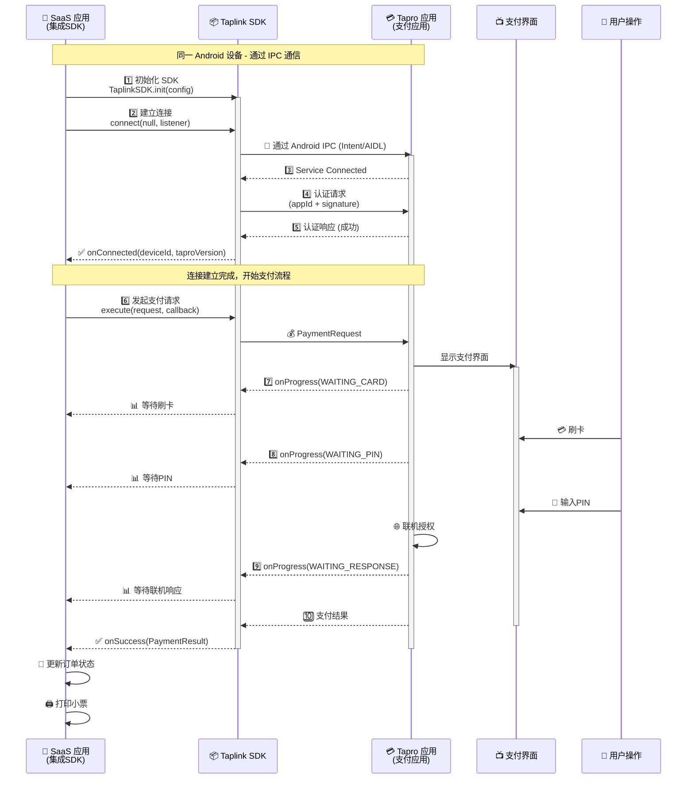
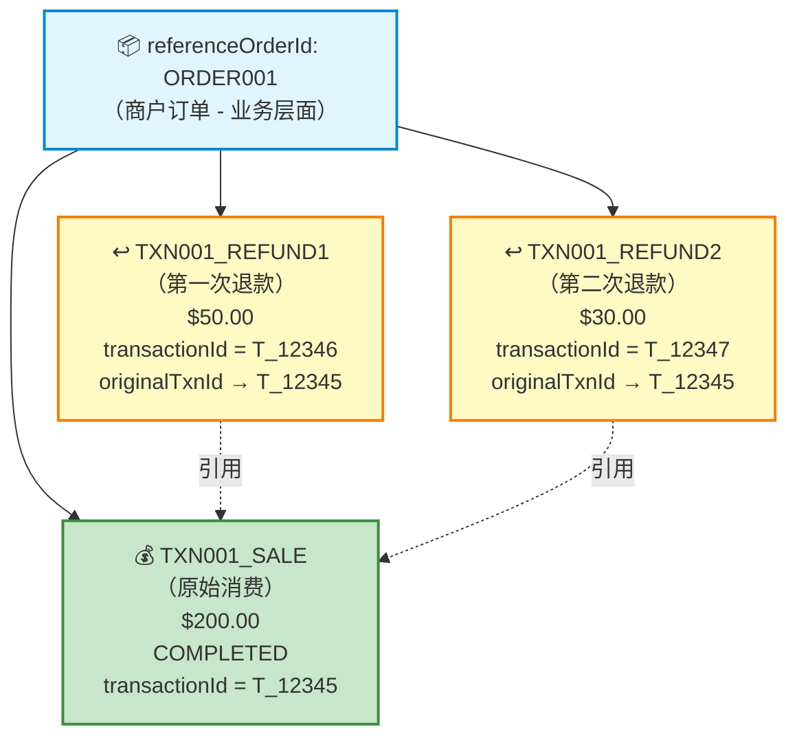

# Taplink SDK for Android - 集成指南

## 文档概述

**版本：** v1.0.0

**平台：** Android 7.1 (API 25) 及以上

**最后更新：** 2025-12-07

**SDK 类型：** Android 原生 SDK (Java/Kotlin)

本指南帮助 Android **POS 应用**开发者快速集成 SUNBAY Taplink SDK for Android，实现支付功能。

**POS 应用定义：POS 应用**是指第三方 ISV或者商户自己开发的收银和业务管理应用，POS 应用负责订单、库存、会员、报表等业务逻辑，通过调用 Taplink SDK 或 Nexus SDK 集成支付能力。

**适用场景：**

*   需要支付集成的 Android POS 应用
    
*   Android 一体机、平板和手持终端
    
*   支持同设备集成和跨设备集成
    
*   支持多种连接模式（应用间、线缆、局域网）
    
*   仅限本地模式集成
    

**平台说明：**

*   本 SDK 专为 Android 平台设计
    
*   其他平台（Windows、iOS、Linux）请联系 SUNBAY 获取可用性信息
    
*   服务端云端模式集成请使用 Nexus SDK（SUNBAY支付网关SDK，支持 Java、Node.js、Python、Go）
    

---

## 目录

1.  [快速开始](https://alidocs.dingtalk.com/i/nodes/YMyQA2dXW792l14zspLNZ02xJzlwrZgb?utm_scene=team_space&iframeQuery=anchorId%3Duu_mifmpzesy9cdoqgl3b)
    
2.  [集成类型和连接模式](https://alidocs.dingtalk.com/i/nodes/YMyQA2dXW792l14zspLNZ02xJzlwrZgb?utm_scene=team_space&iframeQuery=anchorId%3Duu_mifmpzewy56l416ii6o)
    
3.  [核心功能](https://alidocs.dingtalk.com/i/nodes/YMyQA2dXW792l14zspLNZ02xJzlwrZgb?utm_scene=team_space&iframeQuery=anchorId%3Duu_mifmpzfz541p4wuk4st)
    
4.  [高级功能](https://alidocs.dingtalk.com/i/nodes/YMyQA2dXW792l14zspLNZ02xJzlwrZgb?utm_scene=team_space&iframeQuery=anchorId%3Duu_mifmpzgekmui2sqnrmk)
    
5.  [常见问题](https://alidocs.dingtalk.com/i/nodes/YMyQA2dXW792l14zspLNZ02xJzlwrZgb?utm_scene=team_space&iframeQuery=anchorId%3Duu_mifmpzhjckgatyfjvs)
    
6.  [最佳实践](https://alidocs.dingtalk.com/i/nodes/YMyQA2dXW792l14zspLNZ02xJzlwrZgb?utm_scene=team_space&iframeQuery=anchorId%3Duu_mifmpzhxjzfl4bw73ee)
    
7.  [API 参考](https://alidocs.dingtalk.com/i/nodes/YMyQA2dXW792l14zspLNZ02xJzlwrZgb?utm_scene=team_space&iframeQuery=anchorId%3Duu_mifmpzi4fj7qs95qbht)
    
8.  [错误参考码](https://alidocs.dingtalk.com/i/nodes/YMyQA2dXW792l14zspLNZ02xJzlwrZgb?utm_scene=team_space&iframeQuery=anchorId%3Duu_mifmpzkiy1iyvtu2his)
    
9.  [交易结果码参考](https://alidocs.dingtalk.com/i/nodes/YMyQA2dXW792l14zspLNZ02xJzlwrZgb?utm_scene=team_space&iframeQuery=anchorId%3Duu_mifmpzl0s4gcc9i9b0n)
    
10.  [完整示例项目](#完整示例项目)
    

---

## 快速开始

### 1. 添加依赖

在项目的 `settings.gradle.kts` 中添加 Maven 仓库：

```plaintext
dependencyResolutionManagement {
    ...
    repositories {
        ...
        maven("https://repo1.maven.org/maven2/")
    }
}
```

在模块的 `build.gradle.kts` 中添加依赖：

```plaintext
dependencies {
    implementation 'com.sunmi:taplink-sdk:1.0.1'
}
```
---

### 2. 选择您的集成类型

开始之前，请确定您的集成类型：

| 集成类型 | 适用场景 | 快速跳转 |
| --- | --- | --- |
| **同设备集成** | POS 应用和 Tapro 在同一台 Android 设备上 | [→ 同设备集成](https://alidocs.dingtalk.com/i/nodes/YMyQA2dXW792l14zspLNZ02xJzlwrZgb?utm_scene=team_space&iframeQuery=anchorId%3Duu_mifmpzeyq347kkzlhgp) |
| **跨设备集成** | POS 应用和 Tapro 在不同设备上 | [→ 跨设备集成](https://alidocs.dingtalk.com/i/nodes/YMyQA2dXW792l14zspLNZ02xJzlwrZgb?utm_scene=team_space&iframeQuery=anchorId%3Duu_mifmpzeth8hrqyjs4fv) |

---

### 同设备集成快速开始

**适用场景：** Android 一体机、Android 平板、Android 手持终端（POS 应用和 Tapro 在同一设备）

#### 1. 初始化 SDK

```plaintext
import com.sunmi.tapro.taplink.sdk.TaplinkSDK;
import com.sunmi.tapro.taplink.sdk.config.TaplinkConfig;
import com.sunmi.tapro.taplink.sdk.enums.ConnectionMode;

public class MyApplication extends Application {
    @Override
    public void onCreate() {
        super.onCreate();
        
        TaplinkConfig config = new TaplinkConfig()
            .setAppId("your_app_id")
            .setMerchantId("your_merchant_id")
            .setSecretKey("your_secret_key")
            .setConnectionMode(ConnectionMode.APP_TO_APP); // 同设备模式
        
        TaplinkSDK.init(this, config);
    }
}
```

#### 2. 连接到Tapro服务

虽然在同一设备上，但POS应用和Tapro作为独立进程运行，需要建立进程间通信连接：

```plaintext
public class MainActivity extends AppCompatActivity {
    
    @Override
    protected void onCreate(Bundle savedInstanceState) {
        super.onCreate(savedInstanceState);
        setContentView(R.layout.activity_main);
        
        // 创建连接配置（传 null 时使用初始化时指定的 ConnectionMode）
        ConnectionConfig config = null;  // 使用初始化时的 APP_TO_APP 模式
        
        // 连接到 Tapro 服务
        TaplinkSDK.connect(config, new ConnectionListener() {
            @Override
            public void onConnected(String deviceId, String taproVersion) {
                // IPC 服务连接成功
                Toast.makeText(MainActivity.this, 
                    "已连接到 Tapro " + taproVersion, 
                    Toast.LENGTH_SHORT).show();
                enablePaymentButtons(true);
            }
            
            @Override
            public void onDisconnected(String reason) {
                // 服务连接失败或断开
                Toast.makeText(MainActivity.this, 
                    "连接失败：" + reason, 
                    Toast.LENGTH_LONG).show();
                enablePaymentButtons(false);
            }
            
            @Override
            public void onError(ConnectionError error) {
                // 连接错误
                Toast.makeText(MainActivity.this, 
                    "连接错误：" + error.getMessage(), 
                    Toast.LENGTH_LONG).show();
                
                // 检查错误码进行特殊处理
                if ("C22".equals(error.getCode())) {
                    // Tapro 未安装
                    showInstallTaproDialog();
                } else if ("C20".equals(error.getCode())) {
                    // SDK 未初始化
                    showInitializationErrorDialog();
                }
            }
        });
    }
    
    @Override
    protected void onDestroy() {
        super.onDestroy();
        // Activity 销毁时解绑服务
        TaplinkSDK.disconnect();
    }
}
```

**💡 注意事项：**

*   SDK 会自动处理 IPC 服务的连接和断开。您只需要调用 `connect()` 并监听连接状态。
    
*   `onConnected()` 回调会返回设备ID和Tapro版本号，方便您进行版本兼容性检查。
    
*   `connect()` 的配置参数可以传 `null`，SDK 会使用初始化时指定的 `ConnectionMode`。
    

#### 3. 发起支付

连接成功后，发起支付：

```plaintext
public class PaymentActivity extends AppCompatActivity {
    
    private void processPayment() {
        // 创建金额信息
        AmountInfo amount = new AmountInfo()
            .setOrderAmount(100.00)  // $100.00
            .setPricingCurrency("USD");
        
        // 创建支付请求
        PaymentRequest request = new PaymentRequest()
            .setAction("SALE")
            .setReferenceOrderId("ORDER" + System.currentTimeMillis())
            .setTransactionRequestId("TXNREQ" + System.currentTimeMillis())
            .setAmount(amount)
            .setDescription("商品购买");
        
        // 异步调用（推荐）
        TaplinkSDK.execute(request, new PaymentCallback() {
            @Override
            public void onSuccess(PaymentResult result) {
                // 检查交易是否成功
                if (result.isSuccess()) {
                    Toast.makeText(PaymentActivity.this, 
                        "支付成功：" + result.getTransactionId(), 
                        Toast.LENGTH_SHORT).show();
                } else {
                    Toast.makeText(PaymentActivity.this, 
                        "支付失败：" + result.getMessage(), 
                        Toast.LENGTH_LONG).show();
                }
            }
            
            @Override
            public void onFailure(PaymentError error) {
                Toast.makeText(PaymentActivity.this, 
                    "支付失败：" + error.getMessage(), 
                    Toast.LENGTH_LONG).show();
            }
            
            @Override
            public void onProgress(PaymentEvent event) {
                // 更新进度 UI
                updateProgressText(event.getMessage());
            }
        });
    }
}
```

**完成！** 同设备集成需要 3 步：初始化 SDK、连接到 Tapro 服务，然后发起支付。

---

### 跨设备集成快速开始

**适用场景：** 传统 POS + 独立支付终端，云端系统 + 支付终端（POS 应用和 Tapro 在不同设备）

#### 1. 初始化 SDK

```plaintext
public class MyApplication extends Application {
    @Override
    public void onCreate() {
        super.onCreate();
        
        TaplinkConfig config = new TaplinkConfig()
            .setAppId("your_app_id")
            .setMerchantId("your_merchant_id")
            .setSecretKey("your_secret_key")
            .setConnectionMode(ConnectionMode.CABLE);  // 或 ConnectionMode.LAN
        
        TaplinkSDK.init(this, config);
    }
}
```

**连接模式说明：**

*   `ConnectionMode.CABLE` - 线缆模式（USB/串口连接）
    
*   `ConnectionMode.LAN` - 局域网模式（有线/无线网络连接）
    
*   如果不设置，SDK 将自动检测可用的连接方式
    

#### 2. 建立连接

跨设备模式需要先建立连接：

**线缆模式（自动检测）：**

```plaintext
// 传 null 或空配置 - SDK 使用初始化时指定的 CABLE 模式，自动检测线缆类型（USB AOA/USB-VSP/RS232）
ConnectionConfig config = null;  // 或 new ConnectionConfig()

TaplinkSDK.connect(config, new ConnectionListener() {
    @Override
    public void onConnected(String deviceId, String taproVersion) {
        Toast.makeText(context, "线缆已连接到 Tapro " + taproVersion, Toast.LENGTH_SHORT).show();
        enablePaymentButtons(true);
    }
    
    @Override
    public void onDisconnected(String reason) {
        // 连接失败
        Toast.makeText(context, "连接失败：" + reason, Toast.LENGTH_LONG).show();
    }
    
    @Override
    public void onError(ConnectionError error) {
        // 连接错误
        if ("C23".equals(error.getCode())) {
            // 线缆未物理连接
            showCableNotConnectedDialog();
        }
    }
});
```

**线缆模式（指定协议）：**

```plaintext
// 显式指定线缆协议类型
ConnectionConfig config = new ConnectionConfig()
    .setCableProtocol(CableProtocol.USB_AOA);  // 或 USB_VSP、RS232

TaplinkSDK.connect(config, new ConnectionListener() {
    @Override
    public void onConnected(String deviceId, String taproVersion) {
        Toast.makeText(context, "USB AOA 已连接到 Tapro " + taproVersion, Toast.LENGTH_SHORT).show();
    }
    
    @Override
    public void onDisconnected(String reason) {
        Toast.makeText(context, "连接失败", Toast.LENGTH_LONG).show();
    }
    
    @Override
    public void onError(ConnectionError error) {
        // 连接错误
    }
});
```

**局域网模式：**

```plaintext
// 首次连接：输入支付终端的 IP 和端口
// 局域网模式支持有线（以太网）和无线（WiFi）网络
ConnectionConfig config = new ConnectionConfig()
    .setHost("192.168.1.100")  // 从 Tapro 应用界面查看
    .setPort(8443);

TaplinkSDK.connect(config, new ConnectionListener() {
        @Override
        public void onConnected(String deviceId, String taproVersion) {
            Toast.makeText(context, "已连接到 Tapro " + taproVersion, Toast.LENGTH_SHORT).show();
        }
        
        @Override
        public void onDisconnected(String reason) {
            Toast.makeText(context, "连接失败", Toast.LENGTH_SHORT).show();
        }
        
        @Override
        public void onError(ConnectionError error) {
            // 连接错误
        }
    });
```

#### 3. 发起支付

连接成功后，发起支付：

```plaintext
private void processPayment() {
    // 创建金额信息
    AmountInfo amount = new AmountInfo()
        .setOrderAmount(100.00)  // $100.00
        .setPricingCurrency("USD");
    
    // 创建支付请求
    PaymentRequest request = new PaymentRequest()
        .setAction("SALE")
        .setReferenceOrderId("ORDER" + System.currentTimeMillis())
        .setTransactionRequestId("TXNREQ" + System.currentTimeMillis())
        .setAmount(amount)
        .setDescription("商品购买");
    
    // 异步调用（推荐用于跨设备）
    TaplinkSDK.execute(request, new PaymentCallback() {
        @Override
        public void onSuccess(PaymentResult result) {
            // 检查交易是否成功
            if (result.isSuccess()) {
                Toast.makeText(PaymentActivity.this, 
                    "支付成功：" + result.getTransactionId(), 
                    Toast.LENGTH_SHORT).show();
            } else {
                Toast.makeText(PaymentActivity.this, 
                    "支付失败：" + result.getMessage(), 
                    Toast.LENGTH_LONG).show();
            }
        }
        
        @Override
        public void onFailure(PaymentError error) {
            Toast.makeText(PaymentActivity.this, 
                "支付失败：" + error.getMessage(), 
                Toast.LENGTH_LONG).show();
        }
        
        @Override
        public void onProgress(PaymentEvent event) {
            // 更新进度 UI
            updateProgressText(event.getMessage());
        }
    });
}
```

**完成！** 跨设备集成需要先建立连接，然后发起支付。

---

## 集成类型和连接模式

### 集成类型概述

| 集成类型 | 连接模式 | 描述 | 延迟 |
| --- | --- | --- | --- |
| **同设备集成** | 应用间模式 | POS 应用和 Tapro 在同一 Android 设备上 | 毫秒级 |
| **跨设备集成** | 线缆模式 | 通过 USB/串口线缆连接（点对点） | < 1 秒 |
|  | 局域网模式 | 通过有线/无线局域网连接 | 1-3 秒 |

---

### 连接配置（ConnectionConfig）

所有连接模式都使用统一的 `connect()` 方法，通过 `ConnectionConfig` 对象传递连接参数。

**💡 重要说明：** 如果传递 `null` 或空的 `ConnectionConfig` 对象，SDK 将使用初始化时通过 `TaplinkConfig.setConnectionMode()` 指定的连接模式。

**ConnectionConfig 类：**

```plaintext
public class ConnectionConfig {
    // 线缆协议类型（可选）
    private CableProtocol cableProtocol;
    
    // 局域网连接参数（可选）
    private String host;
    private int port;
    
    // 构造方法
    public ConnectionConfig() {}
    
    // 设置线缆协议
    public ConnectionConfig setCableProtocol(CableProtocol protocol) {
        this.cableProtocol = protocol;
        return this;
    }
    
    // 设置主机地址
    public ConnectionConfig setHost(String host) {
        this.host = host;
        return this;
    }
    
    // 设置端口
    public ConnectionConfig setPort(int port) {
        this.port = port;
        return this;
    }
}
```

**使用说明：**

| 连接模式 | ConnectionConfig 配置 | 说明 |
| --- | --- | --- |
| **使用初始化模式** | `null` 或 `new ConnectionConfig()` | 使用初始化时指定的 ConnectionMode |
| **应用间模式** | `null` 或 `new ConnectionConfig()` | 使用初始化时的 APP\\_TO\\_APP 模式 |
| **线缆模式（自动）** | `null` 或 `new ConnectionConfig()` | 使用初始化时的 CABLE 模式，自动检测线缆类型 |
| **线缆模式（指定）** | `new ConnectionConfig().setCableProtocol(CableProtocol.USB_AOA)` | 显式指定线缆协议类型 |
| **局域网（首次）** | `new ConnectionConfig().setHost("192.168.1.100").setPort(8443)` | 指定 IP 和端口 |
| **局域网（后续）** | `null` 或 `new ConnectionConfig()` | 使用初始化时的 LAN 模式，使用缓存的设备信息 |

**统一的连接方法：**

```plaintext
// 方法签名
TaplinkSDK.connect(ConnectionConfig config, ConnectionListener listener)

// 示例：使用初始化时的 ConnectionMode（推荐）
TaplinkSDK.connect(null, listener);  // 或 TaplinkSDK.connect(new ConnectionConfig(), listener);

// 示例：线缆模式（指定协议）
ConnectionConfig config = new ConnectionConfig()
    .setCableProtocol(CableProtocol.USB_AOA);
TaplinkSDK.connect(config, listener);

// 示例：局域网模式（首次连接，指定 IP 和端口）
ConnectionConfig config = new ConnectionConfig()
    .setHost("192.168.1.100")
    .setPort(8443);
TaplinkSDK.connect(config, listener);
```
---

### 集成类型 1：同设备集成

#### 模式 1：应用间模式

**适用场景：** POS 应用和 Tapro 运行在同一 Android 设备上

**技术方案：**

*   通过 Android Intent 机制启动 Tapro 应用
    
*   使用 Taplink SDK 封装调用逻辑
    
*   进程间通信（IPC），毫秒级延迟
    

**特点：**

*   自动检测，无需配置
    
*   最低延迟（毫秒级）
    
*   通过 Android Intent (IPC) 通信
    
*   类似支付宝/微信支付的用户体验
    

**典型设备：** Android 一体机、Android 平板、Android 手持终端

**连接过程：**

```plaintext
1. POS 应用 → Taplink SDK：初始化 SDK
2. POS 应用 → Taplink SDK：调用 connect()
3. Taplink SDK：连接到 Tapro IPC 服务
4. Taplink SDK：与 Tapro 进行认证
5. Taplink SDK → POS 应用：连接就绪（onConnected 回调）
```

**同设备调用流程图：**



**✨ 技术特点：**

*   ⚡ **毫秒级延迟** - 进程间通信速度快
    
*   👁️ **用户可见** - 用户可以看到 Tapro 支付界面
    
*   🔍 **自动检测** - SDK 自动检测并连接到 Tapro 服务
    
*   ⚙️ **无需配置** - 不需要 IP、端口或线缆连接
    
*   🔄 **自动重连** - 支持 Service 异常断开后自动重连
    

**配置：**

```plaintext
TaplinkConfig config = new TaplinkConfig()
    .setConnectionMode(ConnectionMode.APP_TO_APP);
```

**建立连接：**

```plaintext
// 传 null 或空配置 - SDK 使用初始化时指定的 APP_TO_APP 模式
ConnectionConfig config = null;  // 或 new ConnectionConfig()

// 连接到 Tapro 服务
TaplinkSDK.connect(config, new ConnectionListener() {
    @Override
    public void onConnected(String deviceId, String taproVersion) {
        // IPC 服务连接成功，可以进行支付
        Log.d(TAG, "已连接到 Tapro " + taproVersion);
    }
    
    @Override
    public void onDisconnected(String reason) {
        // 服务连接失败或断开
        Log.e(TAG, "连接断开：" + reason);
    }
    
    @Override
    public void onError(ConnectionError error) {
        // 连接错误
        if ("C22".equals(error.getCode())) {
            // Tapro 未安装
            showInstallTaproDialog();
        } else if ("C20".equals(error.getCode())) {
            // SDK 未初始化
            Log.e(TAG, "SDK not initialized. Call TaplinkSDK.init() first.");
        }
    }
}
});
```

**💡 注意：** 虽然在同一设备上，但仍需要调用 connect() 建立IPC连接。SDK 会自动处理服务的连接和断开。

---

### 集成类型 2：跨设备集成

#### 模式 2：线缆模式

**定义：** 通过 USB 或串口线缆在两个设备之间点对点直连

**适用场景：** POS 设备通过 USB 或串口线缆连接到独立支付终端

**支持的连接类型：**

| 连接类型 | 协议 | 适用场景 | 技术特点 |
| --- | --- | --- | --- |
| USB AOA | Android Open Accessory 2.0 | Android ↔ Android | 即插即用，系统级支持 |
| USB-VSP | USB Virtual Serial Port (CDC-ACM) | Windows/Linux ↔ Android | 模拟串口，波特率 115200 |
| RS232 | 标准 RS232 串行通信 | 传统 POS ↔ 支付终端 | 硬件串口，可配置波特率 |

**💡 重要说明：** 线缆模式指通过 USB 或串口线缆点对点直连。**不包括以太网线**连接。以太网连接（无论有线还是无线）属于**局域网模式**。

**特点：**

*   **即插即用**：物理连接后自动检测和连接
    
*   **高安全性**：物理连接提供固有安全性
    
*   **自动检测**：SDK 自动识别连接类型
    
*   **设备记忆**：首次连接记录设备标识符，以便将来识别
    

**连接过程：**

```plaintext
1. 物理线缆连接
2. POS 应用 → SDK：调用 connect() 或 connect(CableProtocol)
3. SDK：检测 USB/串口
4. SDK：识别协议类型（如果自动检测）
5. SDK：与 Tapro 发起握手
6. SDK：与 Tapro 进行认证
7. SDK → POS 应用：连接建立（onConnected 回调）
8. SDK：本地缓存设备标识符
```

**配置：**

```plaintext
TaplinkConfig config = new TaplinkConfig()
    .setConnectionMode(ConnectionMode.CABLE); // 指定线缆模式
```

**建立连接：**

**方法 1：自动检测协议（推荐）**

SDK 会按以下优先级自动检测线缆协议：

1.  USB AOA（Android Open Accessory）
    
2.  USB-VSP（USB Virtual Serial Port）
    
3.  RS232（硬件串口）
    

```plaintext
// 传 null 或空配置 - SDK 使用初始化时指定的 CABLE 模式，自动检测线缆类型和协议
ConnectionConfig config = null;  // 或 new ConnectionConfig()

TaplinkSDK.connect(config, new ConnectionListener() {
    @Override
    public void onConnected(String deviceId, String taproVersion) {
        // 线缆连接成功，SDK 已自动识别协议类型
        Log.d(TAG, "通过线缆连接：" + deviceId);
        enablePaymentButtons(true);
    }
    
    @Override
    public void onDisconnected(String reason) {
        // 连接失败
        Log.e(TAG, "连接断开：" + reason);
    }
    
    @Override
    public void onError(ConnectionError error) {
        // 连接错误
        if ("C23".equals(error.getCode())) {
            // 线缆未物理连接
            showDialog("线缆未连接", 
                "请连接 USB 或串口线缆。");
        } else if ("C24".equals(error.getCode())) {
            // 自动检测失败，建议手动指定协议
            showDialog("无法识别线缆协议", 
                "请使用 setCableProtocol() 手动指定协议类型。");
        }
    }
});
```

**💡 注意：**

*   自动检测过程通常在 1-3 秒内完成
    
*   如果自动检测失败（错误码 C24），建议使用方法 2 显式指定协议
    
*   SDK 会记住成功连接的协议类型，下次优先尝试该协议
    

**方法 2：显式指定协议**

```plaintext
// 指定线缆协议类型
// 可用协议：USB_AOA、USB_VSP、RS232
ConnectionConfig config = new ConnectionConfig()
    .setCableProtocol(CableProtocol.USB_AOA);

TaplinkSDK.connect(config, new ConnectionListener() {
    @Override
    public void onConnected(String deviceId, String taproVersion) {
        Log.d(TAG, "通过 USB AOA 连接到 Tapro " + taproVersion);
        enablePaymentButtons(true);
    }
    
    @Override
    public void onDisconnected(String reason) {
        Log.e(TAG, "USB AOA 连接失败：" + reason);
    }
        
        @Override
        public void onError(ConnectionError error) {
            // 连接错误
        }
    });

// 对于 USB-VSP
ConnectionConfig usbVspConfig = new ConnectionConfig()
    .setCableProtocol(CableProtocol.USB_VSP);
TaplinkSDK.connect(usbVspConfig, callback);

// 对于 RS232
ConnectionConfig rs232Config = new ConnectionConfig()
    .setCableProtocol(CableProtocol.RS232);
TaplinkSDK.connect(rs232Config, callback);
```

**线缆协议枚举：**

```plaintext
public enum CableProtocol {
    AUTO,       // 自动检测（默认），按 USB_AOA → USB_VSP → RS232 优先级检测
    USB_AOA,    // USB Android Open Accessory 2.0
    USB_VSP,    // USB Virtual Serial Port (CDC-ACM)
    RS232       // 标准 RS232 串行通信
}
```

**自动检测说明：**

*   `AUTO` 是默认值，SDK 会自动扫描并识别线缆协议类型
    
*   检测优先级：USB AOA → USB-VSP → RS232
    
*   检测时间：通常 1-3 秒
    
*   成功后会缓存协议类型，下次连接更快
    

**监听连接状态：**

```plaintext
TaplinkSDK.setConnectionListener(new ConnectionListener() {
    @Override
    public void onConnected(String deviceId, String taproVersion) {
        // 线缆已连接
        Toast.makeText(context, "线缆已连接到 Tapro " + taproVersion, Toast.LENGTH_SHORT).show();
        enablePaymentButtons(true);
    }
    
    @Override
    public void onDisconnected(String reason) {
        // 线缆已断开
        Toast.makeText(context, "线缆已断开", Toast.LENGTH_SHORT).show();
        enablePaymentButtons(false);
    }
    
    @Override
    public void onError(ConnectionError error) {
        // 连接错误
    }
});
```

**🔒 安全特性：**

*   物理连接提供高安全性
    
*   首次连接记录设备标识符
    
*   自动识别防止设备替换
    
*   可选的应用层 AES-128 加密
    

**推荐调用方式：** 异步调用（延迟较高，需要进度反馈）

---

#### 模式 3：局域网模式

**适用场景：** POS 设备通过局域网连接到独立支付终端

**协议：** WebSocket over TLS (WSS)

**网络类型：**

*   **有线局域网**：通过以太网线经网络设备（路由器/交换机）连接
    
*   **无线局域网（WiFi）**：通过 WiFi 经网络设备连接
    

**特点：**

*   支持有线（以太网）和无线（WiFi）局域网
    
*   首次需要手动配对
    
*   后续自动连接
    
*   mDNS 自动发现，无缝 IP 更新
    
*   自动处理 DHCP 导致的 IP 变化
    

**💡 注意：** 局域网模式包括有线和无线网络连接。设备必须在同一网段。

**配置：**

```plaintext
TaplinkConfig config = new TaplinkConfig()
    .setConnectionMode(ConnectionMode.LAN); // 指定局域网模式
```

**🔒 安全机制：**

| 安全层 | 实现 | 目的 |
| --- | --- | --- |
| 传输加密 | TLS 1.2+ | 防止局域网嗅探 |
| 设备证书 | 自签名证书 | 设备认证 |
| 端口安全 | 随机端口（8443-8453） | 减少攻击面 |
| 消息完整性 | HMAC-SHA256 签名 | 防止篡改 |
| 会话管理 | 24 小时有效期 | 限制暴露窗口 |

**认证过程：**

```plaintext
1. SDK → Service：CONNECT 请求（包含 SDK 版本）
2. Service → SDK：CHALLENGE（随机数 + 设备网络 ID）
3. SDK → Service：RESPONSE（HMAC 签名验证）
4. Service → SDK：SESSION_KEY（会话密钥）
5. 后续通信使用会话密钥进行 HMAC-SHA256 签名
```

**设备发现：**

**首次连接：**

*   用户手动输入 IP + 端口（在 Tapro 界面显示）
    
*   SDK 缓存网络标识符（设备 SN + MAC 地址）
    

**通过 mDNS 自动更新：**

*   Service 广播：`_taplink._tcp.local`
    
*   广播内容：网络 ID + IP + 端口
    
*   广播频率：每 30 秒 + 网络变化时立即广播
    
*   SDK 自动更新缓存的 IP + 端口
    
*   无缝处理 DHCP IP 变化
    

**首次连接：**

```plaintext
// 1. 在支付终端的 Tapro 应用界面查看 IP 和端口
// 2. 在 POS 应用中输入 IP 和端口
ConnectionConfig config = new ConnectionConfig()
    .setHost("192.168.1.100")
    .setPort(8443);  // 8443-8453 之间的随机端口

TaplinkSDK.connect(config, new ConnectionListener() {
        @Override
        public void onConnected(String deviceId, String taproVersion) {
            // 连接成功，设备信息自动缓存
        // 网络标识符（SN + MAC）存储以供将来连接
        Toast.makeText(context, "已连接到设备：" + deviceId, Toast.LENGTH_SHORT).show();
        }
        
        @Override
        public void onDisconnected(String reason) {
            // 连接失败
        Toast.makeText(context, "连接失败：" + reason, Toast.LENGTH_LONG).show();
        }
        
        @Override
        public void onError(ConnectionError error) {
            // 连接错误
        }
    });
```

**后续自动连接：**

```plaintext
// 传 null 或空配置 - SDK 使用初始化时指定的 LAN 模式，自动连接到上次配对的设备
// 即使由于 DHCP 导致 IP 地址更改，mDNS 也会更新它
ConnectionConfig config = null;  // 或 new ConnectionConfig()，使用缓存的设备信息

TaplinkSDK.connect(config, new ConnectionListener() {
        @Override
        public void onConnected(String deviceId, String taproVersion) {
            // 自动连接成功
        Log.d(TAG, "已连接到缓存的设备：" + deviceId);
        }
        
        @Override
        public void onDisconnected(String reason) {
            // 自动连接失败，提示用户重新输入 IP
        // 这可能发生在设备离线或网络更改时
        showIpInputDialog();
        }
        
        @Override
        public void onError(ConnectionError error) {
            // 连接错误
        }
    });
```

**连接状态：**

*   **在线**：正常通信
    
*   **离线**：返回错误 E02
    
*   **重连中**：SDK自动处理，触发 onDisconnected 和 onConnected 回调
    
*   **IP 已更新**：通过 mDNS 自动更新，对应用透明
    

**推荐调用方式：** 异步调用（网络不稳定，需要容错和进度反馈）

---

## 连接认证

### 认证概述

所有连接模式（应用间模式、线缆模式、局域网模式）在建立连接后都需要进行认证，以确保：

*   **POS 应用身份合法性**：验证应用已获得授权
    
*   **应用具有访问权限**：检查应用是否有权限访问相应功能
    
*   **防止未授权访问和中间人攻击**：确保安全通信
    

### 认证工作原理

**⚡ 重要：** 认证由 **Taplink SDK 自动处理**。开发者需要：

1.  在 SDK 初始化时提供正确的 `appId` 和 `secretKey`
    
2.  调用 `connect()` 方法建立连接
    
3.  SDK 会在连接建立后自动发起认证
    
4.  通过 `ConnectionListener` 回调通知应用认证结果
    

**开发者需要做的：**

```plaintext
// 1. 初始化时提供正确的凭据
TaplinkConfig config = new TaplinkConfig()
    .setAppId("your_app_id")           // 必需
    .setSecretKey("your_secret_key");   // 必需

TaplinkSDK.init(this, config);

// 2. 调用连接接口并监听连接状态
ConnectionConfig connectionConfig = new ConnectionConfig();

TaplinkSDK.connect(connectionConfig, new ConnectionListener() {
        @Override
        public void onConnected(String deviceId, String taproVersion) {
            // 连接成功并认证通过
        Log.d(TAG, "已连接并认证：" + deviceId);
        }
        
        @Override
        public void onDisconnected(String reason) {
            // 连接失败或认证失败
        Log.d(TAG, "连接失败：" + reason);
        }
        
        @Override
        public void onError(ConnectionError error) {
            // 连接错误
        }
    });
```

**认证过程（由 SDK 处理）：**

```plaintext
1. 应用调用 TaplinkSDK.connect()
2. SDK 建立物理连接（IPC/线缆/网络）
3. SDK 从配置中读取 appId 和 secretKey
4. SDK 生成认证签名
5. SDK 向 Tapro 发送认证请求
6. Tapro 与 Nexus（SUNBAY支付网关）平台验证
7. SDK 接收认证结果
8. SDK 通过 ConnectionListener 回调通知应用
```

**认证错误：**

如果认证失败，您将通过 `ConnectionListener.onError()` 收到错误，错误码在 `error.getCode()` 中：

| 错误码 | 描述 | 解决方案 |
| --- | --- | --- |
| `S03` | 签名验证失败 | 检查签名算法、密钥和参数顺序，确认签名参数未被修改，重新生成签名 |
| `S06` | 权限不足 | 联系管理员申请权限或检查您的权限 |
| `M02` | 应用（appId）不存在或已禁用 | 检查 appId 是否正确并在开放平台确认应用状态 |
| `M03` | 应用和商户绑定关系不匹配 | 确认应用已正确授权给此商户并使用正确的配对信息 |

**错误处理示例：**

```plaintext
TaplinkSDK.connect(config, new ConnectionListener() {
    @Override
    public void onConnected(String deviceId, String taproVersion) {
        // 连接成功
    }
    
    @Override
    public void onDisconnected(String reason) {
        // 连接断开，reason 是描述文本
        Log.d(TAG, "连接断开：" + reason);
    }
    
    @Override
    public void onError(ConnectionError error) {
        // 错误处理，error.getCode() 包含错误码
        String errorCode = error.getCode();
        String errorMessage = error.getMessage();
        
        if ("C22".equals(errorCode)) {
            showDialog("Tapro 未安装", "请先安装 Tapro 应用");
        } else if ("C20".equals(errorCode)) {
            showDialog("SDK 未初始化", "请先调用 TaplinkSDK.init()");
        } else {
            showDialog("连接错误", errorMessage + " (错误码: " + errorCode + ")");
        }
    }
});
```

**🔒 安全注意事项：**

*   永远不要在代码中硬编码 `secretKey`
    
*   安全存储凭据（使用 Android Keystore 或加密的 SharedPreferences）
    
*   生产环境定期轮换凭据
    

---

## 交易安全

### 交易认证

**⚡ 重要：** 交易认证由 **Taplink SDK 自动处理**。每个交易请求在处理前都会进行认证，以确保：

1.  **签名验证**：防止传输过程中的数据篡改
    
2.  **权限验证**：确保应用有权限执行该交易类型
    

**开发者需要了解的：**

SDK 自动：

*   为每个请求生成交易签名
    
*   在交易消息中包含认证信息
    
*   处理认证错误并返回适当的错误码
    

**交易权限：**

您的应用必须在 Nexus（SUNBAY支付网关平台）中配置适当的权限才能执行不同的交易类型：

| 交易类型 | 所需权限 | 描述 |
| --- | --- | --- |
| `SALE` | `payment.sale` | 销售交易权限 |
| `AUTH` | `payment.auth` | 预授权权限 |
| `POST_AUTH` | `payment.auth` | 预授权完成权限 |
| `REFUND` | `payment.refund` | 退款交易权限 |
| `VOID` | `payment.void` | 撤销交易权限 |
| `TIP_ADJUST` | `payment.tip_adjust` | 小费调整权限 |
| `QUERY` | `payment.query` | 交易查询权限 |
| `BATCH_CLOSE` | `payment.batch_close` | 批次关闭权限 |

**常见认证错误：**

| 错误码 | 描述 | 解决方案 |
| --- | --- | --- |
| `S06` | 权限不足 | 联系管理员申请权限或检查您的权限 |
| `S03` | 签名验证失败 | 检查签名算法、密钥和参数顺序，确认签名参数未被修改 |
| `M01` | 接口调用权限不足或未激活 | 申请相应接口权限或续期 |
| `C01` | 缺少请求参数 | 确保提供所有必需参数 |

---

## 核心功能

### 1. 销售交易（SALE）

最常用的支付交易类型。

**基本用法：**

```plaintext
// 创建金额信息
AmountInfo amount = new AmountInfo()
    .setOrderAmount(100.00)  // $100.00
    .setPricingCurrency("USD");

// 生成唯一订单号
String orderId = "ORDER" + System.currentTimeMillis();

// 创建支付请求
// 注意：referenceOrderId 和 transactionRequestId 可以使用相同的值
PaymentRequest request = new PaymentRequest()
    .setAction("SALE")
    .setReferenceOrderId(orderId)
    .setTransactionRequestId(orderId)  // 可以与 referenceOrderId 相同
    .setAmount(amount)
    .setDescription("商品购买");

TaplinkSDK.execute(request, new PaymentCallback() {
    @Override
    public void onSuccess(PaymentResult result) {
        // 检查交易是否成功
        if (result.isSuccess()) {
            // 支付成功
            String transactionId = result.getTransactionId();
            String authCode = result.getAuthCode();
            
            // 保存交易信息
            saveTransaction(transactionId, authCode);
            
            // 打印小票
            printReceipt(result.getReceipt());
        } else {
            // 支付失败
            handlePaymentError(result.getMessage());
        }
    }
    
    @Override
    public void onFailure(PaymentError error) {
        // 支付失败
        handlePaymentError(error);
    }
    
    @Override
    public void onProgress(PaymentEvent event) {
        // 更新进度
        updateProgressUI(event);
    }
});
```
---

### 2. 退款交易（REFUND）

交易退款接口用于对已成功的交易发起退款。支持全额退款和部分退款。

**退款类型：**

*   **无参考号退款**：需要客户在支付终端上刷卡、插卡、挥卡或扫码等操作完成退款，参数与Sale交易类似。无参考号退款时，originalTransactionId和originalTransactionRequestId必须为空
    
*   **有参考号退款**：通过原交易的参考号进行退款，无需客户操作，仅需传递基本退款信息。有参考号退款时，必须提供originalTransactionId或originalTransactionRequestId
    

**使用场景：**

*   商品退货退款
    
*   服务取消退款
    
*   交易部分退款
    

**注意事项：**

*   有参考号退款时，只能对已成功的交易进行退款，退款金额不能超过原交易金额
    
*   支持多次部分退款，累计退款金额不能超过原交易金额
    
*   无参考号退款需要客户在终端上完成操作，无需指定原交易
    
*   有参考号退款时不需要传referenceOrderId参数，系统会自动关联原交易的参考订单号
    

**有参考号退款示例：**

```plaintext
// 创建金额信息
AmountInfo amount = new AmountInfo()
    .setOrderAmount(100.00)  // $100.00 退款金额（可以是部分退款）
    .setPricingCurrency("USD");

// 创建有参考号退款请求
PaymentRequest request = new PaymentRequest()
    .setAction("REFUND")
    .setOriginalTransactionId("TXN20231119001") // 原始交易 ID（必需）
    .setTransactionRequestId("TXNREQ" + System.currentTimeMillis()) // 本次退款的请求ID
    .setAmount(amount)
    .setDescription("商品退货")
    .setReason("客户要求");

TaplinkSDK.execute(request, new PaymentCallback() {
    @Override
    public void onSuccess(PaymentResult result) {
        if (result.isSuccess()) {
            Toast.makeText(context, "退款成功", Toast.LENGTH_SHORT).show();
        } else {
            Toast.makeText(context, 
                "退款失败：" + result.getMessage(), 
                Toast.LENGTH_LONG).show();
        }
    }
    
    @Override
    public void onFailure(PaymentError error) {
        Toast.makeText(context, 
            "退款失败：" + error.getMessage(), 
            Toast.LENGTH_LONG).show();
    }
});
```

**无参考号退款示例：**

```plaintext
// 创建金额信息
AmountInfo amount = new AmountInfo()
    .setOrderAmount(50.00)
    .setPricingCurrency("USD");

// 创建无参考号退款请求（需要客户刷卡）
PaymentRequest request = new PaymentRequest()
    .setAction("REFUND")
    .setReferenceOrderId("REFUND" + System.currentTimeMillis()) // 可选，用于业务追溯
    .setTransactionRequestId("TXNREQ" + System.currentTimeMillis())
    .setAmount(amount)
    .setDescription("线下退款");
    // 注意：不设置 originalTransactionId 和 originalTransactionRequestId

TaplinkSDK.execute(request, new PaymentCallback() {
    @Override
    public void onSuccess(PaymentResult result) {
        if (result.isSuccess()) {
            Toast.makeText(context, "退款成功", Toast.LENGTH_SHORT).show();
        }
    }
    
    @Override
    public void onFailure(PaymentError error) {
        Toast.makeText(context, "退款失败：" + error.getMessage(), Toast.LENGTH_LONG).show();
    }
});
```
---

### 3. 撤销交易（VOID）

撤销当日交易（比退款更快）。

**⚠️ 注意：** VOID 只能撤销当日交易，跨日交易需要使用 REFUND。

```plaintext
// 创建撤销请求
PaymentRequest request = new PaymentRequest()
    .setAction("VOID")
    .setOriginalTransactionId("TXN20231119001")
    .setReferenceOrderId("VOID" + System.currentTimeMillis())
    .setTransactionRequestId("TXNREQ" + System.currentTimeMillis())
    .setDescription("撤销交易")
    .setReason("重复交易");

TaplinkSDK.execute(request, new PaymentCallback() {
    @Override
    public void onSuccess(PaymentResult result) {
        // 检查交易是否成功
        if (result.isSuccess()) {
            Toast.makeText(context, "交易已撤销", Toast.LENGTH_SHORT).show();
        } else {
            Toast.makeText(context, 
                "撤销失败：" + result.getMessage(), 
                Toast.LENGTH_LONG).show();
        }
    }
    
    @Override
    public void onFailure(PaymentError error) {
        String errorCode = error.getCode();
        if ("C12".equals(errorCode)) {
            // 订单不存在
            showDialog("撤销失败", 
                "找不到原始交易。请检查交易 ID。");
        } else if ("C11".equals(errorCode)) {
            // 订单已关闭
            showDialog("无法撤销", 
                "这是前一天的交易。请使用 REFUND 代替。");
        } else {
            Toast.makeText(context, 
                "撤销失败：" + error.getMessage(), 
                Toast.LENGTH_LONG).show();
        }
    }
});
```
---

### 4. 交易查询（QUERY）

查询交易状态，特别适用于超时场景。

**按交易 ID 查询：**

```plaintext
QueryRequest query = new QueryRequest()
    .setTransactionId("TXN20231119001");

TaplinkSDK.query(query, new PaymentCallback() {
    @Override
    public void onSuccess(PaymentResult result) {
        String status = result.getTransactionStatus();
        switch (status) {
            case "SUCCESS":
                // 交易成功
                updateOrderStatus("PAID");
                break;
            case "FAILED":
                // 交易失败
                updateOrderStatus("FAILED");
                break;
            case "PROCESSING":
                // 仍在处理中
                // 可以继续轮询
                break;
        }
    }
    
    @Override
    public void onFailure(PaymentError error) {
        // 查询失败
    }
});
```

**按交易请求ID查询：**

```plaintext
QueryRequest query = new QueryRequest()
    .setTransactionRequestId("TXNREQ20231119001");

TaplinkSDK.query(query, callback);
```

**超时后轮询查询：**

```plaintext
private void queryTransactionWithPolling(String transactionRequestId) {
    queryTransactionWithPolling(transactionRequestId, 1);
}

private void queryTransactionWithPolling(String transactionRequestId, int attempt) {
    if (attempt > 12) {
        // 超过 12 次尝试（60 秒），停止轮询
        showDialog("交易状态未知", 
            "请联系客服，交易请求ID：" + transactionRequestId);
        return;
    }
    
    QueryRequest query = new QueryRequest().setTransactionRequestId(transactionRequestId);
    
    TaplinkSDK.query(query, new PaymentCallback() {
        @Override
        public void onSuccess(PaymentResult result) {
            if ("PROCESSING".equals(result.getTransactionStatus())) {
                // 仍在处理中，5 秒后继续查询
                new Handler().postDelayed(() -> {
                    queryTransactionWithPolling(transactionRequestId, attempt + 1);
                }, 5000);
            } else {
                // 交易已完成
                handleQueryResult(result);
            }
        }
        
        @Override
        public void onFailure(PaymentError error) {
            // 查询失败，停止轮询
            showErrorMessage("查询失败：" + error.getMessage());
        }
    });
}
```
---

### 5. 预授权（AUTH）

冻结资金而不实际扣款，常用于酒店、租车等场景。

```plaintext
// 创建金额信息
AmountInfo amount = new AmountInfo()
    .setOrderAmount(500.00)  // $500.00
    .setPricingCurrency("USD");

// 创建预授权请求
PaymentRequest request = new PaymentRequest()
    .setAction("AUTH")
    .setReferenceOrderId("AUTH" + System.currentTimeMillis())
    .setTransactionRequestId("TXNREQ" + System.currentTimeMillis())
    .setAmount(amount)
    .setDescription("酒店预订")
    .setTimeExpire("2024-11-24T10:30:00+08:00"); // 授权过期时间

TaplinkSDK.execute(request, new PaymentCallback() {
    @Override
    public void onSuccess(PaymentResult result) {
        // 检查交易是否成功
        if (result.isSuccess()) {
            // 授权成功，资金已冻结
            String authTransactionId = result.getTransactionId();
            
            // 保存授权交易 ID，以便稍后完成或关闭
            saveAuthTransaction(authTransactionId);
        } else {
            // 授权失败
            Toast.makeText(context, 
                "授权失败：" + result.getMessage(), 
                Toast.LENGTH_LONG).show();
        }
    }
    
    @Override
    public void onFailure(PaymentError error) {
        // 授权失败
        Toast.makeText(context, 
            "授权失败：" + error.getMessage(), 
            Toast.LENGTH_LONG).show();
    }
});
```
---

### 6. 预授权完成（POST\_AUTH）

完成授权并实际扣款。

```plaintext
// 创建金额信息
AmountInfo amount = new AmountInfo()
    .setOrderAmount(450.00)  // $450.00 实际扣款金额（可以 ≤ 授权金额）
    .setPricingCurrency("USD");

// 创建预授权完成请求
PaymentRequest request = new PaymentRequest()
    .setAction("POST_AUTH")
    .setOriginalTransactionId("TXN20231119002") // 原始授权交易 ID
    .setReferenceOrderId("POSTAUTH" + System.currentTimeMillis())
    .setTransactionRequestId("TXNREQ" + System.currentTimeMillis())
    .setAmount(amount)
    .setDescription("完成酒店付款");

TaplinkSDK.execute(request, new PaymentCallback() {
    @Override
    public void onSuccess(PaymentResult result) {
        // 检查交易是否成功
        if (result.isSuccess()) {
            // 授权已完成，资金实际扣除
            Toast.makeText(context, "付款已完成", Toast.LENGTH_SHORT).show();
        } else {
            // 完成失败
            Toast.makeText(context, 
                "付款失败：" + result.getMessage(), 
                Toast.LENGTH_LONG).show();
        }
    }
    
    @Override
    public void onFailure(PaymentError error) {
        // 完成失败
        Toast.makeText(context, 
            "付款失败：" + error.getMessage(), 
            Toast.LENGTH_LONG).show();
    }
});
```
---

### 7. 小费调整（TIP\_ADJUST）

交易完成后调整小费金额。

```plaintext
// 创建小费调整请求
PaymentRequest request = new PaymentRequest()
    .setAction("TIP_ADJUST")
    .setOriginalTransactionId("TXN20231119001")
    .setReferenceOrderId("TIP" + System.currentTimeMillis())
    .setTransactionRequestId("TXNREQ" + System.currentTimeMillis())
    .setTipAmount(15.00)  // $15.00 小费
    .setDescription("小费调整");

TaplinkSDK.execute(request, new PaymentCallback() {
    @Override
    public void onSuccess(PaymentResult result) {
        // 检查交易是否成功
        if (result.isSuccess()) {
            // 小费调整成功
            TransactionAmount amount = result.getAmount();
            double tipAmount = amount.getTipAmount();
            double totalAmount = amount.getTransAmount();
            
            showMessage("小费已调整：$" + tipAmount + "\n" +
                       "总计：$" + totalAmount);
        } else {
            // 调整失败
            Toast.makeText(context, 
                "小费调整失败：" + result.getMessage(), 
                Toast.LENGTH_LONG).show();
        }
    }
    
    @Override
    public void onFailure(PaymentError error) {
        // 调整失败
        Toast.makeText(context, 
            "小费调整失败：" + error.getMessage(), 
            Toast.LENGTH_LONG).show();
    }
});
```
---

### 8. 批次关闭（BATCH\_CLOSE）

日终结算，关闭当前批次。

```plaintext
// 创建批次关闭请求
PaymentRequest request = new PaymentRequest()
    .setAction("BATCH_CLOSE")
    .setReferenceOrderId("BATCH" + System.currentTimeMillis())
    .setTransactionRequestId("TXNREQ" + System.currentTimeMillis())
    .setDescription("批次关闭");

// 显示进度对话框
ProgressDialog dialog = ProgressDialog.show(this, "批次关闭", "处理中...", true);

TaplinkSDK.execute(request, new PaymentCallback() {
    @Override
    public void onSuccess(PaymentResult result) {
        dialog.dismiss();
        
        // 检查交易是否成功
        if (result.isSuccess()) {
            // 批次关闭成功
            int batchNo = result.getBatchNo();
            BatchCloseInfo batchCloseInfo = result.getBatchCloseInfo();
            
            if (batchCloseInfo != null) {
                int totalCount = batchCloseInfo.getTotalCount();
                double totalAmount = batchCloseInfo.getTotalAmount();
                
                // 显示批次摘要
                showBatchSummary(batchNo, totalCount, totalAmount);
            }
        } else {
            // 批次关闭失败
            Toast.makeText(MainActivity.this, 
                "批次关闭失败：" + result.getMessage(), 
                Toast.LENGTH_LONG).show();
        }
    }
    
    @Override
    public void onFailure(PaymentError error) {
        dialog.dismiss();
        Toast.makeText(MainActivity.this, 
            "批次关闭失败：" + error.getMessage(), 
            Toast.LENGTH_LONG).show();
    }
    
    @Override
    public void onProgress(PaymentEvent event) {
        dialog.setMessage(event.getMessage());
    }
});
```
---

## 高级功能

### 1. 异步调用

SDK 使用异步调用方法处理所有交易请求，提供更好的用户体验。

#### 异步调用

**定义：** 非阻塞调用，立即返回。交易结果通过回调方法传递。

**执行流程：**

```plaintext
1. POS 应用调用 SDK 接口
2. SDK 立即返回（非阻塞）
3. POS 应用 UI 保持响应
4. SDK 在后台处理交易
5. 结果通过回调传递（onSuccess/onFailure）
```

**实现：**

```plaintext
TaplinkSDK.execute(request, new PaymentCallback() {
    @Override
    public void onSuccess(PaymentResult result) {
        // 检查交易是否成功
        if (result.isSuccess()) {
            // 成功回调 - 交易成功完成
            String transactionId = result.getTransactionId();
            updateOrderStatus("PAID", transactionId);
        } else {
            // 交易失败
            showErrorDialog(result.getMessage());
        }
    }
    
    @Override
    public void onFailure(PaymentError error) {
        // 失败回调 - 交易失败
        String errorCode = error.getCode();
        String errorMessage = error.getMessage();
        showErrorDialog(errorMessage);
    }
    
    @Override
    public void onProgress(PaymentEvent event) {
        // 进度回调 - 实时交易状态更新
        String status = event.getStatus();
        String message = event.getMessage();
        updateProgressUI(message);
    }
});

// 代码立即继续执行
// 交易期间 UI 保持响应
```

**优势：**

*   ✅ 交易处理期间 UI 保持响应
    
*   ✅ 通过 onProgress 回调支持实时进度反馈
    
*   ✅ 长时间运行操作的更好用户体验
    
*   ✅ 适合延迟可变的网络通信
    
*   ✅ 防止 ANR（应用无响应）错误
    

**使用场景：**

*   所有集成类型（同设备和跨设备）
    
*   所有连接模式（应用间、线缆、局域网）
    
*   任何需要进度更新的场景
    
*   长时间运行的交易（支付交易通常需要 5-30 秒）
    

**⚠️ 为什么强烈推荐异步调用？**

交易处理耗时较长，异步调用可以提供更好的用户体验：

| 交易环节 | 耗时 | 说明 |
| --- | --- | --- |
| 用户刷卡/插卡/挥卡 | 1-5秒 | 等待用户操作 |
| 用户输入PIN码 | 5-15秒 | 等待用户输入 |
| 网络授权处理 | 2-5秒 | 与支付网关通信 |
| 打印小票 | 1-3秒 | 打印机处理 |
| **总计** | **5-30秒或更长** | 完整交易流程 |

**异步调用的优势：**

*   ✅ 代码简洁，无需管理线程
    
*   ✅ 通过onProgress实时反馈交易状态（"等待刷卡"、"请输入PIN"等）
    
*   ✅ UI保持响应，可以显示进度动画和状态提示
    
*   ✅ 更好的用户体验，用户知道当前进度
    
*   ✅ 易于处理超时和异常情况
    
*   ✅ 符合Android开发最佳实践
    

**最佳实践：**

所有集成场景都使用异步调用：

```plaintext
// 异步调用
TaplinkSDK.execute(request, new PaymentCallback() {
    @Override
    public void onProgress(PaymentEvent event) {
        // 实时显示交易进度
        updateUI(event.getMessage()); // "等待刷卡"、"请输入PIN"等
    }
    
    @Override
    public void onSuccess(PaymentResult result) {
        // 检查交易是否成功
        if (result.isSuccess()) {
            // 交易成功
            handleSuccess(result);
        } else {
            // 交易失败
            handleFailure(result.getMessage());
        }
    }
    
    @Override
    public void onFailure(PaymentError error) {
        // 交易失败
        handleFailure(error.getMessage());
    }
});
```
---

### 2. 连接状态监听器

监控设备连接状态变化。

```plaintext
TaplinkSDK.setConnectionListener(new ConnectionListener() {
    @Override
    public void onConnected(String deviceId, String taproVersion) {
        // 设备已连接
        runOnUiThread(() -> {
            updateConnectionStatus("已连接到 Tapro " + taproVersion);
            enablePaymentButtons(true);
        });
    }
    
    @Override
    public void onDisconnected(String reason) {
        // 设备已断开
        runOnUiThread(() -> {
            updateConnectionStatus("已断开：" + reason);
            enablePaymentButtons(false);
        });
    });
    });
    });
    }
    
    @Override
    public void onError(ConnectionError error) {
        // 连接错误
        runOnUiThread(() -> {
            updateConnectionStatus("连接错误：" + error.getMessage());
        });
    }
});
```
---

### 3. 进度事件处理

处理交易期间的实时进度。

```plaintext
@Override
public void onProgress(PaymentEvent event) {
    String status = event.getStatus();
    String message = event.getMessage();
    int progress = event.getProgress();
    
    runOnUiThread(() -> {
        // 更新进度条
        progressBar.setProgress(progress);
        
        // 更新状态文本
        tvStatus.setText(message);
        
        // 根据状态显示不同的 UI
        switch (status) {
            case "PROCESSING":
                showProcessingAnimation("处理中...");
                break;
            case "WAITING_CARD":
                showCardPrompt("请插入、刷卡或挥卡");
                break;
            case "CARD_DETECTED":
                showCardPrompt("已检测到卡片");
                break;
            case "READING_CARD":
                showProcessingAnimation("正在读取卡片信息");
                break;
            case "WAITING_PIN":
                showPinPrompt("请在支付终端上输入 PIN");
                break;
            case "WAITING_SIGNATURE":
                showSignaturePrompt("请在支付终端上签名");
                break;
            case "WAITING_RESPONSE":
                showProcessingAnimation("等待支付网关响应...");
                break;
            case "PRINTING":
                showProcessingAnimation("正在打印小票...");
                break;
            case "COMPLETED":
                hideAllPrompts();
                break;
            case "CANCEL":
                showCancelMessage("交易已取消");
                break;
        }
    });
}
```

**进度状态列表：**

| 状态 | 描述 | 进度 | 说明 |
| --- | --- | --- | --- |
| PROCESSING | 处理中 | 10% | 交易开始处理 |
| WAITING\\\_CARD | 等待刷卡/插卡/挥卡 | 20% | 等待用户出示卡片 |
| CARD\\\_DETECTED | 检测到卡 | 30% | 已检测到卡片 |
| READING\\\_CARD | 读取卡信息 | 40% | 正在读取卡片信息 |
| WAITING\\\_PIN | 等待输入 PIN | 50% | 等待用户输入 PIN 码 |
| WAITING\\\_SIGNATURE | 等待签名 | 55% | 等待用户签名（如需要） |
| WAITING\\\_RESPONSE | 等待联机请求结果 | 70% | 等待支付网关响应 |
| PRINTING | 打印小票 | 80% | 正在打印小票 |
| COMPLETED | 交易完成 | 100% | 交易处理完成 |
| CANCEL | 交易取消 | 0% | 交易已取消 |

### 4. 错误处理最佳实践

```plaintext
private PaymentRequest currentRequest;  // 保存当前请求用于重试

private void handlePaymentError(PaymentError error) {
    String errorCode = error.getCode();
    String errorMessage = error.getMessage();
    
    switch (errorCode) {
        case "E02": // 网络错误（临时性错误）
            new AlertDialog.Builder(this)
                .setTitle("网络错误")
                .setMessage("网络连接失败。使用相同交易请求重试？")
                .setPositiveButton("重试", (dialog, which) -> {
                    // 使用相同的 transactionRequestId 重试（幂等性保证）
                    retryWithSameRequestId();
                })
                .setNegativeButton("取消", null)
                .show();
            break;
            
        case "996": // 系统超时（临时性错误）
            new AlertDialog.Builder(this)
                .setTitle("交易超时")
                .setMessage("系统超时，是否重试？")
                .setPositiveButton("重试", (dialog, which) -> {
                    // 使用相同的 transactionRequestId 重试
                    retryWithSameRequestId();
                })
                .setNegativeButton("取消", null)
                .show();
            break;
            
        case "E01": // 系统繁忙（临时性错误）
        case "C08": // 交易锁定（临时性错误）
            Toast.makeText(this, 
                "系统繁忙，请稍后使用相同请求重试", 
                Toast.LENGTH_SHORT).show();
            // 可以在几秒后自动使用相同 transactionRequestId 重试
            new Handler().postDelayed(() -> retryWithSameRequestId(), 3000);
            break;
            
        case "051": // 余额不足（明确失败）
            new AlertDialog.Builder(this)
                .setTitle("余额不足")
                .setMessage("请使用其他支付方式")
                .setPositiveButton("重新支付", (dialog, which) -> {
                    // 使用新的交易请求 ID
                    processPayment();
                })
                .setNegativeButton("取消", null)
                .show();
            break;
            
        case "055": // PIN 不正确或缺失（明确失败）
            Toast.makeText(this, 
                "PIN 错误。请使用新交易重试。", 
                Toast.LENGTH_LONG).show();
            break;
            
        case "S03": // 签名验证失败
            new AlertDialog.Builder(this)
                .setTitle("签名验证失败")
                .setMessage("请联系技术支持")
                .setPositiveButton("确定", null)
                .show();
            break;
            
        default:
            // 其他错误
            new AlertDialog.Builder(this)
                .setTitle("支付失败")
                .setMessage(errorMessage + " (错误码: " + errorCode + ")")
                .setPositiveButton("确定", null)
                .show();
            break;
    }
}

/**
 * 使用相同的 transactionRequestId 重试（幂等性保证）
 * 适用于临时性错误场景
 */
private void retryWithSameRequestId() {
    if (currentRequest != null) {
        // 使用保存的请求对象重试，保持相同的 transactionRequestId
        TaplinkSDK.execute(currentRequest, callback);
    }
}
```
---

## 常见问题

### Q1: 如何检查设备是否已连接？

```plaintext
boolean isConnected = TaplinkSDK.isConnected();
if (isConnected) {
    // 已连接，可以发起交易
    processPayment();
} else {
    // 未连接，提示用户
    Toast.makeText(this, "请先连接到支付终端", Toast.LENGTH_SHORT).show();
    // 跳转到连接页面
    startActivity(new Intent(this, ConnectionActivity.class));
}
```

### Q2: 如何获取已连接设备的信息？

```plaintext
String deviceId = TaplinkSDK.getConnectedDeviceId();
ConnectionMode mode = TaplinkSDK.getConnectionMode();
```

### Q3: 如何处理交易超时？

```plaintext
@Override
public void onFailure(PaymentError error) {
    if ("E10".equals(error.getCode())) {
        // 交易超时，查询状态
        String orderNo = error.getReferenceOrderId();
        
        new AlertDialog.Builder(this)
            .setTitle("交易超时")
            .setMessage("正在检查交易状态...")
            .setCancelable(false)
            .show();
        
        // 轮询查询
        queryTransactionWithPolling(orderNo);
    }
}
```

### Q4: 如何避免重复扣款？

**最佳实践：**

1.  每笔交易使用唯一的 `transactionRequestId`（用于幂等性）
    
2.  超时或临时性错误后，先查询交易状态
    
3.  根据查询结果决定重试策略：
    
    *   临时性错误（网络超时、系统繁忙等）：使用**相同** `transactionRequestId` 重试
        
    *   明确失败（余额不足、卡片被拒等）：使用**新** `transactionRequestId` 重试
        
4.  在服务端实现订单去重验证
    

**场景 1：临时性错误 - 使用相同 transactionRequestId 重试（推荐）**

```plaintext
private String currentTransactionRequestId;
private PaymentRequest currentRequest;

private void processPayment() {
    // 生成唯一的交易请求 ID
    currentTransactionRequestId = "TXNREQ" + System.currentTimeMillis();
    
    // 创建金额信息
    AmountInfo amount = new AmountInfo()
        .setOrderAmount(100.00)
        .setPricingCurrency("USD");
    
    // 创建并保存支付请求
    currentRequest = new PaymentRequest()
        .setAction("SALE")
        .setReferenceOrderId("ORDER" + System.currentTimeMillis())
        .setTransactionRequestId(currentTransactionRequestId)
        .setAmount(amount)
        .setDescription("商品购买");
    
    TaplinkSDK.execute(currentRequest, new PaymentCallback() {
        @Override
        public void onSuccess(PaymentResult result) {
            if (result.isSuccess()) {
                handleSuccess(result);
            }
        }
        
        @Override
        public void onFailure(PaymentError error) {
            handlePaymentError(error);
        }
    });
}

private void handlePaymentError(PaymentError error) {
    String errorCode = error.getCode();
    
    // 判断是否为临时性错误
    if (isTemporaryError(errorCode)) {
        // 临时性错误：使用相同的 transactionRequestId 重试
        new AlertDialog.Builder(this)
            .setTitle("交易超时")
            .setMessage("网络连接不稳定，是否重试？")
            .setPositiveButton("重试", (dialog, which) -> {
                // 使用相同的 transactionRequestId 重试（幂等性保证）
                TaplinkSDK.execute(currentRequest, callback);
            })
            .setNegativeButton("取消", null)
            .show();
    } else {
        // 明确失败：提示用户，需要新交易
        showErrorDialog(error.getMessage());
    }
}

private boolean isTemporaryError(String errorCode) {
    // 临时性错误码列表
    return "996".equals(errorCode)  // 系统超时
        || "E01".equals(errorCode)  // 系统繁忙
        || "E02".equals(errorCode)  // 网络错误
        || "C08".equals(errorCode); // 交易锁定
}
```

**场景 2：先查询再决定重试策略**

```plaintext
private void retryPayment() {
    // 先查询原交易状态
    QueryRequest query = new QueryRequest()
        .setTransactionRequestId(currentTransactionRequestId);
    
    TaplinkSDK.query(query, new PaymentCallback() {
        @Override
        public void onSuccess(PaymentResult result) {
            if ("SUCCESS".equals(result.getTransactionStatus())) {
                // 原交易已成功，不要重试
                Toast.makeText(MainActivity.this, 
                    "支付已完成", Toast.LENGTH_SHORT).show();
            } else if ("PROCESSING".equals(result.getTransactionStatus())) {
                // 仍在处理中，继续等待或轮询
                Toast.makeText(MainActivity.this, 
                    "交易处理中，请稍候", Toast.LENGTH_SHORT).show();
            } else if ("FAILED".equals(result.getTransactionStatus())) {
                // 原交易失败，使用新交易请求ID重试
                processPayment();
            }
        }
        
        @Override
        public void onFailure(PaymentError error) {
            // 查询失败（可能交易未到达服务器）
            // 使用相同的 transactionRequestId 重试（幂等性保证）
            TaplinkSDK.execute(currentRequest, callback);
        }
    });
}
```

**幂等性重试说明：**

*   ✅ **使用相同** `transactionRequestId` - 适用于网络超时、系统繁忙等临时性错误。即使第一次请求已处理但响应未收到，重试时也不会重复扣款。
    
*   ❌ **使用新** `transactionRequestId` - 适用于明确的业务失败（如余额不足、卡片被拒）或修改了交易参数。
    

### Q5: 应用崩溃后如何处理交易？

应用启动时检查未完成的交易：

```plaintext
public class MyApplication extends Application {
    @Override
    public void onCreate() {
        super.onCreate();
        
        // 初始化 SDK
        TaplinkSDK.init(this, config);
        
        // 检查未完成的交易
        checkPendingTransactions();
    }
    
    private void checkPendingTransactions() {
        // 从本地数据库获取未完成的交易
        List<String> pendingTransactionRequestIds = getPendingTransactionRequestIdsFromDB();
        
        for (String transactionRequestId : pendingTransactionRequestIds) {
            // 查询每个交易的状态
            QueryRequest query = new QueryRequest().setTransactionRequestId(transactionRequestId);
            
            TaplinkSDK.query(query, new PaymentCallback() {
                @Override
                public void onSuccess(PaymentResult result) {
                    // 更新交易状态
                    updateTransactionStatusInDB(transactionRequestId, result.getTransactionStatus());
                }
                
                @Override
                public void onFailure(PaymentError error) {
                    // 查询失败，保持待处理状态
                }
            });
        }
    }
}
```

### Q6: 如何处理网络断开？

SDK 会自动重连，您只需监听状态：

```plaintext
TaplinkSDK.setConnectionListener(new ConnectionListener() {
    @Override
    public void onDisconnected(String reason) {
        // 网络断开，SDK 将自动重连
        showMessage("连接丢失。正在重连...");
        disablePaymentButtons();
    })
            .show();
    }
});
```
---

## 最佳实践

### 1. 订单管理

建议在本地数据库中保存订单信息：

```plaintext
public class Order {
    private String orderNo;
    private String transactionId;
    private int amount;
    private String currency;
    private String status; // PENDING, PAID, FAILED, REFUNDED, VOIDED
    private long createTime;
    private long updateTime;
    
    // Getters 和 Setters
}

// 创建订单
private void createOrder(PaymentRequest request) {
    Order order = new Order();
    order.setOrderNo(request.getOrderNo());
    order.setAmount(request.getAmount());
    order.setCurrency(request.getCurrency());
    order.setStatus("PENDING");
    order.setCreateTime(System.currentTimeMillis());
    
    // 保存到数据库
    orderDao.insert(order);
}

// 更新订单状态
private void updateOrderStatus(String orderNo, String status, String transactionId) {
    Order order = orderDao.getByOrderNo(orderNo);
    if (order != null) {
        order.setStatus(status);
        order.setTransactionId(transactionId);
        order.setUpdateTime(System.currentTimeMillis());
        orderDao.update(order);
    }
}
```

### 2. 用户体验优化

**进度提示：**

```plaintext
private void showPaymentProgress(PaymentEvent event) {
    String userFriendlyMessage;
    
    switch (event.getStatus()) {
        case "PROCESSING":
            userFriendlyMessage = "处理中...";
            showProcessingAnimation();
            break;
        case "WAITING_CARD":
            userFriendlyMessage = "请出示您的卡";
            showCardAnimation();
            break;
        case "CARD_DETECTED":
            userFriendlyMessage = "已检测到卡片";
            break;
        case "READING_CARD":
            userFriendlyMessage = "正在读取卡片";
            showProcessingAnimation();
            break;
        case "WAITING_PIN":
            userFriendlyMessage = "在终端上输入 PIN";
            showPinAnimation();
            break;
        case "WAITING_SIGNATURE":
            userFriendlyMessage = "请在终端上签名";
            showSignatureAnimation();
            break;
        case "WAITING_RESPONSE":
            userFriendlyMessage = "等待支付网关响应...";
            showProcessingAnimation();
            break;
        case "PRINTING":
            userFriendlyMessage = "正在打印小票...";
            break;
        case "COMPLETED":
            userFriendlyMessage = "交易完成";
            break;
        case "CANCEL":
            userFriendlyMessage = "交易已取消";
            break;
        default:
            userFriendlyMessage = event.getMessage();
            break;
    }
    
    tvStatus.setText(userFriendlyMessage);
    progressBar.setProgress(event.getProgress());
}
```

**超时提示：**

```plaintext
private void handleTimeout(String orderNo) {
    ProgressDialog dialog = new ProgressDialog(this);
    dialog.setMessage("交易超时。正在检查状态...");
    dialog.setCancelable(false);
    dialog.show();
    
    queryTransactionStatus(orderNo, new QueryCallback() {
        @Override
        public void onResult(PaymentResult result) {
            dialog.dismiss();
            if ("SUCCESS".equals(result.getTransactionStatus())) {
                showSuccessDialog(result);
            } else {
                showRetryDialog();
            }
        }
    });
}
```

### 4. 安全建议

**保护密钥：**

```plaintext
// 不要硬编码密钥
// ❌ 错误做法
String secretKey = "your_secret_key_here";

// ✅ 正确做法：从安全存储读取
String secretKey = SecureStorage.getSecretKey(context);

// 或从服务器获取
String secretKey = fetchSecretKeyFromServer();
```

**使用 ProGuard 混淆：**

```plaintext
# proguard-rules.pro


-keep class com.sunmi.tapro.taplink.sdk.** { *; }


-keepclassmembers class com.sunmi.tapro.taplink.sdk.** { *; }
```
---

## API 参考

### TaplinkSDK

主 SDK 类，提供所有核心功能。

#### 初始化

```plaintext
public static void init(Context context, TaplinkConfig config)
```

**参数：**

*   `context`: Application 或 Activity 上下文
    
*   `config`: SDK 配置对象
    

**示例：**

```plaintext
TaplinkSDK.init(this, config);
```
---

#### 连接管理

```plaintext
/**
 * 建立连接（统一连接方法）
 * 
 * 支持所有连接模式：
 * - 应用间模式：传 null 使用初始化时的 APP_TO_APP 模式
 * - 线缆模式：传 null 使用初始化时的 CABLE 模式，自动检测线缆类型；或指定协议类型
 * - 局域网模式：首次连接指定 IP 和端口；后续连接传 null 使用缓存的设备信息
 * 
 * @param config 连接配置对象（可为 null，使用初始化时指定的 ConnectionMode）
 * @param listener 连接监听器
 */
public static void connect(ConnectionConfig config, ConnectionListener listener)

// 断开连接
public static void disconnect()

// 检查连接状态
public static boolean isConnected()

// 获取已连接设备ID
public static String getConnectedDeviceId()

// 获取连接模式
public static ConnectionMode getConnectionMode()

// 获取Tapro版本号
public static String getTaproVersion()
```
---

#### 交易执行

```plaintext
// 异步执行
public static void execute(PaymentRequest request, PaymentCallback callback)
```
---

#### 交易查询

```plaintext
// 异步查询
public static void query(QueryRequest request, PaymentCallback callback)
```
---

#### 监听器

```plaintext
// 设置连接状态监听器
public static void setConnectionListener(ConnectionListener listener)

// 移除连接状态监听器
public static void removeConnectionListener()
```
---

#### 实用方法

```plaintext
// 获取 SDK 版本
public static String getVersion()

// 清除缓存的设备信息
public static void clearDeviceCache()
```
---

### TaplinkConfig

SDK 配置类，支持默认值以简化请求参数。

```plaintext
public class TaplinkConfig {
    // ========== 必需配置 ==========
    
    // 设置 AppId（必需）
    public TaplinkConfig setAppId(String appId)
    
    // 设置商户 ID（必需）
    public TaplinkConfig setMerchantId(String merchantId)
    
    // 设置签名密钥（必需）
    public TaplinkConfig setSecretKey(String secretKey)
    
    // ========== 连接配置 ==========
    
    // 设置连接模式（可选）
    public TaplinkConfig setConnectionMode(ConnectionMode mode)
    
    // 设置连接超时（可选，默认 10 秒）
    public TaplinkConfig setConnectionTimeout(int seconds)
    
    // 信任自签名证书（可选，默认 true）
    public TaplinkConfig setTrustSelfSignedCert(boolean trust)
    
    // ========== 默认值配置（简化请求参数）==========
    
    // 设置默认员工信息（可选）
    // 设置后，PaymentRequest 可以省略 staffInfo 参数
    public TaplinkConfig setDefaultStaffInfo(StaffInfo staffInfo)
    
    // 设置默认设备信息（可选）
    // 设置后，PaymentRequest 可以省略 deviceInfo 参数
    public TaplinkConfig setDefaultDeviceInfo(DeviceInfo deviceInfo)
}
```

**使用示例：**

```plaintext
// 创建默认设备信息
DeviceInfo defaultDeviceInfo = new DeviceInfo()
    .setDeviceType("POS")
    .setOsType("ANDROID")
    .setOsVersion("13.0")
    .setAppVersion("1.0.0")
    .setDeviceVendor("Sunmi")
    .setDeviceModel("T2");

// 创建默认员工信息
StaffInfo defaultStaffInfo = new StaffInfo()
    .setOperatorId("OP001");

// 配置 SDK
TaplinkConfig config = new TaplinkConfig()
    .setAppId("your_app_id")
    .setMerchantId("your_merchant_id")
    .setSecretKey("your_secret_key")
    .setLogEnabled(BuildConfig.DEBUG)
    .setDefaultStaffInfo(defaultStaffInfo)  // 设置默认员工信息
    .setDefaultDeviceInfo(defaultDeviceInfo);  // 设置默认设备信息

TaplinkSDK.init(this, config);
```

**💡 注意：** 设置默认值后，创建 PaymentRequest 时可以省略这些参数，SDK 会自动使用配置的默认值。如果在 PaymentRequest 中显式设置这些参数，则会覆盖默认值。

---

### PaymentRequest

支付请求类，具有全面的字段支持。

#### 字段说明

**基本交易字段：**

| **字段名称** | **类型** | **必需** | **说明** | **示例值** |
| --- | --- | --- | --- | --- |
| action | String | 是 | 交易类型：SALE, REFUND, VOID, AUTH, POST\_AUTH, INCREMENT\_AUTH, FORCED\_AUTH, TIP\_ADJUST, BATCH\_CLOSE | "SALE" |
| referenceOrderId | String(6-32) | 是 | 商户系统内部订单号，6-32 个字符，只能包含数字、字母、\_-\|\\*，同一商户内唯一 | "ORDER20231119001" |
| transactionRequestId | String(64) | 是 | 商户系统分配的交易请求 ID，用于幂等性。相同 transactionRequestId 视为重复请求 | "TXNREQ20231119001" |

**💡 重要说明：**

**1. referenceOrderId 与 transactionRequestId 的区别**

在交易接口中，这两个标识字段有不同的用途和特点：

**referenceOrderId（参考订单号）：**

*   **用途**：用于标识商户业务系统中的订单或业务记录，便于业务追溯、对账和客户服务
    
*   **特点**：一个订单可以关联多笔交易，用于在商户系统中关联和追踪所有相关交易
    

**transactionRequestId（交易请求ID）：**

*   **用途**：用于标识单笔交易请求，作为 API 幂等性控制字段，防止重复提交
    
*   **特点**：
    
    *   每笔交易请求必须有唯一的 transactionRequestId
        
    *   同一个 referenceOrderId 下的不同交易类型，必须使用不同的 transactionRequestId
        
    *   对于同一交易类型，如果交易失败或取消，可以使用相同的 transactionRequestId 重新发起
        

**常见场景示例：**

1.  **部分退款场景**（最常见）
    
    *   订单号：ORDER123（订单金额 $100）
        
    *   销售交易：$100（Sale）
        
    *   第一次部分退款：$30（Refund）
        
    *   第二次部分退款：$20（Refund）
        
    *   同一个订单关联了 3 笔交易
        
2.  **预授权场景**（酒店、租车等）
    
    *   订单号：ORDER456
        
    *   预授权交易：$500（Auth）
        
    *   增量授权：$100（Incremental Auth）
        
    *   预授权完成：$600（Post Auth）
        
    *   同一个订单关联了 3 笔交易
        

**2. 使用建议**

**❌ 错误做法：**

```plaintext
// 使用订单号作为交易请求ID
String referenceOrderId = "ORDER123";
String transactionRequestId = "ORDER123";  // 错误：无法支持同一订单的多笔交易
```

**✅ 正确做法：**

**示例1：部分退款场景**

```plaintext
// 销售交易
referenceOrderId: "ORDER123"
transactionRequestId: "ORDER123_SALE"

// 第一次部分退款（同一订单）
referenceOrderId: "ORDER123"
transactionRequestId: "ORDER123_REFUND_001"

// 第二次部分退款（同一订单）
referenceOrderId: "ORDER123"
transactionRequestId: "ORDER123_REFUND_002"
```

**示例2：预授权场景**

```plaintext
// 预授权交易
referenceOrderId: "ORDER456"
transactionRequestId: "ORDER456_AUTH"

// 增量授权交易（同一订单）
referenceOrderId: "ORDER456"
transactionRequestId: "ORDER456_INCR"

// 预授权完成交易（同一订单）
referenceOrderId: "ORDER456"
transactionRequestId: "ORDER456_POST"
```

**3. 幂等性重试机制**

当交易失败或取消后需要重试时：

```plaintext
// 第一次销售请求（失败）
referenceOrderId: "ORDER456"
transactionRequestId: "ORDER456_SALE_001"

// 重新发起销售请求（使用相同的 transactionRequestId）
referenceOrderId: "ORDER456"
transactionRequestId: "ORDER456_SALE_001"  // 允许：同一交易类型可重用
```

`transactionRequestId` 用于实现幂等性。在以下场景可以使用**相同的** `transactionRequestId` 重试：

*   网络超时（错误码 996、E02）
    
*   系统繁忙（错误码 E01）
    
*   交易锁定（错误码 C08）
    
*   其他临时性错误
    

**重试条件：**

*   ✅ 交易在有效期内（未过期）
    
*   ✅ 确认原交易未成功（通过查询接口确认）
    
*   ✅ 错误是临时性的、可恢复的错误
    

**幂等性保证：** 使用相同的 `transactionRequestId` 重试，即使第一次请求实际已处理但响应未收到，重试时也不会重复扣款。

**4. 新交易请求**

对于以下场景，必须使用**新的** `transactionRequestId`：

*   ❌ 原交易已成功
    
*   ❌ 原交易已明确失败（如余额不足、卡片被拒等）
    
*   ❌ 修改了交易金额或其他关键参数
    
*   ❌ 超过交易有效期
    

**5. 重要提示**

*   建议在商户系统中维护订单与交易的关联关系
    
*   不要将 referenceOrderId 直接用作 transactionRequestId
    
*   为每笔交易生成独立的 transactionRequestId，确保幂等性控制的准确性
    

**6. 关系模型**

```plaintext
referenceOrderId（商户订单）
    ├─ transactionRequestId-001（原始消费交易）
    ├─ transactionRequestId-002（部分退款）
    ├─ transactionRequestId-003（小费调整）
    └─ transactionRequestId-004（剩余金额退款）
```

**典型场景示例：**

**场景 1：一笔订单，一笔交易（最简单场景）**

```plaintext
// 订单：ORDER001，一笔消费交易
String referenceOrderId = "ORDER001";
String transactionRequestId = "TXN001";

PaymentRequest saleRequest = new PaymentRequest()
    .setAction("SALE")
    .setReferenceOrderId(referenceOrderId)           // ORDER001
    .setTransactionRequestId(transactionRequestId)  // TXN001
    .setAmount(new AmountInfo().setOrderAmount(100.00))
    .setDescription("商品购买");
```

**场景 2：一笔订单，多笔交易（消费 + 退款）**

```plaintext
// 1. 原始消费交易
String referenceOrderId = "ORDER002";
String originalTxnRequestId = "TXN002_SALE";

PaymentRequest saleRequest = new PaymentRequest()
    .setAction("SALE")
    .setReferenceOrderId(referenceOrderId)              // ORDER002
    .setTransactionRequestId(originalTxnRequestId)    // TXN002_SALE
    .setAmount(new AmountInfo().setOrderAmount(100.00))
    .setDescription("商品购买");

TaplinkSDK.execute(saleRequest, new PaymentCallback() {
    @Override
    public void onSuccess(PaymentResult result) {
        // 保存原始交易ID，用于后续退款
        String originalTransactionId = result.getTransactionId();
        saveToDatabase(referenceOrderId, originalTransactionId);
    }
});

// 2. 部分退款（同一个订单号，但使用新的交易请求ID）
String refundTxnRequestId = "TXN002_REFUND";  // 新的交易请求ID

PaymentRequest refundRequest = new PaymentRequest()
    .setAction("REFUND")
    .setReferenceOrderId(referenceOrderId)              // 相同订单号：ORDER002
    .setTransactionRequestId(refundTxnRequestId)      // 新的交易请求ID：TXN002_REFUND
    .setAmount(new AmountInfo().setOrderAmount(30.00)) // 退款 $30
    .setOriginalTransactionId(originalTransactionId)   // 引用原始交易
    .setDescription("部分退款");
```

**场景 3：一笔订单，多笔后续交易（消费 + 小费调整）**

```plaintext
// 1. 原始消费交易
String referenceOrderId = "ORDER003";
String saleTxnRequestId = "TXN003_SALE";

PaymentRequest saleRequest = new PaymentRequest()
    .setAction("SALE")
    .setReferenceOrderId(referenceOrderId)           // ORDER003
    .setTransactionRequestId(saleTxnRequestId)     // TXN003_SALE
    .setAmount(new AmountInfo().setOrderAmount(50.00))
    .setDescription("餐饮消费");

TaplinkSDK.execute(saleRequest, callback);

// 2. 小费调整（同一订单，新的交易请求ID）
String tipAdjustTxnRequestId = "TXN003_TIP";  // 新的交易请求ID

PaymentRequest tipAdjustRequest = new PaymentRequest()
    .setAction("TIP_ADJUST")
    .setReferenceOrderId(referenceOrderId)              // 相同订单号：ORDER003
    .setTransactionRequestId(tipAdjustTxnRequestId)   // 新的交易请求ID：TXN003_TIP
    .setOriginalTransactionId(originalTransactionId)  // 引用原始交易
    .setTipAmount(new BigDecimal("10.00"))           // 添加 $10 小费
    .setDescription("添加小费");
```

**场景 4：复杂订单（多笔后续操作）**

```plaintext
// 完整的订单生命周期示例
public class OrderTransactionManager {
    
    private String referenceOrderId = "ORDER005";  // 订单号保持不变
    
    /**
     * 1. 原始消费
     */
    public void performSale() {
        String txnRequestId = referenceOrderId + "_SALE_" + System.currentTimeMillis();
        
        PaymentRequest request = new PaymentRequest()
            .setAction("SALE")
            .setReferenceOrderId(referenceOrderId)        // ORDER005
            .setTransactionRequestId(txnRequestId)       // ORDER005_SALE_1234567890
            .setAmount(new AmountInfo().setOrderAmount(200.00))
            .setDescription("商品购买");
        
        TaplinkSDK.execute(request, callback);
    }
    
    /**
     * 2. 第一次部分退款
     */
    public void performPartialRefund1(String originalTxnId) {
        String txnRequestId = referenceOrderId + "_REFUND1_" + System.currentTimeMillis();
        
        PaymentRequest request = new PaymentRequest()
            .setAction("REFUND")
            .setReferenceOrderId(referenceOrderId)        // 相同：ORDER005
            .setTransactionRequestId(txnRequestId)       // 不同：ORDER005_REFUND1_xxx
            .setAmount(new AmountInfo().setOrderAmount(50.00))
            .setOriginalTransactionId(originalTxnId)
            .setDescription("部分退款1");
        
        TaplinkSDK.execute(request, callback);
    }
    
    /**
     * 3. 第二次部分退款
     */
    public void performPartialRefund2(String originalTxnId) {
        String txnRequestId = referenceOrderId + "_REFUND2_" + System.currentTimeMillis();
        
        PaymentRequest request = new PaymentRequest()
            .setAction("REFUND")
            .setReferenceOrderId(referenceOrderId)        // 相同：ORDER005
            .setTransactionRequestId(txnRequestId)       // 不同：ORDER005_REFUND2_xxx
            .setAmount(new AmountInfo().setOrderAmount(30.00))
            .setOriginalTransactionId(originalTxnId)
            .setDescription("部分退款2");
        
        TaplinkSDK.execute(request, callback);
    }
}
```

**最佳实践：**

**1. transactionRequestId 命名规范**

推荐使用有意义的命名规则，便于追踪和调试：

```plaintext
// ✅ 推荐：包含订单号、操作类型、时间戳
String txnRequestId = referenceOrderId + "_SALE_" + System.currentTimeMillis();
// 示例：ORDER001_SALE_1701234567890

String refundTxnRequestId = referenceOrderId + "_REFUND_" + System.currentTimeMillis();
// 示例：ORDER001_REFUND_1701234567891

// ❌ 不推荐：纯随机字符串，难以追踪
String txnRequestId = UUID.randomUUID().toString();
```

**2. 订单和交易的关联管理**

```plaintext
// 数据库表结构建议
public class Order {
    String referenceOrderId;      // 订单号
    double totalAmount;          // 订单总金额
    String status;               // 订单状态
    List<Transaction> transactions; // 关联的所有交易
}

public class Transaction {
    String transactionRequestId;  // 交易请求ID
    String transactionId;         // 支付网关返回的交易ID
    String referenceOrderId;       // 所属订单号
    String action;                // 交易类型（SALE, REFUND, VOID等）
    double amount;                // 交易金额
    String status;                // 交易状态
    String originalTransactionId; // 原始交易ID（退款/撤销时）
    long timestamp;               // 交易时间戳
}
```

**3. 不同交易类型的 transactionRequestId 策略**

| 交易类型 | transactionRequestId 要求 | 示例 |
| --- | --- | --- |
| **SALE（消费）** | 新的唯一ID | ORDER001\\_SALE\\_1234567890 |
| **REFUND（退款）** | 新的唯一ID | ORDER001\\_REFUND\\_1234567891 |
| **VOID（撤销）** | 新的唯一ID | ORDER001\\_VOID\\_1234567892 |
| **TIP\\_ADJUST（小费调整）** | 新的唯一ID | ORDER001\\_TIP\\_1234567893 |
| **重试（临时性错误）** | **使用原交易的ID**（幂等性） | ORDER001\\_SALE\\_1234567890（相同） |
| **重新支付（明确失败）** | 新的唯一ID | ORDER001\\_SALE\\_1234567894（不同） |

**关系图示：**



**总结：**

| 项目 | referenceOrderId | transactionRequestId |
| --- | --- | --- |
| **含义** | 商户业务订单号 | 具体交易请求ID |
| **唯一性** | 商户系统内唯一 | 全局唯一 |
| **数量关系** | 1个订单 | 可包含多个交易 |
| **用途** | 业务对账、订单追踪 | 交易幂等性、去重 |
| **后续交易** | 保持不变 | 必须使用新ID |
| **重试场景** | 保持不变 | 临时性错误可用相同ID |
| **示例** | ORDER001 | ORDER001\\_SALE, ORDER001\\_REFUND |

💡 **核心原则：**

*   ✅ **同一业务订单 = 相同 referenceOrderId**
    
*   ✅ **不同交易操作 = 不同 transactionRequestId**
    
*   ✅ **后续交易必须通过 originalTransactionId 关联原始交易**
    

**金额信息（AmountInfo）：**

| 字段名称 | 类型 | 必需 | 说明 | 示例值 |
| --- | --- | --- | --- | --- |
| orderAmount | double | 是 | 订单金额，单位：基本货币单位（如美元） | 100.00 |
| tipAmount | double | 否 | 小费金额，单位：基本货币单位 | 5.00 |
| taxAmount | double | 否 | 税额，单位：基本货币单位 | 8.00 |
| surchargeAmount | double | 否 | 附加费金额，单位：基本货币单位 | 2.00 |
| cashbackAmount | double | 否 | 现金返还金额，单位：基本货币单位 | 10.00 |
| pricingCurrency | String(3) | 是 | 定价货币，ISO 4217 标准（如 "USD", "EUR"） | "USD" |

**支付方式信息（PaymentMethodInfo）：**

| 字段名称 | 类型 | 必需 | 说明 | 示例值 |
| --- | --- | --- | --- | --- |
| category | String(32) | 否 | 支付方式类别：CARD, CARD-CREDIT, CARD-DEBIT, QR-MPM, QR-CPM, EBT, CASH | "CARD" |
| id | String(32) | 否 | 具体支付方式ID：   <br>• 二维码支付：WECHAT（微信）, ALIPAY（支付宝）   <br>• EBT子方式：SNAP（营养援助）, VOUCHER（代金券）, WITHDRAW（提现）, BENEFIT（福利） | "WECHAT" |

**💡 注意：**

*   **银行卡交易**（CARD-CREDIT, CARD-DEBIT, CARD）：`paymentMethod` 参数可为空，不传递时默认使用 Credit（信用卡）支付方式。不传递时，支付终端将显示所有可用的银行卡支付方式选项，提供最大灵活性。
    
*   **EBT 交易**：必须指定 `category` 为 "EBT"，并且必须指定 `id` 字段来选择具体的 EBT 子方式（SNAP、VOUCHER、WITHDRAW 或 BENEFIT）。
    
*   **二维码支付**（QR-MPM, QR-CPM）：必须指定 `category` 和 `id` 字段以明确支付方式。
    
*   **现金支付**（CASH）：只需指定 `category` 字段。
    

**支付方式 ID（paymentMethod.id）详细说明：**

**支持的 ID 值：**

| ID值 | 说明 | 适用category |
| --- | --- | --- |
| WECHAT | 微信支付 | QR-MPM, QR-CPM |
| ALIPAY | 支付宝 | QR-MPM, QR-CPM |
| SNAP | 补充营养援助计划 | EBT |
| VOUCHER | 代金券/食品券 | EBT |
| WITHDRAW | 提现 | EBT |
| BENEFIT | 福利 | EBT |

**使用示例：**

```plaintext
// 示例 1：微信支付（主扫模式）
PaymentMethodInfo wechatPay = new PaymentMethodInfo()
    .setCategory("QR-MPM")
    .setId("WECHAT");

// 示例 2：支付宝（被扫模式）
PaymentMethodInfo alipay = new PaymentMethodInfo()
    .setCategory("QR-CPM")
    .setId("ALIPAY");

// 示例 3：EBT SNAP 支付
PaymentMethodInfo ebtSnap = new PaymentMethodInfo()
    .setCategory("EBT")
    .setId("SNAP");

// 示例 4：银行卡支付（不需要指定 id）
PaymentMethodInfo card = new PaymentMethodInfo()
    .setCategory("CARD-CREDIT");
// 不需要设置 id，系统会自动识别卡类型（VISA、MASTERCARD 等）
```

**category 与 id 的关系：**

| category | 是否需要 id | 支持的 id 值 | 说明 |
| --- | --- | --- | --- |
| CARD | 否 |  | 自动检测卡类型 |
| CARD-CREDIT | 否 |  | 信用卡支付 |
| CARD-DEBIT | 否 |  | 借记卡支付 |
| QR-MPM | **是** | WECHAT, ALIPAY | 商家主扫模式，必须指定支付方式 |
| QR-CPM | **是** | WECHAT, ALIPAY | 消费者主扫模式，必须指定支付方式 |
| EBT | **是** | SNAP, VOUCHER, WITHDRAW, BENEFIT | EBT子支付方式，必须指定 |
| CASH | 否 |  | 现金支付 |

**💡 重要提示：**

*   PaymentResult 中的 `cardInfo.paymentMethodId` 用于**返回时**显示银行卡品牌（如 VISA、MASTERCARD）
    

**员工信息（StaffInfo）：**

| 字段名称 | 类型 | 必需 | 说明 | 示例值 |
| --- | --- | --- | --- | --- |
| operatorId | String(32) | 否 | 操作员 ID，处理交易的员工标识符 | "OP001" |
| tipRecipientId | String(32) | 否 | 小费接收者 ID，接收小费的员工标识符（如服务员） | "WAITER001" |

**设备信息（DeviceInfo）：**

| 字段名称 | 类型 | 必需 | 说明 | 示例值 |
| --- | --- | --- | --- | --- |
| deviceType | String(32) | 否 | 设备类型：PC, LAPTOP, TABLET, MOBILE, POS, KIOSK, HANDHELD, OTHER | "POS" |
| osType | String(32) | 否 | 操作系统类型：ANDROID, IOS, WINDOWS, LINUX, MACOS | "ANDROID" |
| osVersion | String(32) | 否 | 操作系统版本 | "13.0" |
| appVersion | String(32) | 否 | 商户应用版本 | "1.0.0" |
| sdkVersion | String(32) | 否 | Taplink SDK 版本 | "1.0.0" |
| userAgent | String(256) | 否 | 浏览器用户代理（仅 Web 应用） | "Mozilla/5.0..." |
| deviceVendor | String(32) | 否 | 设备供应商 | "Sunmi" |
| deviceModel | String(64) | 否 | 设备型号 | "T2" |
| ip | String(45) | 否 | 设备 IP 地址（支持 IPv4/IPv6） | "192.168.1.100" |
| latitude | String(32) | 否 | 纬度（十进制度数） | "40.712776" |
| longitude | String(32) | 否 | 经度（十进制度数） | "-74.005974" |
| locale | String(16) | 否 | 设备语言/地区，格式：语言\\\_地区 | "en\\\_US" |
| timezone | String(32) | 否 | 时区，UTC 偏移或时区名称 | "America/New\\\_York" |

**商品详情（GoodsDetail）：**

| 字段名称 | 类型 | 必需 | 说明 | 示例值 |
| --- | --- | --- | --- | --- |
| goodsId | String(32) | 否 | 商品 ID，商品/服务的唯一标识符 | "GOODS001" |
| goodsName | String(128) | 否 | 商品名称或描述 | "美式咖啡" |
| quantity | int | 否 | 数量，单位数 | 2 |
| price | int | 否 | 单价，单位：分（最小货币单位） | 5000 |

**引用交易字段：**

| 字段名称 | 类型 | 必需 | 说明 | 示例值 |
| --- | --- | --- | --- | --- |
| originalTransactionId | String(64) | 条件 | 原始交易的 Nexus（SUNBAY支付网关）交易 ID（退款/撤销/授权完成时必需） | "TXN20231119001" |
| originalTransactionRequestId | String(64) | 条件 | 原始交易的交易请求 ID（originalTransactionId 的替代） | "TXNREQ20231119001" |

**小费调整特定字段：**

| 字段名称 | 类型 | 必需 | 说明 | 示例值 |
| --- | --- | --- | --- | --- |
| tipAmount | double | 是（小费调整时） | 小费调整的小费金额，单位：基本货币单位 | 15.00 |

**强制授权特定字段：**

| 字段名称 | 类型 | 必需 | 说明 | 示例值 |
| --- | --- | --- | --- | --- |
| forcedAuthCode | String(32) | 是（强制授权时） | 强制授权码，用于强制授权交易 | "AUTH123456" |

**附加字段：**

| 字段名称 | 类型 | 必需 | 说明 | 示例值 |
| --- | --- | --- | --- | --- |
| reason | String(128) | 否 | 退款或撤销原因 | "客户要求" |
| attach | String(512) | 否 | 附加到交易的自定义数据（推荐 JSON 格式） | "{"storeId":"STORE001"}" |
| notifyUrl | String(256) | 否 | 接收交易结果通知的 URL | "https://merchant.com/notify" |
| timeExpire | String(64) | 否 | 交易过期时间，ISO 8601 格式 | "2024-11-24T10:30:00+08:00" |

#### API 定义

```plaintext
public class PaymentRequest {
    // ========== 基本交易字段 ==========
    
    // 设置交易类型（必需）
    // 值：SALE, REFUND, VOID, AUTH, POST_AUTH, INCREMENT_AUTH, 
    //     FORCED_AUTH, TIP_ADJUST, BATCH_CLOSE
    public PaymentRequest setAction(String action)
    
    // 设置商户订单号（必需，6-32 个字符）
    // 商户系统中订单的唯一标识符
    // 注意：referenceOrderId 和 transactionRequestId 可以使用相同的值
    public PaymentRequest setReferenceOrderId(String referenceOrderId)
    
    // 设置交易请求 ID（幂等性必需）
    // 此特定交易请求的唯一标识符
    // 
    // 幂等性说明：
    // - 相同 transactionRequestId 的请求被视为同一笔交易
    // - 临时性错误（网络超时、系统繁忙）时，可使用相同 transactionRequestId 重试
    // - 明确失败或修改参数后，必须使用新的 transactionRequestId
    // 
    // 注意：transactionRequestId 和 referenceOrderId 可以使用相同的值
    public PaymentRequest setTransactionRequestId(String transactionRequestId)
    
    // 设置描述（必需）
    // 交易描述或目的
    public PaymentRequest setDescription(String description)
    
    // ========== 金额信息 ==========
    
    // 设置金额信息（必需）
    // 包含详细金额明细的结构化对象
    public PaymentRequest setAmount(AmountInfo amount)
    
    // ========== 支付方式 ==========
    
    // 设置支付方式信息（可选）
    // 指定首选支付方式类别和 ID
    // 
    // 使用规则：
    // - 银行卡交易（CARD-CREDIT, CARD-DEBIT, CARD）：
    //   可以不传递此参数，不传递时默认使用 Credit（信用卡）支付方式，支付终端将显示所有可用的银行卡支付方式选项
    // - 非银行卡交易（QR-MPM, QR-CPM, CASH 等）：
    //   必须传递此参数并指定 category 字段以明确支付方式类型
    public PaymentRequest setPaymentMethod(PaymentMethodInfo paymentMethod)
    
    // ========== 员工信息 ==========
    
    // 设置员工信息（可选）
    // 操作员和小费接收者的信息
    public PaymentRequest setStaffInfo(StaffInfo staffInfo)
    
    // ========== 设备信息 ==========
    
    // 设置设备信息（可选）
    // 发起交易的设备详情
    public PaymentRequest setDeviceInfo(DeviceInfo deviceInfo)
    
    // ========== 商品详情 ==========
    
    // 设置商品详情列表（可选）
    // 交易中商品/服务的明细列表
    public PaymentRequest setGoodsDetail(List<GoodsDetail> goodsDetail)
    
    // ========== 引用交易字段 ==========
    
    // 设置原始交易 ID（退款/撤销/授权完成时必需）
    // 引用原始交易
    public PaymentRequest setOriginalTransactionId(String originalTransactionId)
    
    // 设置原始交易请求 ID（originalTransactionId 的替代）
    // 使用原始交易请求 ID 进行引用
    public PaymentRequest setOriginalTransactionRequestId(String originalTransactionRequestId)
    
    // ========== 退款特定字段 ==========
    
    // ========== 小费调整 ==========
    
    // 设置小费金额（小费调整时必需，单位：基本货币单位）
    public PaymentRequest setTipAmount(double tipAmount)
    
    // ========== 强制授权特定字段 ==========
    
    // 设置强制授权码（强制授权时必需）
    // 用于强制授权交易的授权码
    public PaymentRequest setForcedAuthCode(String forcedAuthCode)
    
// ========== 支持类 ==========

/**
 * 金额信息，包含详细明细
 */
public class AmountInfo {
    // 订单金额（必需，单位：基本货币单位，如美元）
    public AmountInfo setOrderAmount(double orderAmount)
    
    // 小费金额（可选，单位：基本货币单位）
    public AmountInfo setTipAmount(double tipAmount)
    
    // 税额（可选，单位：基本货币单位）
    public AmountInfo setTaxAmount(double taxAmount)
    
    // 附加费金额（可选，单位：基本货币单位）
    public AmountInfo setSurchargeAmount(double surchargeAmount)
    
    // 现金返还金额（可选，单位：基本货币单位）
    public AmountInfo setCashbackAmount(double cashbackAmount)
    
    // 定价货币（必需，ISO 4217 标准，如 "USD", "EUR"）
    public AmountInfo setPricingCurrency(String pricingCurrency)
}

/**
 * 支付方式信息
 */
public class PaymentMethodInfo {
    // 支付方式类别（可选）
    // 值：CARD, CARD-CREDIT, CARD-DEBIT, QR-MPM, QR-CPM,  CASH
    // 
    // 使用规则：
    // - 银行卡交易（CARD-CREDIT, CARD-DEBIT, CARD）：
    //   可以不传递 paymentMethod 参数，不传递时默认使用 Credit（信用卡）支付方式
    // - 非银行卡交易（QR-MPM, QR-CPM, CASH 等）：
    //   必须传递 paymentMethod 参数并指定 category 字段
    public PaymentMethodInfo setCategory(String category)
    
    // 具体支付方式 ID（可选）
    // 支持的值：
    // • 二维码支付：WECHAT（微信支付）, ALIPAY（支付宝）
    // 
    // 使用说明：
    // - QR-MPM/QR-CPM 支付时：指定二维码支付方式（WECHAT 或 ALIPAY）
    // - 银行卡支付时：不需要指定 id，系统会自动识别卡类型
    public PaymentMethodInfo setId(String id)
}

/**
 * 员工信息
 */
public class StaffInfo {
    // 操作员 ID（可选）
    // 处理交易的员工标识符
    public StaffInfo setOperatorId(String operatorId)
    
    // 小费接收者 ID（可选）
    // 接收小费的员工标识符
    public StaffInfo setTipRecipientId(String tipRecipientId)
}

/**
 * 设备信息
 */
public class DeviceInfo {
    // 设备类型（可选）
    // 值：PC, LAPTOP, TABLET, MOBILE, POS, KIOSK, HANDHELD, OTHER
    public DeviceInfo setDeviceType(String deviceType)
    
    // 操作系统类型（可选）
    // 值：ANDROID, IOS, WINDOWS, LINUX, MACOS
    public DeviceInfo setOsType(String osType)
    
    // 操作系统版本（可选，如 "13.0", "14.2"）
    public DeviceInfo setOsVersion(String osVersion)
    
    // 应用版本（可选，如 "1.0.0", "2.3.1"）
    public DeviceInfo setAppVersion(String appVersion)
    
    // SDK 版本（可选，如 "1.0.0"）
    public DeviceInfo setSdkVersion(String sdkVersion)
    
    // 用户代理（可选，仅 Web 应用）
    public DeviceInfo setUserAgent(String userAgent)
    
    // 设备供应商（可选，如 "Samsung", "Apple", "Sunmi"）
    public DeviceInfo setDeviceVendor(String deviceVendor)
    
    // 设备型号（可选，如 "T2", "P2", "iPhone 15"）
    public DeviceInfo setDeviceModel(String deviceModel)
    
    // 设备 IP 地址（可选，支持 IPv4/IPv6）
    public DeviceInfo setIp(String ip)
    
    // 纬度（可选，十进制度数）
    public DeviceInfo setLatitude(String latitude)
    
    // 经度（可选，十进制度数）
    public DeviceInfo setLongitude(String longitude)
    
    // 语言环境（可选，格式：语言_地区，如 "en_US", "zh_CN"）
    public DeviceInfo setLocale(String locale)
    
    // 时区（可选，UTC 偏移或时区名称，如 "+08:00", "America/New_York"）
    public DeviceInfo setTimezone(String timezone)
}

/**
 * 明细交易的商品详情
 */
public class GoodsDetail {
    // 商品 ID（可选）
    // 商品/服务的唯一标识符
    public GoodsDetail setGoodsId(String goodsId)
    
    // 商品名称（可选）
    // 商品/服务的名称或描述
    public GoodsDetail setGoodsName(String goodsName)
    
    // 数量（可选）
    // 单位数
    public GoodsDetail setQuantity(int quantity)
    
    // 单价（可选，单位：分）
    // 每单位价格，以最小货币单位计
    public GoodsDetail setPrice(int price)
}
```

**使用示例 1：标准方式（使用不同的值）**

```plaintext
// 创建金额信息
AmountInfo amount = new AmountInfo()
    .setOrderAmount(100.00)  // $100.00
    .setTipAmount(15.00)     // $15.00 小费
    .setTaxAmount(8.50)      // $8.50 税
    .setPricingCurrency("USD");

// 创建设备信息（可选）
DeviceInfo deviceInfo = new DeviceInfo()
    .setDeviceType("POS")
    .setOsType("ANDROID")
    .setOsVersion("13.0")
    .setAppVersion("1.0.0")
    .setDeviceVendor("Sunmi")
    .setDeviceModel("T2");

// 创建员工信息（可选）
StaffInfo staffInfo = new StaffInfo()
    .setOperatorId("OP001")
    .setTipRecipientId("WAITER001");

// 创建支付请求
PaymentRequest request = new PaymentRequest()
    .setAction("SALE")
    .setReferenceOrderId("ORDER" + System.currentTimeMillis())
    .setTransactionRequestId("TXNREQ" + System.currentTimeMillis())
    .setAmount(amount)
    .setDescription("商品购买")
    .setStaffInfo(staffInfo)
    .setDeviceInfo(deviceInfo);
```

**使用示例 2：简化方式（使用相同的值）**

```plaintext
// 如果业务系统已有唯一订单号，可以同时用作 referenceOrderId 和 transactionRequestId
String orderId = "ORDER" + System.currentTimeMillis();

// 创建金额信息
AmountInfo amount = new AmountInfo()
    .setOrderAmount(100.00)
    .setPricingCurrency("USD");

// 创建支付请求（使用相同的订单号）
PaymentRequest request = new PaymentRequest()
    .setAction("SALE")
    .setReferenceOrderId(orderId)
    .setTransactionRequestId(orderId)  // 可以使用相同的值
    .setAmount(amount)
    .setDescription("商品购买");
```
---

### QueryRequest

查询请求类。

```plaintext
public class QueryRequest {
    // 设置交易 ID（与 transactionRequestId 二选一）
    // Nexus（SUNBAY支付网关）交易 ID
    public QueryRequest setTransactionId(String transactionId)
    
    // 设置交易请求 ID（与 transactionId 二选一）
    // 商户系统分配的交易请求 ID
    public QueryRequest setTransactionRequestId(String transactionRequestId)
}
```

**💡 注意：** 不支持通过 `referenceOrderId` 查询，因为一个商户订单号可能对应多个交易（如原始交易、退款交易等）。

---

### PaymentResult

支付结果类，包含全面的交易信息。

#### 字段说明

**基本响应字段：**

| 字段名称 | 类型 | 说明 | 示例值 |
| --- | --- | --- | --- |
| code | String(16) | 响应码，"0" 表示成功 | "0" |
| message | String(128) | 响应描述 | "交易成功" |
| traceId | String(64) | 追踪 ID，用于故障排查 | "TRACE123456789" |

**交易标识符字段：**

| 字段名称 | 类型 | 说明 | 示例值 |
| --- | --- | --- | --- |
| transactionId | String(64) | Nexus（SUNBAY支付网关）交易 ID | "TXN20231119001" |
| referenceOrderId | String(32) | 商户订单号 | "ORDER20231119001" |
| transactionRequestId | String(64) | 交易请求 ID | "TXNREQ20231119001" |

**交易状态字段：**

| 字段名称 | 类型 | 说明 | 示例值 |
| --- | --- | --- | --- |
| transactionStatus | String(16) | 交易状态：SUCCESS, PROCESSING, FAILED | "SUCCESS" |
| transactionType | String(16) | 交易类型：SALE, AUTH, FORCED\\_AUTH, INCREMENTAL, POST\\_AUTH, VOID, REFUND | "SALE" |

**金额信息（TransactionAmount）：**

| 字段名称 | 类型 | 说明 | 示例值 |
| --- | --- | --- | --- |
| priceCurrency | String(3) | 定价货币 | "USD" |
| transAmount | double | 交易金额，单位：基本货币单位 | 113.00 |
| orderAmount | double | 订单金额，单位：基本货币单位 | 100.00 |
| taxAmount | double | 税额，单位：基本货币单位 | 8.00 |
| serviceFee | double | 服务费，单位：基本货币单位 | 0.00 |
| surchargeAmount | double | 附加费金额，单位：基本货币单位 | 2.00 |
| tipAmount | double | 小费金额，单位：基本货币单位 | 5.00 |
| cashbackAmount | double | 现金返还金额，单位：基本货币单位 | 10.00 |

**时间字段：**

| 字段名称 | 类型 | 说明 | 示例值 |
| --- | --- | --- | --- |
| createTime | String(64) | 交易创建时间，ISO 8601 格式 | "2023-11-19T10:30:00+08:00" |
| completeTime | String(64) | 交易完成时间，ISO 8601 格式 | "2023-11-19T10:32:00+08:00" |

**卡信息（CardInfo）：**

| 字段名称 | 类型 | 说明 | 示例值 |
| --- | --- | --- | --- |
| cardInfo | CardInfo | 卡片信息对象，包含卡号、卡类型、输入方式等详细信息 |  |

通过 `cardInfo` 对象可以获取：

*   `maskedPan` - 掩码卡号（前 6 位 + \*\*\*\*\*\* + 后 4 位）
    
*   `cardNetworkType` - 卡网络类型（CREDIT, DEBIT, EBT, EGC, UNKNOWN）
    
*   `paymentMethodId` - 支付方式 ID（VISA, MASTERCARD, AMEX, DISCOVER, UNIONPAY 等）
    
*   `subPaymentMethodId` - 子支付方式 ID
    
*   `entryMode` - 输入模式（MANUAL, SWIPE, FALLBACK\_SWIPE, CONTACT, CONTACTLESS）
    
*   `authenticationMethod` - 认证方式（NOT\\_AUTHENTICATED, PIN, OFFLINE\_PIN, BY\_PASS, SIGNATURE）
    

**交易凭证信息：**

| 字段名称 | 类型 | 说明 | 示例值 |
| --- | --- | --- | --- |
| batchNo | int | 批次号 | 1 |
| voucherNo | String(32) | 凭证号 | "V20231119001" |
| stan | String(32) | 系统跟踪审计号 | "STAN20231119001" |
| rrn | String(32) | 检索参考号 | "RRN20231119001" |
| authCode | String(32) | 授权码 | "AUTH20231119001" |

**交易结果信息：**

| 字段名称 | 类型 | 说明 | 示例值 |
| --- | --- | --- | --- |
| transactionResultCode | String(32) | 交易结果码 | "00" |
| transactionResultMsg | String(128) | 交易结果消息 | "交易成功" |

**终端和描述信息：**

| 字段名称 | 类型 | 说明 | 示例值 |
| --- | --- | --- | --- |
| description | String(128) | 商品描述 | "商品购买" |
| attach | String(512) | 附加数据（原样返回） | "{"storeId":"STORE001"}" |

**批次关闭特定字段（BatchCloseInfo）：**

| 字段名称 | 类型 | 说明 | 示例值 |
| --- | --- | --- | --- |
| batchCloseInfo | BatchCloseInfo | 批次关闭信息对象（仅批次关闭） |  |

通过 `batchCloseInfo` 对象可以获取：

*   `transactionCount` - 交易数量
    
*   `totalAmount` - 批次总金额
    
*   `closeTime` - 批次关闭时间
    

**小费调整特定字段：**

| 字段名称 | 类型 | 说明 | 示例值 |
| --- | --- | --- | --- |
| tipAmount | double | 小费金额（仅小费调整） | 15.00 |

**增量授权特定字段：**

| 字段名称 | 类型 | 说明 | 示例值 |
| --- | --- | --- | --- |
| incrementalAmount | double | 增量金额（仅增量授权） | 20.00 |
| totalAuthorizedAmount | double | 总授权金额（仅增量授权） | 120.00 |

**有参考退款/撤销/预授权完成等基于原交易特定字段：**

| 字段名称 | 类型 | 说明 | 示例值 |
| --- | --- | --- | --- |
| originalTransactionId | String(64) | 原始交易 ID（退款/撤销/授权完成） | "TXN20231119001" |
| originalTransactionRequestId | String(64) | 原始交易请求 ID（退款/撤销/授权完成） | "TXNREQ20231119001" |

#### API 定义

```plaintext
public class PaymentResult {
    // ========== 基本响应字段 ==========
    
    // 获取响应码（"0" 表示成功）
    public String getCode()
    
    // 获取响应描述
    public String getMessage()
    
    // 获取追踪 ID（用于故障排查）
    public String getTraceId()
    
    // ========== 交易标识符字段 ==========
    
    // 获取交易 ID（Nexus（SUNBAY支付网关）交易 ID）
    public String getTransactionId()
    
    // 获取商户订单号
    public String getReferenceOrderId()
    
    // 获取交易请求 ID
    public String getTransactionRequestId()
    
    // ========== 交易状态字段 ==========
    
    // 获取交易状态
    // 值：SUCCESS, PROCESSING, FAILED
    public String getTransactionStatus()
    
    // 获取交易类型
    // 值：SALE, AUTH, FORCED_AUTH, INCREMENTAL, POST_AUTH, VOID, REFUND
    public String getTransactionType()
    
    // ========== 金额信息 ==========
    
    // 获取交易金额详情
    public TransactionAmount getAmount()
    
    // ========== 时间字段 ==========
    
    // 获取交易创建时间（ISO 8601 格式）
    public String getCreateTime()
    
    // 获取交易完成时间（ISO 8601 格式）
    public String getCompleteTime()
    
    // ========== 卡信息 ==========
    
    // 获取卡片信息对象
    // 包含卡号、卡类型、输入方式、认证方式等详细信息
    public CardInfo getCardInfo()
    
    // ========== 交易凭证信息 ==========
    
    // 获取批次号
    public int getBatchNo()
    
    // 获取凭证号
    public String getVoucherNo()
    
    // 获取系统跟踪审计号（STAN）
    public String getStan()
    
    // 获取检索参考号（RRN）
    public String getRrn()
    
    // 获取授权码
    public String getAuthCode()
    
    // ========== 交易结果信息 ==========
    
    // 获取交易结果码
    public String getTransactionResultCode()
    
    // 获取交易结果消息
    public String getTransactionResultMsg()
    
    // ========== 终端和描述信息 ==========
    
    // 获取商品描述
    public String getDescription()
    
    // 获取附加数据（原样返回）
    public String getAttach()
    
    // ========== 便捷方法 ==========
    
    // 检查交易是否成功
    // 返回 true 如果响应码为 "0" 且交易状态为 "SUCCESS"
    public boolean isSuccess()
    
    // 检查交易是否处理中
    // 返回 true 如果交易状态为 "PROCESSING"
    public boolean isProcessing()
    
    // 检查交易是否失败
    // 返回 true 如果交易状态为 "FAILED" 或响应码不为 "0"
    public boolean isFailed()
    
    // ========== 批次关闭特定字段 ==========
    
    // 获取批次关闭信息对象（仅批次关闭）
    // 包含交易数量、批次总金额、关闭时间等信息
    public BatchCloseInfo getBatchCloseInfo()
    
    // ========== 小费调整特定字段 ==========
    
    // 获取小费金额
    public double getTipAmount()
    
    // ========== 增量授权特定字段 ==========
    
    // 获取增量金额
    public double getIncrementalAmount()
    
    // 获取总授权金额
    public double getTotalAuthorizedAmount()
    
    // ========== 退款特定字段 ==========
    
    // 获取原始交易 ID
    public String getOriginalTransactionId()
    
    // 获取原始交易请求 ID
    public String getOriginalTransactionRequestId()
}

/**
 * 交易金额类
 * 包含详细的金额明细信息
 */
public class TransactionAmount {
    // 获取定价货币
    public String getPriceCurrency()
    
    // 获取交易金额（单位：基本货币单位）
    public double getTransAmount()
    
    // 获取订单金额（单位：基本货币单位）
    public double getOrderAmount()
    
    // 获取税额（单位：基本货币单位）
    public double getTaxAmount()
    
    // 获取服务费（单位：基本货币单位）
    public double getServiceFee()
    
    // 获取附加费金额（单位：基本货币单位）
    public double getSurchargeAmount()
    
    // 获取小费金额（单位：基本货币单位）
    public double getTipAmount()
    
    // 获取现金返还金额（单位：基本货币单位）
    public double getCashbackAmount()
}

/**
 * 批次关闭信息类
 * 
 * 用于批次关闭时返回批次汇总信息
 */
public class BatchCloseInfo {
    // 获取交易数量
    public int getTotalCount()
    
    // 获取批次总金额（单位：基本货币单位）
    public double getTotalAmount()
    
    // 获取总小费金额（单位：基本货币单位，可选）
    public double getTotalTip()
    
    // 获取总税金额（单位：基本货币单位，可选）
    public double getTotalTax()
    
    // 获取总附加费金额（单位：基本货币单位，可选）
    public double getTotalSurchargeAmount()
    
    // 获取总服务费金额（单位：基本货币单位，可选）
    public double getTotalServiceFee()
    
    // 获取总现金优惠金额（单位：基本货币单位，可选）
    public double getCashDiscount()
    
    // 获取批次关闭时间（ISO 8601 格式）
    public String getCloseTime()
}
```
---

### PaymentError

支付错误类，包含全面的错误信息。

```plaintext
public class PaymentError {
    // 获取错误码
    public String getCode()
    
    // 获取错误描述
    public String getMessage()
    
    // 获取追踪 ID（用于故障排查）
    public String getTraceId()
    
    // 获取商户订单号（如果可用）
    public String getReferenceOrderId()
    
    // 获取交易 ID（如果可用）
    public String getTransactionId()
    
    // 获取交易请求 ID（如果可用）
    public String getTransactionRequestId()
}
```
---

### PaymentEvent

支付进度事件类。

```plaintext
public class PaymentEvent {
    // 获取状态码
    public String getStatus()
    
    // 获取状态描述
    public String getMessage()
    
    // 获取进度（0-100）
    public int getProgress()
    
    // 获取时间戳
    public long getTimestamp()
}
```

**可用的事件状态码：**

| 状态码 | 描述 | 进度 |
| --- | --- | --- |
| `PROCESSING` | 处理中 | 10% |
| `WAITING_CARD` | 等待刷卡/插卡/挥卡 | 20% |
| `CARD_DETECTED` | 检测到卡 | 30% |
| `READING_CARD` | 读取卡信息 | 40% |
| `WAITING_PIN` | 等待输入 PIN | 50% |
| `WAITING_SIGNATURE` | 等待签名 | 55% |
| `WAITING_RESPONSE` | 等待联机请求结果 | 70% |
| `PRINTING` | 打印小票 | 80% |
| `COMPLETED` | 交易完成 | 100% |
| `CANCEL` | 交易取消 | 0% |

---

### CardInfo

卡信息类，包含卡片的详细信息。

```plaintext
public class CardInfo {
    // 获取掩码卡号（格式：411111******1111）
    public String getMaskedPan()
    
    // 获取卡网络类型
    // 值：CREDIT, DEBIT,  EGC, UNKNOWN
    public String getCardNetworkType()
    
    // 获取支付方式 ID
    // 说明：对于银行卡交易，返回卡品牌（如 VISA, MASTERCARD, AMEX, DISCOVER, UNIONPAY 等）
    // 注意：此字段仅在银行卡交易时返回，与 PaymentRequest 中的 paymentMethod.id 不同
    public String getPaymentMethodId()
    
    // 获取子支付方式 ID
    // 值：SNAP（补充营养援助计划）, VOUCHER（代金券）, WITHDRAW（提现）, BENEFIT（福利）
    public String getSubPaymentMethodId()
    
    // 获取输入模式
    // 值：MANUAL, SWIPE, FALLBACK_SWIPE, CONTACT, CONTACTLESS
    public String getEntryMode()
    
    // 获取认证方式
    // 值：NOT_AUTHENTICATED, PIN, OFFLINE_PIN, BY_PASS, SIGNATURE
    public String getAuthenticationMethod()
    
    // 获取持卡人姓名（可选）
    public String getCardholderName()
    
    // 获取到期日期（格式：MM/YY，可选）
    public String getExpiryDate()
    
    // 获取发卡行（可选）
    public String getIssuerBank()
    
    // 获取卡品牌（可选）
    public String getCardBrand()
}
```
---

### 回调接口

#### PaymentCallback

```plaintext
public interface PaymentCallback {
    // 成功回调
    void onSuccess(PaymentResult result);
    
    // 失败回调
    void onFailure(PaymentError error);
    
    // 进度回调（可选实现）
    default void onProgress(PaymentEvent event) {}
}
```

**⚡ 重要说明：**

*   `**onSuccess(PaymentResult result)**`：表示 SDK 成功接收到响应，但**不代表交易一定成功**。必须通过 `result.isSuccess()` 判断交易实际状态。
    
*   `**onFailure(PaymentError error)**`：表示 SDK 级别的错误或网络错误，交易未完成。
    

**使用示例：**

```plaintext
TaplinkSDK.execute(request, new PaymentCallback() {
    @Override
    public void onSuccess(PaymentResult result) {
        // 必须检查交易是否成功
        if (result.isSuccess()) {
            // 交易成功
            String transactionId = result.getTransactionId();
            handleSuccess(transactionId);
        } else {
            // 交易失败（例如：余额不足、PIN错误等）
            String errorMessage = result.getMessage();
            handleFailure(errorMessage);
        }
    }
    
    @Override
    public void onFailure(PaymentError error) {
        // SDK 错误或网络错误
        handleError(error);
    }
    
    @Override
    public void onProgress(PaymentEvent event) {
        // 更新进度
        updateProgress(event.getMessage());
    }
});
```

#### ConnectionListener

```plaintext
/**
 * 连接状态监听器
 * 
 * 实时监听连接状态变化、断线重连等事件。
 */
public interface ConnectionListener {
    /**
     * 连接成功
     * 
     * @param deviceId 设备标识
     * @param taproVersion Tapro 版本号
     */
    void onConnected(String deviceId, String taproVersion);
    
    /**
     * 连接断开
     * 
     * @param reason 断开原因
     */
    void onDisconnected(String reason);
    
    /**
     * 连接错误
     * 
     * @param error 错误信息
     */
    void onError(ConnectionError error);
}
```
---

### 枚举类型

#### ConnectionMode

```plaintext
public enum ConnectionMode {
    APP_TO_APP,     // 应用间模式 - 同设备 Intent
    CABLE,          // 线缆模式 - USB/串口线缆（不包括以太网）
    LAN             // 局域网模式 - 通过 WebSocket 的有线/无线网络
}
```

#### LogLevel

```plaintext
public enum LogLevel {
    VERBOSE,
    DEBUG,
    INFO,
    WARN,
    ERROR
}
```
---

## 错误码参考

本节列出 SDK 可能返回的所有错误码及其说明。

### 成功响应

| 错误码 | 说明 | 备注 |
| --- | --- | --- |
| 0 | 接口响应成功 | 接口响应成功，不代表交易成功。需检查交易状态和交易结果码以确定实际交易状态 |

### 安全限制错误（S 系列）

| 错误码 | 说明 | 解决方案 |
| --- | --- | --- |
| S01 | IP 地址无效 | 检查商户是否配置了 IP 白名单，并将调用服务器 IP 添加到白名单 |
| S02 | 请求时间戳与服务器时间相差过大 | 同步客户端系统时间，确保时间差在允许范围内（±10 分钟） |
| S03 | 签名验证失败 | 检查签名算法、密钥和参数顺序，确认签名参数未被修改，重新生成签名 |
| S04 | API 调用频率超限 | 降低调用频率，遵循平台频率限制规则 |
| S05 | 数据解密失败 | 检查代码加密逻辑或密钥设置 |
| S06 | 权限不足 | 联系管理员申请权限 |
| S07 | TMK 密钥不存在或已过期 | 重新获取 TMK |
| S08 | 工作密钥不存在或已过期 | 重新获取工作密钥 |
| S09 | 登录会话过期或未登录 | 重新登录 |

### 客户端错误（C 系列）

| 错误码 | 说明 | 解决方案 |
| --- | --- | --- |
| C01 | 缺少请求参数 | 确保提供所有必需参数 |
| C02 | 请求 JSON 格式错误 | 检查 JSON 结构、括号匹配和数据类型有效性 |
| C03 | 商户（merchantId）不存在或已禁用 | 检查商户 ID 是否正确并确认商户状态 |
| C04 | 门店（storeId）不存在或已禁用 | 检查门店 ID 是否正确并确认门店状态 |
| C05 | 设备（sn）不存在 | 检查设备 SN 是否正确并确认设备绑定 |
| C06 | 重复的请求序列号 | 确保商户请求号的唯一性 |
| C07 | 重复的商户订单号 | 确保商户订单号的唯一性 |
| C08 | 交易锁定（防并发操作） | 等待当前操作完成后再发起新请求 |
| C09 | 订单未支付 | 检查订单号和订单状态 |
| C10 | 订单已支付 | 通过订单查询接口检查订单状态 |
| C11 | 订单已关闭 | 重新创建订单并发起请求 |
| C12 | 订单不存在 | 检查订单号是否正确且订单属于商户 |
| C13 | 不支持的定价货币 | 检查商户支持的定价货币 |
| C14 | 交易金额超出允许范围 | 检查平台金额限制规则，调整请求金额 |
| C15 | 退款金额超出原订单金额 | 验证原订单金额和已退款金额 |
| C16 | 请求参数为空 | 确保非空参数设置了正确的值 |
| C17 | 请求参数格式错误 | 确保所有值按文档规范填写 |
| C18 | 请求接口不存在 | 检查接口 API 地址 |
| C19 | 不支持的 HTTP 方法 | 检查接口 HTTP 方法 |
| C20 | SDK 未初始化 | 在调用 connect() 之前先调用 TaplinkSDK.init() 初始化 SDK |
| C21 | 设备不存在 | 完成设备激活或在平台上绑定 |
| C22 | Tapro 应用未安装（应用间模式） | 在设备上安装 Tapro 应用 |
| C23 | 线缆未物理连接（线缆模式） | 检查 USB 或串口线缆的物理连接 |
| C24 | 不支持的线缆协议（线缆模式） | 使用支持的线缆协议（USB AOA/USB-VSP/RS232）或启用自动检测 |
| C25 | IPC 服务连接失败（应用间模式） | 检查 Tapro 应用是否正常运行，重启应用或设备 |
| C26 | IPC 服务连接超时（应用间模式） | 检查 Tapro 应用状态，确保应用未被系统杀死 |
| C27 | 线缆连接超时（线缆模式） | 检查线缆连接状态，重新插拔线缆或更换线缆 |
| C28 | 线缆通信错误（线缆模式） | 检查线缆质量和连接稳定性，尝试更换线缆 |
| C29 | 设备未配对（局域网模式） | 首次连接需要手动输入 IP 和端口进行配对 |
| C30 | 网络连接失败（局域网模式） | 检查网络连接，确保设备在同一网段 |
| C31 | 网络连接超时（局域网模式） | 检查网络状态，确认支付终端在线 |
| C32 | TLS 握手失败（局域网模式） | 检查证书配置，确认 SDK 配置信任自签名证书 |
| C33 | WebSocket 连接失败（局域网模式） | 检查网络防火墙设置，确保端口 8443-8453 未被阻止 |
| C34 | 设备离线（局域网模式） | 检查支付终端网络连接和电源状态 |
| C35 | mDNS 发现失败（局域网模式） | 检查网络是否支持 mDNS，或手动输入 IP 地址 |
| C36 | 连接已断开 | 检查连接状态，调用 connect() 重新建立连接 |
| C37 | 未建立连接 | 在发起交易前先调用 connect() 建立连接 |
| C38 | 不支持的交易类型（Action） | 检查请求的 action 是否正确且被当前设备支持 |
| C39 | 交易被取消 | 交易已被用户或系统取消，无需重试 |
| C40 | 应用初始化失败 | 检查初始化参数配置，确认网络连接和权限设置，重新尝试初始化 |
| C41 | 协议数据无效或解析失败 | 检查协议字符串格式，确保使用正确的协议格式（如 ws://host:port、local://、usb\\_aoa://） |

### 商户配置错误（M 系列）

| 错误码 | 说明 | 解决方案 |
| --- | --- | --- |
| M01 | 接口调用权限不足或未激活 | 申请相应接口权限或续期 |
| M02 | 应用（appId）不存在或已禁用 | 检查 appId 是否正确并确认应用状态 |
| M03 | 应用和商户绑定关系不匹配 | 确认应用已正确授权给此商户 |
| M04 | 商户未激活此支付产品 | 确认商户已激活支付产品并完成配置 |

### 支付渠道错误（P 系列）

| 错误码 | 说明 | 解决方案 |
| --- | --- | --- |
| P01 | 银行渠道异常 | 调用订单查询接口确认交易状态，如未支付可重试，仍失败请联系技术支持 |

### 系统错误（E 系列）

| 错误码 | 说明 | 解决方案 |
| --- | --- | --- |
| E01 | 系统繁忙，请稍后重试 | 调用订单查询接口确认交易状态，如未支付可重试，仍失败请联系技术支持 |
| E02 | 网络错误 | 调用订单查询接口确认交易状态，如未支付可重试，仍失败请联系技术支持 |
| E03 | 未知异常 | 调用订单查询接口确认交易状态，如未支付可重试，仍失败请联系技术支持 |
| E04 | 系统异常 | 捕获系统抛出的异常，调用订单查询接口确认交易状态，仍失败请联系技术支持 |

### 风控拦截（R 系列）

| 错误码 | 说明 | 解决方案 |
| --- | --- | --- |
| R01 | 风控系统拒绝交易 | 检查交易行为是否异常，联系平台风控团队 |

### 其他错误码

| 错误码 | 说明 | 解决方案 |
| --- | --- | --- |
| 996 | 系统超时 | 调用订单查询接口确认交易状态，如未支付可重试，仍失败请联系技术支持 |

---

## 交易结果码参考

本节列出交易查询接口返回的 `transactionResultCode` 字段的所有可能值及其说明。交易结果码由卡网络（如 Visa、Mastercard 等）返回，用于解释交易的具体处理结果。

### 成功结果码

| 结果码 | 说明 | 解释 |
| --- | --- | --- |
| 000 | 成功 | 交易成功 |

### 发卡行相关结果码

| 结果码 | 说明 | 解决方案 |
| --- | --- | --- |
| 001 | 联系发卡行 | 检查卡信息并重试、联系发卡行或更换卡 |
| 002 | 联系发卡行，特殊情况 | 检查卡信息并重试、联系发卡行或更换卡 |
| 005 | 不接受 | 检查卡信息并重试、联系发卡行或更换卡 |
| 006 | 错误 | 稍后重试或更换卡 |
| 019 | 重新输入交易 | 联系收单方检查格式（如频繁出现）、引导店内支付或检查地址信息 |
| 01Z | 授权系统或发卡行系统不可用 | 联系发卡行或更换卡 |
| 090 | 日切正在进行 | 联系发卡行或更换卡 |
| 091 | 发卡行不可用或交换机不可用 | 24 小时内重试、联系发卡行或更换卡 |
| 096 | 系统故障 | 检查卡信息并重试、联系发卡行或更换卡 |

### 卡状态相关结果码

| 结果码 | 说明 | 解决方案 |
| --- | --- | --- |
| 004 | 取卡（无欺诈） | 联系发卡行或更换卡 |
| 007 | 取卡，特殊情况 | 联系发卡行或更换卡 |
| 041 | 丢失卡 | 联系发卡行或更换卡 |
| 043 | 被盗卡 | 联系发卡行或更换卡 |
| 046 | 账户已关闭 | 检查卡信息并重试、联系发卡行或更换卡 |
| 054 | 过期卡 | 检查卡信息并重试、联系发卡行或更换卡 |
| 062 | 受限卡 | 联系发卡行或更换卡 |
| 078 | 已阻止，首次使用 | 联系发卡行确认激活或更换卡 |
| 129 | 疑似伪卡 | 联系发卡行或更换卡 |

### 卡信息验证相关结果码

| 结果码 | 说明 | 解决方案 |
| --- | --- | --- |
| 012 | 无效交易 | 检查卡信息并重试、联系发卡行或更换卡 |
| 014 | 无效账号 | 检查卡信息并重试、联系发卡行或更换卡 |
| 015 | 无此发卡行 | 检查卡信息并重试、联系发卡行或更换卡 |
| 025 | 无法定位记录 | 检查卡信息并重试、联系发卡行或更换卡 |
| 030 | 格式错误 | 检查卡信息并重试、联系发卡行或更换卡 |
| 0N7 | CVV2 失败 | 检查卡信息并重试、联系发卡行或更换卡 |
| 0Q1 | 卡认证失败 | 检查卡信息并重试、联系发卡行或更换卡 |
| 082 | 负 CAM/CVV 结果 | 检查卡信息并重试、联系发卡行或更换卡 |
| 084 | 无效授权生命周期 | 检查卡信息并重试、联系发卡行或更换卡 |

### PIN 相关结果码

| 结果码 | 说明 | 解决方案 |
| --- | --- | --- |
| 055 | PIN 不正确或缺失 | 联系发卡行或更换卡 |
| 070 | 需要 PIN 数据 | 联系发卡行或更换卡 |
| 071 | PIN 未更改 | 联系发卡行或更换卡 |
| 074 | PIN 加密错误 | 联系发卡行或更换卡 |
| 075 | PIN 输入尝试超限 | 联系发卡行或更换卡 |
| 081 | PIN 加密错误 | 检查卡信息并重试、联系发卡行或更换卡 |
| 086 | 无法验证 PIN | 当天可重试或尝试无 PIN 交易 |
| 0P5 | 拒绝 PIN 解锁 | 联系发卡行或更换卡 |
| 0P6 | 拒绝 PIN 更改 | 联系发卡行或更换卡 |
| 0R2 | 不符合 Visa PIN 资格 | 联系发卡行或更换卡 |

### 金额/余额相关结果码

| 结果码 | 说明 | 解决方案 |
| --- | --- | --- |
| 013 | 无效金额 | 检查 API 中的金额或货币是否正确，或联系支付提供商 |
| 051 | 余额不足 | 联系发卡行确认信用额度或更换卡 |
| 061 | 超出批准金额限制 | 联系发卡行或更换卡 |
| 065 | 超出取款频率 | 联系发卡行、更换卡或联系支付提供商 |
| 0N3 | 现金服务不可用 | 联系发卡行、稍后重试、更改金额或更换卡 |
| 0N4 | 现金请求超限 | 联系发卡行、更改金额或更换卡 |
| 0N8 | 超出预授权金额 | 检查捕获金额是否低于授权金额 |

完整的交易结果码请参考云端模式接口文档。

---

## 完整示例项目

完整的示例项目代码请访问 GitHub 仓库：

**GitHub 仓库：** [taplink-sdk-android-demo](https://github.com/sunbay-developer/taplink-sdk-android-demo)

该示例项目包含：

*   完整的 SDK 集成示例
    
*   各种交易类型的实现（消费、退款、撤销、预授权等）
    
*   连接管理和错误处理
    
*   UI 交互示例
    
*   最佳实践参考
    

克隆仓库：

```plaintext
git clone https://github.com/sunbay-developer/taplink-sdk-android-demo.git
```
---

**文档版本：** v1.0.0   **最后更新：** 2025-12-07  **维护团队：** SUNBAY 产品与技术团队

---

© 2025 SUNBAY. 保留所有权利。