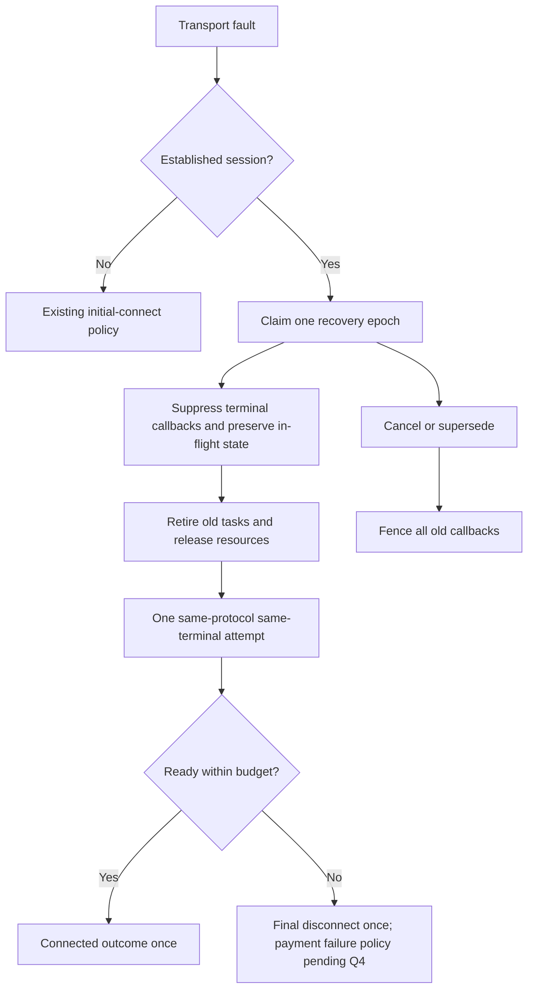

# One recovery attempt before reporting established connection loss

**APPROVED v1.1. L3 gate cleared by the maintainer on 2026-10-15; Q1-Q4 decided (see §4).**
Requirements R1-R3, R14 and R15 have explicit human sources; the design decisions behind
R4-R12 were approved by the maintainer's Q1-Q4 rulings recorded in §4 and
SCR-ESTABLISHED-RECOVERY-001. See the coverage file for source classification and approval status.

## 0. Changelog

| Version | Date | Change | Rules / ACs | Level | Behavioral compatibility | SCR |
|---|---|---|---|---|---|---|
| v1.0 draft | 2026-10-15 | Cross-protocol established-link recovery proposal | R1-R15 / AC1-AC15 | L3 | Changes autoReconnect=false and established failure callbacks | SCR-ESTABLISHED-RECOVERY-001 |
| v1.1 | 2026-10-15 | Maintainer approved Q1-Q4; recovery is fully silent to callers until a single terminal outcome (no onReconnecting, no transient onError/onDisconnected); R6/AC6 revised accordingly | R4-R12 unblocked; R6/AC6 revised | L3 | Established recovery emits no progress or transient error callbacks; only one terminal onConnected (success) or onDisconnected(E213) (failure) | SCR-ESTABLISHED-RECOVERY-001 |
| v1.2 | 2026-10-15 | Maintainer clarified onError scope: onError corresponds to connect() only; an established-connection fault is never reported via onError, the SDK recovers internally, and the registered ConnectionListener is never removed by the SDK during recovery (only the caller's explicit removeConnectionListener()/disconnect() removes it). R6/AC6 refined. | R6/AC6 refined | L3 | Clarifies (does not relax) the callback contract: no onError for established faults; listener retention guaranteed | SCR-ESTABLISHED-RECOVERY-001 |

## 1. Scope and source analysis

The original request and two decisions are preserved verbatim in
`sources/TAPLINK_ESTABLISHED_RECOVERY_REQUEST.md` S1-S3. SDK-managed protocols must
attempt one recovery after an established connection fails, before reporting final
disconnect. This applies without an in-flight transaction and regardless of
autoReconnect=false. First-ever connection failure retains existing behavior.

Concrete adapters: LAN/WebSocket, Cable USB_VSP, RS232, USB_AOA Host, local AIDL
(APP_TO_APP / ON_DEVICE), and SUB_SCREEN (VSP plus screen initialization). Public
CROSS_DEVICE selects LAN or an explicit Cable protocol. Audit AOA Accessory shared
classes for consistency, but do not claim a public client route where none exists.
Cloud is N/A: the SDK has no Cloud connection entity; this task does not create one.
No protocol auto-switch or new public protocol is implied.

Existing spec SPEC-LAN-RECOVERY-001 is draft v1.2 with previously approved v1.1
rules retained. R6/R7/R9 overlap the new established recovery; R8/AC8b in the
pending SCR-LAN-FASTRECOVERY-ALLMODES-001 describe non-LAN recovery as a no-op.
This proposal records replacement scope in SCR rather than silently editing or
approving either older document. First-connect LAN R1-R5 remain authoritative.

## 2. Rules (all pending approval)

### 2.1 Business flow

| ID | Condition -> behavior | Source / classification |
|---|---|---|
| R1 | An established SDK-managed connection faults -> SDK owns a recovery attempt before final disconnect; every concrete adapter follows the same policy. | SRC-1 / EXPLICIT |
| R2 | autoReconnect is omitted (default false), explicitly false or true -> the mandatory established recovery still has one attempt. Retry-count interaction is proposed separately in R4. | SRC-2 / EXPLICIT |
| R3 | No connection has succeeded in this logical session -> keep existing first-connect behavior; recovery-attempt failure cannot recursively become a new first-connect recovery. | SRC-3 / EXPLICIT |
| R4 | One established fault episode -> one serialized same-protocol transport rebuild, no additional ReconnectManager/fast-recovery/mDNS/adaptor retry chain. Budget: 5,000ms monotonic wall time including cleanup, device wait, handshake, readiness and cancellation; no retry delay. maxRetryCount=0 or positive does not change this one-attempt limit. Failure/exhaustion ends this episode without background retries. | SRC-4 / APPROVED (Q1, maintainer 2026-10-15: "只恢复一次") |

### 2.2 State and callback ownership

| ID | Condition -> behavior | Source / classification |
|---|---|---|
| R5 | A fault is observed -> synchronously claim a recovery epoch before any public callback or PaymentManager physical-disconnect cleanup. Keep logical recovery nonterminal; isConnected=false and isConnecting=true. Transport ERROR/DISCONNECTED are diagnostics, not final public outcomes. | SRC-4 / APPROVED (Q1, maintainer 2026-10-15) |
| R6 | onError is scoped to the explicit connect() action only: it reports failure of a first/explicit connection attempt. A fault on an already-established connection is NOT an onError case and is never reported to callers through onError; the SDK absorbs it internally and runs the one established recovery. During recovery emit NO onReconnecting progress, NO onError and NO transient onDisconnected, including autoReconnect=false; transport ERROR/DISCONNECTED mid-attempt are diagnostics only. The registered ConnectionListener MUST NOT be removed by the SDK during recovery (success or failure), so the terminal callback still reaches it; only the caller's explicit removeConnectionListener()/disconnect() removes it (R9). Exactly one terminal callback per distinct observer: recovery succeeds with validated peer and protocol readiness -> one onConnected, with no paired onError/onDisconnected for the recovered fault; recovery fails -> one onDisconnected with existing E213 and diagnostic cause, with NO onError in any case. Queued callers joining the episode receive only that single terminal outcome once and are released. | SRC-5 / APPROVED (Q2, maintainer 2026-10-15) |

### 2.3 Interface and system boundaries

| ID | Condition -> behavior | Source / classification |
|---|---|---|
| R7 | Recovery starts -> retire the old epoch, cancel its tasks and await safe resource release before opening a successor. Old read/write/status/close/permission/handshake callbacks cannot mutate the successor, close its resources or emit outcomes. A deadline expiry fences a stuck cleanup and terminates recovery without opening overlapping resources. | SRC-4 / APPROVED (Q1, maintainer 2026-10-15) |
| R8 | Recovery selects peer -> retain the original protocol/configuration and validate the original terminal identity; VID/PID or USB bus path alone are insufficient. Missing reliable identity or rejected peer ends the single attempt with disconnect; never silently select another terminal. SUB_SCREEN success requires transport plus screen initialization. | SRC-6 / APPROVED (Q3, maintainer 2026-10-15: "身份无法可靠确认时，不自动接入其他终端") |
| R9 | User disconnect, SDK cleanup or superseding connect -> cancel/fence recovery; no later old success, error or new connection. Manual disconnect emits once. New config starts a fresh logical session; same-config connect joins the current attempt rather than reopening a second transport. Throwing listeners cannot prevent cleanup or delivery to other distinct listeners. | SRC-4 / APPROVED (Q1, maintainer 2026-10-15) |

### 2.4 Transactions, errors and compatibility

| ID | Condition -> behavior | Source / classification |
|---|---|---|
| R10 | In-flight request exists -> preserve its callbacks/dedup during recovery without extending the original request deadline; never resend a possibly submitted payment, even through processPendingTransaction on recovery success. Successful recovery must reconnect the original receive-routing chain so original traceId responses continue into the original PaymentCallback (R15); do not clear/fail/re-register it or reset its deadline to make recovery appear successful. Recovery FAILURE (Q4, maintainer 2026-10-15: "恢复失败后的交易 callback 都被清除了") -> on the single final disconnect, clear/fail the in-flight transaction callbacks through the existing physical-disconnect/failAllPendingTransactions cleanup path, released exactly once alongside the one terminal onDisconnected(E213); this cleanup must not run before or during the attempt (no synthetic early E306), only at the terminal failure. Normal final-response versus original request-timeout races must complete once. | SRC-7 / APPROVED (Q4, maintainer 2026-10-15) |
| R11 | A request is submitted while recovery is active -> reject it before serialization/send with existing E213, do not queue or replay it. Existing request timeout continues; its expiry does not create another recovery episode. Error 307/308 and all business-result semantics remain unchanged. | SRC-7 / APPROVED (Q4, maintainer 2026-10-15) |
| R12 | USB temporarily absent during mandatory recovery -> await one eligible re-enumeration/attach within the remaining common budget, then open at most once; do not fail immediately or restart the budget. Missing/denied USB permission or missing AIDL target -> fail the prerequisite evaluation without automatic permission prompts or loops. A prerequisite refusal counts as a failed attempt, not permission to switch protocol/target. | SRC-4 / APPROVED (Q1, maintainer 2026-10-15) |

### 2.4.1 Non-interactive recovery requirement

| ID | Condition -> behavior | Source / classification |
|---|---|---|
| R14 | SDK-internal recovery -> do not invoke USB requestPermission, privilege-based permission grants, pairing/authorization UI or any new user authorization flow on either endpoint. Use existing effective permissions; if permission is missing or reauthorization is required, finish with the single final disconnect and retain the authorization-required diagnostic. Normal explicit connect keeps its current authorization policy. | SRC-9 / EXPLICIT; security boundary clarified by SRC-10 / DERIVED |

### 2.4.2 In-flight continuation priority

| ID | Condition -> behavior | Source / classification |
|---|---|---|
| R15 | Reconnect succeeds while an original transaction is in flight -> keep the original callback and traceId/transactionRequestId correlation, attach the rebuilt receive path to that same mapping, and deliver continued progress/final responses through the original PaymentCallback using the existing continuation mechanism. Do not start or resend a transaction, silently replace its callback, or lose terminal dedup state. | SRC-11 / EXPLICIT; lifecycle mechanics in R10 remain proposed |

### 2.5 Acceptance and verification

| ID | Condition -> behavior | Source / classification |
|---|---|---|
| R13 | Release of this behavior -> retain public signatures and background-callback allowance; update config KDoc, SDK public docs/release notes and consumer guidance. No SDK/AAR publishing or downstream dependency upgrade until maintainer-confirmed Maven version. All R/AC/TC mappings and per-adapter evidence must be present. | SRC-8 / DERIVED |

## 3. Fields and public contract

Recovery and explicit user connection must carry distinct internal intent. Every
adapter must enforce non-interactive recovery before any permission/pairing branch,
including AOA pre-switch and post-enumeration device opens and RS232 privileged grant
fallbacks. Do not reuse unrestricted connect paths without this intent. Stale
permission responses from older explicit attempts cannot advance a recovery epoch.
Existing permission checks, identity checks and protocol handshake remain necessary;
this requirement does not authorize bypassing platform or payment security. If a
platform or peer requires interaction for reconnection, the SDK must not initiate
that flow and cannot promise silent recovery success. It cannot control unrelated
system UI triggered independently of its own operations.

No new public API is proposed. Conceptual internal state (design only):

```kotlin
internal data class RecoveryEpisode(
    val sessionId: Long,
    val epoch: Long,
    val deadlineMonotonicMs: Long,
    val attemptLimit: Int = 1,
    val originalConfig: ConnectionConfig,
    val expectedTerminalIdentity: String?,
)
```

An absent identity is not authorization to choose a different terminal. The actual
identity source and adapter support require Q3 approval before implementation.
No new public RECOVERING enum is assumed: proposed projection uses existing
CONNECTING/isConnecting while internal ownership carries the epoch.

`autoReconnect` retains its first-connect behavior but ceases to disable the new
mandatory established-link attempt. `maxRetryCount`/`retryDelayMs` do not multiply
this attempt or append a second chain (proposed R4). This is a behavioral contract
change even without a signature change; version/migration policy must be reviewed.

## 4. Boundaries and decisions (Q1-Q4 approved 2026-10-15)

Already decided by the human: mandatory recovery even with autoReconnect=false;
established connections only. Do not ask for these again. Q1-Q4 were decided by the
maintainer in chat on 2026-10-15; their verbatim rulings and interpretation follow.

| ID | Maintainer decision (approved 2026-10-15) | Verbatim ruling / interpretation |
|---|---|---|
| Q1 | APPROVED: one common 5,000ms total budget, exactly one attempt, no appended ReconnectManager/fast-recovery/mDNS retries; logical CONNECTING during the attempt; manual cancellation and prerequisite failure per R4/R5/R7/R9/R12. maxRetryCount does not multiply the attempt. | "只恢复一次" — a single recovery attempt only. If the real outage outlasts the 5,000ms budget (e.g. the observed 7s), the attempt fails and ends with one final disconnect; a later plug-in is a new logical session. |
| Q2 | APPROVED: onError is scoped to the connect() action only; an established-connection fault is never reported via onError. Recovery is FULLY SILENT to callers until the terminal outcome — NO onReconnecting, NO onError, NO transient onDisconnected during the attempt. The registered ConnectionListener is never removed by the SDK during recovery (only the caller's explicit removeConnectionListener()/disconnect() removes it), so the one terminal callback (onConnected on success, or onDisconnected(E213) on failure, with no onError in either case) still reaches it. Distinct listeners deduplicated; queued callers get the one terminal outcome once. | "恢复期间不发进度回调，仅终局一次结果回调，onError 的回调也不给调用端" plus follow-up: "onError 只在调用 connect() 时有对应回调，连接建立过后的 onError 不需要返回给他，我们 SDK 内部做恢复重试，并保证连接监听不被移除" — onError only corresponds to connect(); post-establishment onError is not returned to the caller; the SDK recovers internally and guarantees the connection listener is not removed. |
| Q3 | APPROVED: same-terminal identity validation per adapter; missing reliable identity or ambiguous peer ends the single attempt with disconnect, never silently selecting another terminal. The pre-INIT idle limitation (unknown deviceId / missing USB serial may prevent automatic reopen) is accepted. SUB_SCREEN requires full screen readiness. | "身份无法可靠确认时，不自动接入其他终端" — when identity cannot be reliably confirmed, do not automatically connect to another terminal. |
| Q4 | APPROVED: successful recovery retains original callbacks and continues original traceId responses (R15). Recovery FAILURE clears/fails the in-flight transaction callbacks via the existing physical-disconnect/failAllPendingTransactions cleanup, released once with the one terminal onDisconnected(E213). New submissions during recovery are rejected with E213 (R11). No synthetic early E306: cleanup happens only at terminal failure, not before/during the attempt. | "恢复失败后的交易 callback 都被清除了呀" — after recovery fails, the in-flight transaction callbacks are cleared. |

### 4.1 Proposed original-peer identity evidence (Q3)

| Adapter | Current identity availability | Proposed recovery evidence / limitation |
|---|---|---|
| LAN | Public deviceId is unknown before INIT; mDNS may already bind a terminal serial | Use the already bound serial when available and retain same-terminal validation; never discover arbitrary reachable terminals. No trustworthy serial -> final disconnect without opening an ambiguous replacement. |
| VSP / RS232 / AOA Host | Public deviceId is unknown before INIT; USB serial may be absent or inaccessible | Preserve an accessible validated original USB serial or existing validated terminal identity, and compare on replacement. VID/PID, interface and path alone do not authorize replacement. If the adapter cannot validate a candidate before readiness, it must not report recovery success; lack of any usable anchor may make idle recovery fail. |
| Local AIDL | Local terminal hardware does not change; application/service target is configured | Rebind only the same application/component under the existing package/signature/identity validation; do not bind an arbitrary matching service. |
| SUB_SCREEN | VSP transport plus screen initialization | Apply VSP target validation and require screen readiness before public recovery success. |
| AOA Accessory shared classes | No current public client selection route identified | Audit shared failure/cleanup wiring; do not invent a public mode or claim hardware coverage. |

This table is a proposed safety policy, not proof that all serial/identity checks
already exist. Adapter feasibility and the pre-INIT idle limitation must be resolved
at Q3 before implementation. Identity validation never replays a business transaction.

No proposal changes amounts, tip calculations, Refund/Abort eligibility, INIT public
visibility, signing, credentials or production log defaults. INIT readiness after
recovery must not resubmit an in-flight business request or silently extend its deadline.
Do not suppress payment business outcomes or confuse connection recovery with approval.

## 5. Examples

- VSP + autoReconnect=false + idle + validated original USB serial: read fault -> one rebuild -> ready -> one
  onConnected, no transient disconnect/error.
- RS232 + autoReconnect=true + maxRetryCount=3: fault -> one rebuild fails -> one
  final disconnect, not three extra retries (proposed Q1).
- LAN with submitted payment: fault -> preserve trace/request/dedup -> successful
  same-terminal recovery -> await original outcome; do not invoke sale again.
- Cable absent through 5s: finish disconnect at the budget; plug-in at 7s cannot
  revive that expired episode; a new explicit connect is a new logical session.
- Initial LAN stale endpoint: retain existing approved discovery recovery policy.

## 6. Flow



## 7. Implementation and downstream impact (proposal)

Use one connection-level coordinator above protocol adapters, not independent retry
loops in each kernel. Normalize failure events with session/epoch/cause/established
context; do not infer phase solely from code 232/213. Capture recovery ownership
before synchronous status listeners can publish terminal callbacks or clear payments.
Refactor existing tryFastRecovery/fastRecoveryFallback and ReconnectManager entry
points to avoid stacked budgets, duplicated disconnects and premature transaction failure.
Capture immutable per-attempt config/resources so a retired kernel cannot close its successor.

Continuation wiring is a critical success criterion, not just isConnected=true:
retain PaymentManager/LocalCallbackManager and original traceId mappings; restore
ConnectionManager -> PaymentManager -> ResponseProcessor receive routing before the
first continued payload can arrive. Do not register a new request/callback, run
pending-send processing against a submitted payment, or clear terminal dedup because
a physical transport changed. Suppression must cover direct failAllPendingTransactions,
connection error listener and physical-disconnect cleanup, not only public callbacks. Candidate-peer continuation frames arriving before R8 identity validation must be isolated/buffered within the recovery budget, never delivered to original callbacks or used to announce recovery success before validation.

The current Host continuation spec is active v1.2, LAN only, onOpen rebind (not a
sign-in-success trigger). Do not add a new sign-in dependency or silently reinterpret
its approved safety boundary. For VSP/RS232/AOA/local adapters, separately audit Host
binding survival/sender reattachment and first continued payload. Callback retention
is necessary but not sufficient; absent Host support is a blocking end-to-end gap,
not a successful cross-protocol continuation test. Source S9 records this distinction.

Per-adapter checks: LAN socket/error/close + same-terminal guard; VSP read/write/probe
+ permission/enumeration; RS232 read/write/keepalive; AOA Host attach/detach + handshake
(shared Accessory path audit); local AIDL death/binding lifecycle; SUB_SCREEN transport
+ screen activation. No private SDK package may be exported to consumers.

Tapro: assess Host response-binding retention, SUB_SCREEN behavior, channel status and
version consumption; do not edit embedded/legacy SDK AAR. Demo: add public-API examples
and regression scenarios for the changed callbacks/config semantics. Public docs:
en/zh recovery, autoReconnect=false, callback ordering, migration, E213/E306 and release
history must be synchronized in the eventual release. Scope assessment is recorded
now; no downstream version or Current marker is changed before confirmed publication.
This draft creates no Maven version, Git commit, AAR or release tag.

## 8. Acceptance criteria and proposed test inventory

Each item is Given / When / Then; TC identifiers are planned, not executed tests.

| AC / Rule / TC | Given | When | Then |
|---|---|---|---|
| AC1 / R1 / TC-ER-001 | Established LAN/VSP/RS232/AOA/local/SUB_SCREEN, idle and in-flight variants | Fault event arrives | The common recovery owner is entered for each actual client adapter before terminal notification; Cloud is explicitly N/A. |
| AC2 / R2 / TC-ER-002 | autoReconnect omitted/false/true | Established connection fails | One mandatory recovery is eligible in every configuration; no boolean default bypass. |
| AC3 / R3 / TC-ER-003 | Initial connect never succeeded, plus failure during an already-running recovery | Connect/handshake fails | Initial policy remains unchanged; the recovery child does not start recursive recovery. |
| AC4 / R4 / TC-ER-004 | An established fault episode, maxRetryCount=0/3, duplicate fault events and slow adapter | Failures race or deadline reaches 5,000ms | Exactly one rebuild attempt at most; failed prerequisites do not spin; no stacked mDNS/fast/regular loops, and an expired attempt cannot later succeed. A genuinely restored connection may start a new episode on a new fault. |
| AC5 / R5 / TC-ER-005 | Read/write/probe plus status/close events in every ordering | First fault is detected | Ownership is claimed first; isConnected=false/isConnecting=true; no public transient error/disconnect and no physical-disconnect payment cleanup. |
| AC6 / R6 / TC-ER-006 | Shared connect/global listener, distinct listeners and queued connect callers; a listener registered before the established fault | Recovery succeeds or fails | onError is never invoked for an established-connection fault (onError stays scoped to connect() failures). No onReconnecting and no transient onDisconnected reach any observer during the attempt, including autoReconnect=false. The registered ConnectionListener is still attached throughout recovery (the SDK does not remove it); only an explicit caller removeConnectionListener()/disconnect() detaches it. Each distinct observer gets exactly one terminal callback: one onConnected on success or one E213-reason onDisconnected on failure, with no onError either way; queued callers receive that single terminal outcome once and all pending callers are released. |
| AC7 / R7 / TC-ER-007 | Blocking old read, late status/permission/handshake and delayed cleanup | Recovery starts/expires | No successor opens before old release; no stale callback mutates or closes a successor; stuck cleanup is fenced and budget ends once. |
| AC8 / R8 / TC-ER-008 | Same terminal, different terminal with identical VID/PID, missing identity, SUB_SCREEN activation failure | Rebuild appears physically connected | Only validated original target with full readiness succeeds; no protocol switch, ambiguous target acceptance or transport-only SUB_SCREEN success. |
| AC9 / R9 / TC-ER-009 | Recovery running, listener throws, connect requests race | Manual disconnect / cleanup / superseding config / same config | Cancel and fence old epoch; same config joins; new config starts fresh; manual disconnect and other observers receive one appropriate outcome. |
| AC10 / R10 / TC-ER-010 | Submitted payment, active dedup and deadline; final response races timeout | Recover succeeds/fails | On successful recovery no payment replay including processPendingTransaction; retain original callback mapping, deadline and terminal dedup. Original final response or original request timeout completes once; recovery success cannot be preceded by synthetic connection-error/E306 cleanup. On recovery FAILURE (Q4 approved) the in-flight transaction callbacks are cleared/failed via the existing physical-disconnect cleanup exactly once together with the single terminal onDisconnected(E213), never earlier and never as a synthetic E306. |
| AC11 / R11 / TC-ER-011 | Recovery running and a new payment request | Caller submits | Return existing E213 before send with no hidden queue; existing timeout/307/308/result tri-state behavior preserved. |
| AC12 / R12 / TC-ER-012 | Permission denied, USB absent or AIDL target unavailable | Mandatory attempt evaluates prerequisites | A transiently absent USB peer appearing within the remaining budget can open once and recover; absence through deadline disconnects once. Denied permission/missing AIDL target fails prerequisite evaluation without prompts/loops; later explicit connect remains possible. |
| AC15 / R15 / TC-ER-015 | Original callback C registered for trace T and request ID U; payment is in progress | Transport fails and recovery succeeds, Host continues progress then terminal response with T | The same original C receives continuation and exactly one final result; no business resend/new trace/new callback; receive routing is attached before earliest continued payload; duplicates are suppressed. LAN uses existing Host v1.2 onOpen rebind without a forced sign-in; other adapters require demonstrated Host support before end-to-end claims. |
| AC14 / R14 / TC-ER-014 | Recovery on each actual adapter; missing/granted/revoked permission and stale explicit-connect permission responses | Connection is rebuilt or AOA switches/re-enumerates | No requestPermission/privileged grant/pairing UI or authorization request on either endpoint; granted permission allows silent handshake, missing permission gives one final disconnect, stale responses are ignored, and explicit first-connect permission behavior is unchanged. |
| AC13 / R13 / TC-ER-013 | Final reviewed change and release preparation | Verify compatibility/documentation | Public signatures/threads unchanged, changed semantics documented, bilingual release updates planned, no publish/dependency upgrade before maintainer confirmation. |

Layering: deterministic JVM controller tests for budgets/ordering/cancellation/identity/
transactions; protocol adapter tests for normalization/cleanup/readiness; explicitly
authorized device validation for USB unplug-free reset, port power interruption,
enumeration/permission, LAN loss/rebind and local process restart. Tests must exercise
real callback wiring, not only a pure eligibility predicate. Preserve existing LAN
initial recovery, config-setter and payment result regression suites.

## 9. Approval and verification

Source analysis and draft creation only. Independent reviewer must first inspect
original sources, then compare this draft. Report stays outside Git. Q1-Q4 and the
full L3 spec/SCR/test inventory require human approval before code/test implementation.
No existing spec, SCR or coverage approval status is changed by this draft.
