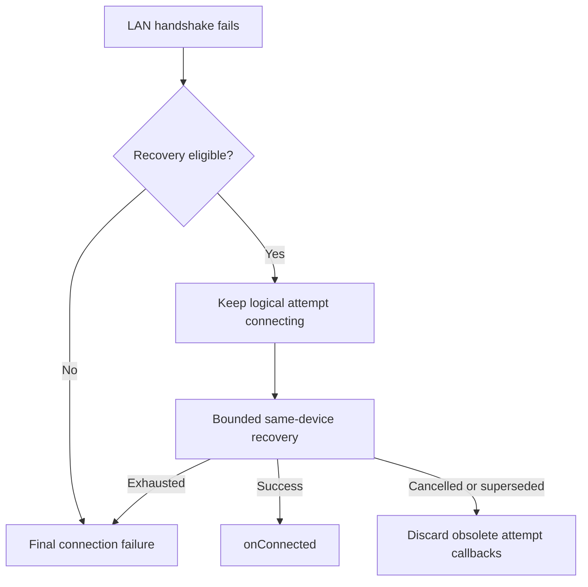

# LAN recovery callback ordering

> ░░░ THIS REVISION (v1.2) IS PENDING HUMAN APPROVAL ░░░
>
> The v1.2 revision below rewrites R8/AC8 (and adds AC8b) under the DRAFT SCR
> `SCR-LAN-FASTRECOVERY-ALLMODES-001` to match the maintainer-pinned all-modes fast-recovery
> widening in `ConnectionManager.kt`. R8/AC8/AC8b are **DRAFT / PENDING_APPROVAL** and must NOT be
> treated as approved. All other rules (R1–R7, R9, R10) and their ACs remain at their previously
> approved v1.1 state and are untouched by this revision. A human maintainer (SDK connection /
> payment-response-path rule owner) must approve the SCR before `status`, `version`, R8/AC8/AC8b
> status, or the coverage `approved` flag are flipped back to active/approved.

## 0. Changelog

v1.0 (2026-10-14): initial specification independently reviewed and approved in the current conversation.
No existing active connection spec is changed; an SCR is not required for this initial draft.

v1.1 (2026-10-10): applied by SCR-LAN-TRACEID-REBIND-001 (APPROVED, L3) at the human approval gate.
Covers the Host-side "traceId-anchored unified LAN rebind" plan. Adds R7–R10 / AC7–AC10 and a boundary
note on R6. These describe the SDK's role under that plan: the in-transaction fast-recovery path and the
180s callback timeout are the authoritative in-flight callback lifetime and are UNCHANGED; the plan
requires NO SDK code change for LAN (the isLanMode fast-recovery gate stays as-is; Cable widening is
out of scope); the Host must align its binding-retention window to the 180s callback timeout, not the
5s fast-recovery budget; and the appId identity guard is a Host-side authorization boundary adding no
SDK public API, no new error code and no new identity anchor. Level L3 (authorization boundary on the
payment response path). Rules R7–R10 are now Approved. Affected R/AC: R6 (clarified), R7–R10 (added).
The two Host-side high-risk questions were resolved safety-first at approval: empty appId does not
rebind (Q-1); the rebind trigger is the sign-in success callback, not onOpen (Q-2) — these are
Host-side decisions and do not change the SDK's no-code-change conclusion for LAN.

v1.2 (2026-10-15, DRAFT — PENDING HUMAN APPROVAL): proposed by SCR-LAN-FASTRECOVERY-ALLMODES-001
(DRAFT, L3). Rewrites R8/AC8 and adds AC8b to match the maintainer-pinned all-modes fast-recovery
widening in ConnectionManager.kt: the OPT-R1 in-flight fast-recovery ENTRY judgment no longer gates on
the connection mode. The inline `isLanMode && ...` expression was replaced by the pure internal
function `computeCanFastRecover(autoReconnectEnabled, isManual, hasInFlight, isFastRecovering,
isReconnecting, hasConnectionConfig)`, widening the judgment layer to all connection modes (LAN /
Cable / App-to-App / Cloud). Per the Step-1 static risk assessment this is a harmless widening: the
runtime layer stays bounded by the onDisconnected `isConnectionError` disconnect-code classification,
so only LAN (WebSocket close codes 1000/1001/1006) disconnects actually reach the judgment; non-LAN
modes are classified into the connection-error branch (or produce no SDK onDisconnected) and the
widening is a runtime no-op for them. `computeCanFastRecover` is INTERNAL (not public API); no new
public API, error code or identity anchor is added, so R10's identity boundary and R7/R9's timing
boundaries are unchanged. Level L3 (trigger scope of in-flight payment-response-path fast recovery).
Affected: R8 (rewritten), AC8 (rewritten), AC8b (added). R1–R7, R9, R10 are UNCHANGED. R8/AC8/AC8b
are DRAFT/PENDING; nothing in this entry is approved until the human L3 gate clears the SCR.

## 1. Scope

SDK-managed LAN initial connection and reconnect to a stale endpoint, with
service discovery of the same target device. This is a connection callback timing
fix, not a transaction retry or a change to transport framing/device identity.
R1 comes from the original request; R2–R6 boundaries were explicitly approved
with AC1–AC6 by the maintainer response “开始实现” after the approval request.

## 2. Rules

| Rule | Condition → behavior | Source | Status |
|---|---|---|---|
| R1 | Auto-reconnect enabled: a failed initial LAN endpoint must not emit a terminal connection failure before attempting recovery to the discovered endpoint. | SRC-1 (EXPLICIT) | Approved |
| R2 | Keep the logical attempt connecting during recoverable handshake error/close; suppress paired transport-close state regression regardless of callback ordering. | SRC-2 (EXPLICIT) | Approved |
| R3 | When recovery has no acceptable target or replacement connection fails and configured recovery is exhausted, terminate the logical attempt and report a final connection error once per listener, with no handshake-generated duplicate disconnect. | SRC-2 (EXPLICIT) | Approved |
| R4 | autoReconnect=false retains direct failure reporting and disables discovery recovery; errors remain existing codes. | SRC-2 (EXPLICIT) | Approved |
| R5 | Manual disconnect, superseding connection or cleanup cancels pending recovery; obsolete callbacks cannot report success/failure or start a replacement for the cancelled attempt. | SRC-2 (EXPLICIT) | Approved |
| R6 | Scope the deferral to pre-connection LAN handshake recovery; preserve established-link errors and existing in-flight fast recovery budgets, transaction callbacks and query-first rules. (Boundary note, SCR-LAN-TRACEID-REBIND-001: the Host traceId-rebind plan touches established-link in-flight response routing on the HOST side only; the SDK in-flight fast-recovery path is still preserved per R7.) | SRC-2 (EXPLICIT) | Approved |

Five dimensions: business flow R1; state/rules R2; interface boundary R4;
exception/risk R3/R5; acceptance/regression R6. Each R maps to the same numbered AC.

### 2.1 Extension by SCR-LAN-TRACEID-REBIND-001 (R7/R9/R10 Approved 2026-10-10, L3) and SCR-LAN-FASTRECOVERY-ALLMODES-001 (R8 DRAFT, L3)

R7, R9 and R10 were Approved (Type B DESIGN_DECISION, L3) at the 2026-10-10 human approval gate under
SCR-LAN-TRACEID-REBIND-001 and remain approved. **R8 is now DRAFT / PENDING_APPROVAL**: it is rewritten
by SCR-LAN-FASTRECOVERY-ALLMODES-001 (DRAFT, L3) for the maintainer-pinned all-modes fast-recovery
widening and supersedes the v1.1 "isLanMode gate retained; Cable out of scope" wording only after human
approval. The widening is assessed harmless (only LAN reaches fast recovery at runtime), so R7/R9/R10
are unaffected.

| Rule | Condition → behavior | Source | Status |
|---|---|---|---|
| R7 | In-transaction OPT-R1 fast recovery (LAN + autoReconnect + hasInFlight + non-manual) keeps suppressing the paired disconnect cleanup via `isFastRecovering`, so transaction callbacks and the terminal-dedup set are NOT cleared during a recoverable in-flight drop; a recovered connection keeps in-flight callbacks under the existing 180s callback timeout. Unchanged by this plan. | SRC-3 (EXPLICIT) | Approved |
| R8 | OPT-R1 in-flight fast-recovery ENTRY is mode-agnostic: `computeCanFastRecover` does NOT gate on the connection mode. Entry is decided purely by runtime conditions — `autoReconnect` enabled AND non-manual disconnect AND has in-flight transaction AND not already fast-recovering AND not already reconnecting AND has a reusable connection config. The judgment layer is widened to all modes (LAN / Cable USB_VSP·RS232·USB_AOA / App-to-App / Cloud); the runtime layer stays bounded by the `onDisconnected` `isConnectionError` disconnect-code classification, so in practice only LAN (WebSocket close codes 1000/1001/1006) disconnects reach the judgment and non-LAN modes are a runtime no-op (harmless widening). `computeCanFastRecover` is an internal pure function (not public API); no new public API, error code or identity anchor is added. **(DRAFT / PENDING_APPROVAL — SCR-LAN-FASTRECOVERY-ALLMODES-001; supersedes the v1.1 "isLanMode gate retained" wording once approved.)** | SRC-4 (EXPLICIT) | DRAFT / PENDING |
| R9 | Host-retained in-flight bindings must align to the SDK 180s transaction callback timeout, not the 5s `FAST_RECOVERY_BUDGET_MS`. When fast recovery is not achieved within 5s the SDK fails in-flight callbacks with E306 and reports E213; the Host must not expect the SDK to keep an in-flight callback alive beyond the 180s callback timeout, and 306 must not be retried directly. | SRC-3 (EXPLICIT) | Approved |
| R10 | The appId / merchant identity guard replacing the LAN different-IP reject is a Host-side authorization boundary. The SDK adds no public API, no new error code and no new identity anchor; traceId remains the globally unique transaction identity. | SRC-3 (EXPLICIT) | Approved |

## 3. Public contract

No new public API, field, default, error code or callback thread guarantee.
Existing ConnectionConfig.autoReconnect and bounded retry/discovery policy apply.
The connect-call listener, persistent observer and queued connect callers joining
the active reconnect must obey the callback order. Intermediate handshake failure
must not fail queued callers before recovery succeeds. Terminal failure releases
pending callers and reconnect state so subsequent explicit connect is accepted.
Internal log messages may retain endpoint failures for diagnosis.

## 4. Boundaries

Preserve same-device discovery checks: never select a different terminal merely
because its port is reachable. Test repeated failures, discovery failure/no target,
replacement failure, successful replacement, upper-layer rejection (including unchanged address or identity/mode protection), error/close ordering, cancellation,
autoReconnect=false, and established-link/fast-recovery regression.
This specification does not make intermediate failures across all connection modes silent.
No change to maxRetryCount, retryDelayMs, discovery retry limits or transaction deadlines.
Discovery and reconnect retain their existing separate budgets; this task introduces
no global retry budget. A discovered target rejected without an accepted handoff
cannot silently finish the logical attempt with no final outcome.

## 5. Example

With autoReconnect=true: connect(8445) → refused → discover same device(8443)
→ connect(8443) → onConnected; the failed handshake does not cause an error popup.
With autoReconnect=false: connect(8445) → refused → existing final onError.

## 6. Flow

## 7. Compatibility and downstream impact

Signatures and error meanings unchanged; autoReconnect=true consumers stop seeing
transient terminal callbacks during successful endpoint recovery. Tapro/Demo can
continue using public listeners. Public en/zh documentation needs this clarification
in the eventual confirmed-version release. No version bump, Maven publication,
consumer dependency update or current-version document update is part of this fix.
APP-to-APP/Cable/Cloud, amounts, Refund/Abort, INIT, 306/307/308, request IDs,
credentials/log settings and lifecycle API are unchanged and outside implementation scope.
Callback code must remain safe for background threads.

## 8. Acceptance / regression cases

### AC1 (R1; TC-LAN-RECOVERY-001)

Given autoReconnect=true, stale port 8445 and same-device discovery at 8443. When old endpoint fails and replacement succeeds. Then onConnected is delivered; neither onError nor onDisconnected is emitted for the failed handshake.

### AC2 (R2; TC-LAN-RECOVERY-002)

Given fallback eligible and no established socket. When transport error and close occur in either order while discovery is pending. Then isConnecting remains true; ERROR/DISCONNECTED and public terminal callbacks are absent.

### AC3 (R3; TC-LAN-RECOVERY-003)

Given autoReconnect=true; no target, discovery exception, missing/rejecting address-change listener without accepted handoff, or failed replacement connection. When existing bounded recovery is exhausted or a non-retryable failure terminates it. Then connecting ends; each distinct listener instance (including a shared connect/global listener and queued reconnect callers) gets one final onError for this eligible LAN recovery attempt, no duplicate handshake onDisconnected; pending reconnect callers are released and reconnect state ends; a subsequent explicit connect can proceed.

### AC4 (R4; TC-LAN-RECOVERY-004)

Given autoReconnect=false and refused endpoint. When direct connection fails. Then existing direct failure reporting is preserved without discovery or new-port connection; this task does not add a handshake disconnect or redesign disabled-reconnect error deduplication.

### AC5 (R5; TC-LAN-RECOVERY-005)

Given discovery/replacement connection pending. When user disconnects, switches connection or cleans up. Then old attempt produces no later recovery success/error or new connection; explicit disconnect follows the existing API contract.

### AC6 (R6; TC-LAN-RECOVERY-006)

Given established link error or transaction fast recovery path. When transport failure occurs. Then existing error/recovery path remains operative; no broadened error suppression, transaction resubmission or change to the existing fast-recovery path.

Fast-recovery caveat: existing comments describe no mDNS, but the actual call reuses
connectInternal with the enabled fallback option. This discrepancy is observed,
not an approved requirement; this task preserves the existing path.

### AC7 (R7; TC-LAN-RECOVERY-006) — Approved

Given a LAN connection with autoReconnect=true and an in-flight transaction. When a passive drop (e.g. 1006) occurs and OPT-R1 fast recovery is eligible. Then `isFastRecovering` suppresses the paired `connectionDisconnectedListener` invoke; transaction callbacks and the terminal-dedup set are not cleared; a recovered connection keeps delivering the in-flight transaction's traceId events under the existing 180s callback timeout. No SDK code change is introduced.

### AC8 (R8; TC-FASTRECOVERY-ALLMODES-001) — DRAFT / PENDING_APPROVAL

Given the OPT-R1 in-flight fast-recovery entry judgment extracted as the pure internal `computeCanFastRecover(autoReconnectEnabled, isManual, hasInFlight, isFastRecovering, isReconnecting, hasConnectionConfig)`. When all runtime conditions hold (autoReconnect enabled, non-manual, has in-flight transaction, not fast-recovering, not reconnecting, has connection config). Then it returns true with NO connection-mode parameter (mode-agnostic); when any single condition is unsatisfied it returns false; and the original LAN scenario still returns true (regression). `computeCanFastRecover` stays internal — no public API is added. (Verified by the JVM unit test `FastRecoveryModeAgnosticTest`; status DRAFT pending the human L3 gate on SCR-LAN-FASTRECOVERY-ALLMODES-001.)

### AC8b (R8; TC-FASTRECOVERY-ALLMODES-001) — DRAFT / PENDING_APPROVAL

Given the judgment layer is widened to all connection modes while the runtime layer is bounded by `onDisconnected` `isConnectionError`. When a non-LAN mode (Cable VSP/RS232/AOA, App-to-App, or Cloud) experiences a passive disconnect or has no SDK connection entity. Then that disconnect is classified as a connection error (E212/E232/E251.. for Cable, E213 for App-to-App) and routed to the connection-error branch — which has no fast-recovery call — or produces no SDK `onDisconnected` at all (Cloud); so `computeCanFastRecover` is never reached for non-LAN modes and the widening is a runtime no-op. Only LAN (WebSocket close codes 1000/1001/1006) actually reaches fast recovery, so R7's 180s callback timeout and R9's 5s `FAST_RECOVERY_BUDGET_MS` boundaries continue to apply exactly as before. (Verified by the Step-1 static risk assessment; status DRAFT pending the human L3 gate.)

### AC9 (R9; TC-LAN-RECOVERY-006) — Approved

Given an in-flight transaction and a passive drop. When fast recovery is not achieved within `FAST_RECOVERY_BUDGET_MS` (5s). Then the SDK fails in-flight callbacks with E306 and reports E213; the in-flight callback is not kept alive beyond the 180s callback timeout; the Host binding-retention window must align to 180s rather than 5s, and 306 is handled query-first, never retried directly.

### AC10 (R10; verified by preservation) — Approved

Given the appId identity guard replaces the LAN different-IP reject on the Host. When the SDK public surface is inspected. Then no new SDK public API, error code or identity anchor is added, and traceId remains the globally unique transaction identity.

## 9. Approval and verification

Approved of R1–R6 and AC1–AC6 (v1.0). R7–R10 and AC7–AC10 approved at the human approval gate on
2026-10-10 via SCR-LAN-TRACEID-REBIND-001 (L3), bumping this spec to v1.1. The two Host-side high-risk
questions were resolved safety-first: Q-1 empty appId does not rebind; Q-2 the rebind trigger is the
sign-in success callback, not onOpen.

v1.2 (DRAFT — PENDING HUMAN APPROVAL): R8/AC8 are rewritten and AC8b added by
SCR-LAN-FASTRECOVERY-ALLMODES-001 (DRAFT, L3) to match the maintainer-pinned all-modes fast-recovery
widening. These three items are DRAFT / PENDING_APPROVAL and are NOT approved; R1–R7, R9, R10 keep
their v1.1 approved state. The all-modes widening is assessed as harmless (Step-1 static risk
assessment): only LAN disconnects reach `computeCanFastRecover` at runtime, so R7's 180s callback
timeout and R9's 5s fast-recovery budget are unaffected, and R10's identity boundary is preserved
(internal pure function, no public surface). A human L3 reviewer (SDK connection / payment-response-path
owner) must approve the SCR before v1.2, R8/AC8/AC8b status, or the coverage approved flag are flipped
to approved/active. The computeCanFastRecover JVM unit test is implemented and run; the existing
fast-recovery regression suite is the preservation evidence for R6/R7/R9. Independent review report is
retained outside the repository in the task workspace. Mechanical spec-check cannot substitute for
semantic review or approval.
