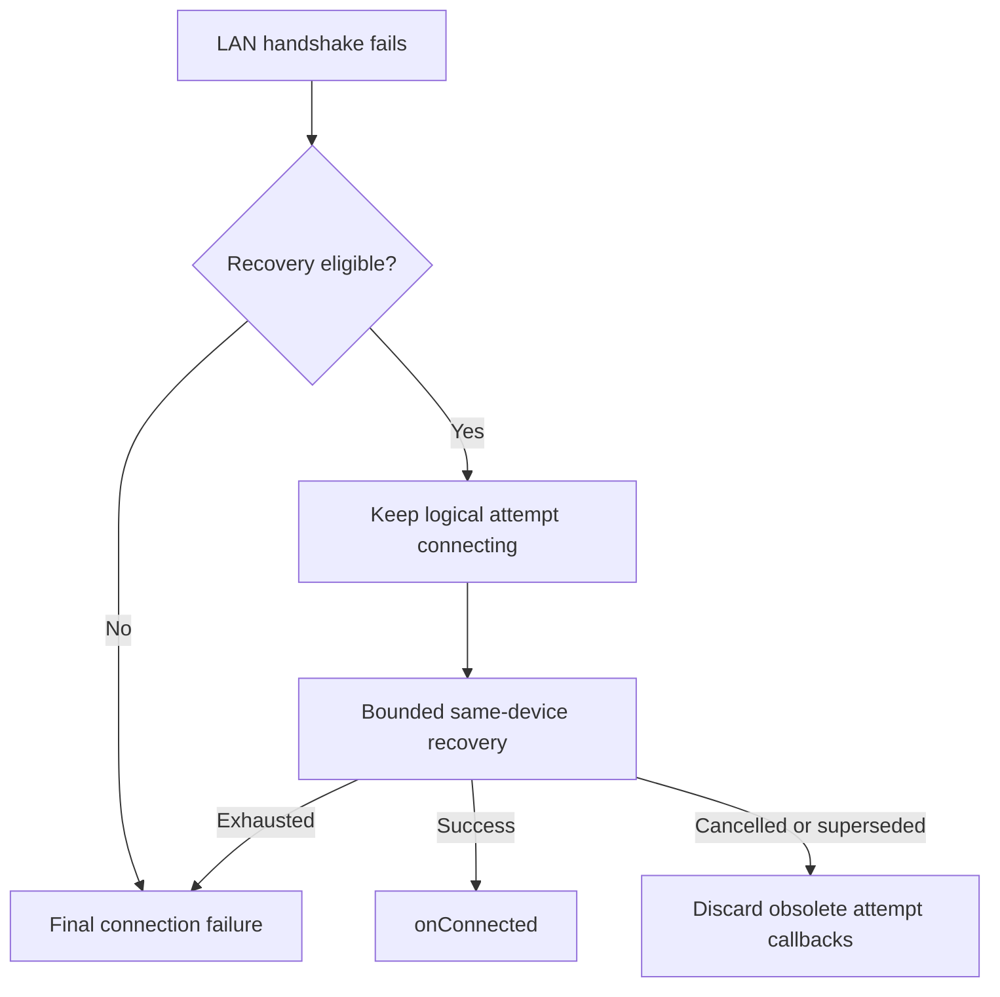

# LAN recovery callback ordering

## 0. Changelog

v1.0 (2026-10-14): initial specification independently reviewed and approved in the current conversation.
No existing active connection spec is changed; an SCR is not required for this initial draft.

## 1. Scope

SDK-managed LAN initial connection and reconnect to a stale endpoint, with
service discovery of the same target device. This is a connection callback timing
fix, not a transaction retry or a change to transport framing/device identity.
R1 comes from the original request; R2–R6 boundaries were explicitly approved
with AC1–AC6 by the maintainer response “开始实现” after the approval request.

## 2. Rules

| Rule | Condition → behavior | Source | Status |
|---|---|---|---|
| R1 | Auto-reconnect enabled: a failed initial LAN endpoint must not emit a terminal connection failure before attempting recovery to the discovered endpoint. | SRC-1 (EXPLICIT) | Approved |
| R2 | Keep the logical attempt connecting during recoverable handshake error/close; suppress paired transport-close state regression regardless of callback ordering. | SRC-2 (EXPLICIT) | Approved |
| R3 | When recovery has no acceptable target or replacement connection fails and configured recovery is exhausted, terminate the logical attempt and report a final connection error once per listener, with no handshake-generated duplicate disconnect. | SRC-2 (EXPLICIT) | Approved |
| R4 | autoReconnect=false retains direct failure reporting and disables discovery recovery; errors remain existing codes. | SRC-2 (EXPLICIT) | Approved |
| R5 | Manual disconnect, superseding connection or cleanup cancels pending recovery; obsolete callbacks cannot report success/failure or start a replacement for the cancelled attempt. | SRC-2 (EXPLICIT) | Approved |
| R6 | Scope the deferral to pre-connection LAN handshake recovery; preserve established-link errors and existing in-flight fast recovery budgets, transaction callbacks and query-first rules. | SRC-2 (EXPLICIT) | Approved |

Five dimensions: business flow R1; state/rules R2; interface boundary R4;
exception/risk R3/R5; acceptance/regression R6. Each R maps to the same numbered AC.

## 3. Public contract

No new public API, field, default, error code or callback thread guarantee.
Existing ConnectionConfig.autoReconnect and bounded retry/discovery policy apply.
The connect-call listener, persistent observer and queued connect callers joining
the active reconnect must obey the callback order. Intermediate handshake failure
must not fail queued callers before recovery succeeds. Terminal failure releases
pending callers and reconnect state so subsequent explicit connect is accepted.
Internal log messages may retain endpoint failures for diagnosis.

## 4. Boundaries

Preserve same-device discovery checks: never select a different terminal merely
because its port is reachable. Test repeated failures, discovery failure/no target,
replacement failure, successful replacement, upper-layer rejection (including unchanged address or identity/mode protection), error/close ordering, cancellation,
autoReconnect=false, and established-link/fast-recovery regression.
This specification does not make intermediate failures across all connection modes silent.
No change to maxRetryCount, retryDelayMs, discovery retry limits or transaction deadlines.
Discovery and reconnect retain their existing separate budgets; this task introduces
no global retry budget. A discovered target rejected without an accepted handoff
cannot silently finish the logical attempt with no final outcome.

## 5. Example

With autoReconnect=true: connect(8445) → refused → discover same device(8443)
→ connect(8443) → onConnected; the failed handshake does not cause an error popup.
With autoReconnect=false: connect(8445) → refused → existing final onError.

## 6. Flow

## 7. Compatibility and downstream impact

Signatures and error meanings unchanged; autoReconnect=true consumers stop seeing
transient terminal callbacks during successful endpoint recovery. Tapro/Demo can
continue using public listeners. Public en/zh documentation needs this clarification
in the eventual confirmed-version release. No version bump, Maven publication,
consumer dependency update or current-version document update is part of this fix.
APP-to-APP/Cable/Cloud, amounts, Refund/Abort, INIT, 306/307/308, request IDs,
credentials/log settings and lifecycle API are unchanged and outside implementation scope.
Callback code must remain safe for background threads.

## 8. Acceptance / regression cases

### AC1 (R1; TC-LAN-RECOVERY-001)

Given autoReconnect=true, stale port 8445 and same-device discovery at 8443. When old endpoint fails and replacement succeeds. Then onConnected is delivered; neither onError nor onDisconnected is emitted for the failed handshake.

### AC2 (R2; TC-LAN-RECOVERY-002)

Given fallback eligible and no established socket. When transport error and close occur in either order while discovery is pending. Then isConnecting remains true; ERROR/DISCONNECTED and public terminal callbacks are absent.

### AC3 (R3; TC-LAN-RECOVERY-003)

Given autoReconnect=true; no target, discovery exception, missing/rejecting address-change listener without accepted handoff, or failed replacement connection. When existing bounded recovery is exhausted or a non-retryable failure terminates it. Then connecting ends; each distinct listener instance (including a shared connect/global listener and queued reconnect callers) gets one final onError for this eligible LAN recovery attempt, no duplicate handshake onDisconnected; pending reconnect callers are released and reconnect state ends; a subsequent explicit connect can proceed.

### AC4 (R4; TC-LAN-RECOVERY-004)

Given autoReconnect=false and refused endpoint. When direct connection fails. Then existing direct failure reporting is preserved without discovery or new-port connection; this task does not add a handshake disconnect or redesign disabled-reconnect error deduplication.

### AC5 (R5; TC-LAN-RECOVERY-005)

Given discovery/replacement connection pending. When user disconnects, switches connection or cleans up. Then old attempt produces no later recovery success/error or new connection; explicit disconnect follows the existing API contract.

### AC6 (R6; TC-LAN-RECOVERY-006)

Given established link error or transaction fast recovery path. When transport failure occurs. Then existing error/recovery path remains operative; no broadened error suppression, transaction resubmission or change to the existing fast-recovery path.

Fast-recovery caveat: existing comments describe no mDNS, but the actual call reuses
connectInternal with the enabled fallback option. This discrepancy is observed,
not an approved requirement; this task preserves the existing path.

## 9. Approval and verification

Approved of R1–R6 and AC1–AC6. Tests are planned, not implemented or run.
Independent review report is retained outside the repository in the task workspace.
Mechanical spec-check cannot substitute for semantic review or approval.
