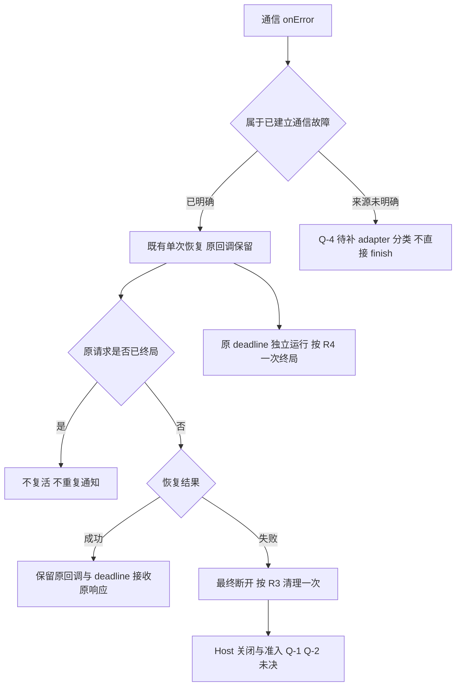

# TapLink onError 恢复结果与请求回调生命周期技术规格

> 使用 `.agents/skills/spec-authoring/assets/templates/spec.md`。本文件是 SDD 草案，不替代已 active 的 established recovery。维护者已澄清 onError 时序；新 Host 关闭、手动通知和 adapter 分类仍有高风险缺口，不能批准或用于实现。本文 TC 均为计划编号，非已实现/已运行测试。

## 0. 变更记录（Changelog）

| 版本 | 日期 | 变更 | 影响的 R/AC | 级别 | breaking | SCR | 评审人 |
|---|---|---|---|---|---|---|---|
| v1.0 | 2026-10-19 | 根据维护者原文建立草案；原 AI 方案仅作待复核分析 | R1–R12 / AC1–AC5、AC10–AC12 | L3 | 待裁决 | SCR-ONERROR-CALLBACK-LIFECYCLE-001（PENDING） | 独立复核报告另存会话目录；未人工批准 |

## 1. 背景与范围

### 1.1 业务场景

在途交易发生通信 onError 或断开时，先拿到既有恢复重试结果，再决定是否移除原请求回调；调研最终断开后关闭交易并允许下一笔。原始需求见 [来源记录](sources/TAPLINK_ONERROR_CALLBACK_LIFECYCLE_REQUEST.md) S1–S3。

### 1.2 目标

将“onError 不提前移除”与已批准 R10/R15 的恢复保留、失败清理、原超时一次终局对齐；记录 Host 关闭/准入所需裁决，建立完整来源链。

### 1.3 非目标

不删除公开 onError，不自动重发支付，不增加恢复次数/预算，不提前结束所有 Host 阶段，不推定通信失败等于支付失败。不发布、不升级依赖。Cloud 不新建 SDK transport。

### 1.4 适用范围与术语

- 通信 onError：transport/InnerCallback 的故障入口，不等同于公开 ConnectionListener.onError。
- 恢复结果：既有 established recovery 协调器最终成功或失败；一次/5000ms/同终端规则沿用 active spec。
- 请求终局：一次 PaymentCallback 请求生命周期结束，不等于资金 approved/declined。
- 交易关闭：Host 真实执行、交互和资源退出；明确实现策略待 Q-1/Q-2。
- 范围：SDK ON_DEVICE/兼容 APP_TO_APP（本地 AIDL）、LAN、Cable VSP/RS232/AOA，以及 SUB_SCREEN（VSP + 屏初始化）实际路径；Host LAN/Cable 为跨端影响调研。SAF 控制/持续订阅不依据历史方案假定当前具备；若实际版本启用，按 Q-4 另列路径，不顺带退订持续事件。

## 2. 规则定义（按五维完整性框架组织）

来源、状态和计划测试以 [coverage](coverage/SPEC-REQUEST-CALLBACK-LIFECYCLE-001.yaml) 为准。EXPLICIT 表示原文存在，不等于本草案获批；未决规则不编造 AC。

### 2.1 业务流程完整性

| 编号 | 条件 | 确定行为 | 来源 |
|---|---|---|---|
| R1 | 通信故障及恢复结果 | 通信 onError 到达先保留原请求登记，等待既有恢复重试结果，再决定移除；不将 onError 到达本身当成终局。 | SRC-2 / REVIEW_REQUIRED |
| R2 | 通信故障及恢复结果 | 原请求未终局且原终端恢复成功，保留原 callback、traceId、transactionRequestId、去重与原 deadline，重挂原响应路由，不重发支付。 | SRC-3 / REVIEW_REQUIRED |
| R3 | 通信故障及恢复结果 | 恢复最终失败时经最终断开路径清理/失败本会话在途请求一次；已完成请求不重复通知，保留 ConnectionListener。 | SRC-5 / REVIEW_REQUIRED |

### 2.2 状态与规则完整性

| 编号 | 条件/状态 | 确定行为/转换 | 来源 |
|---|---|---|---|
| R4 | 原请求/恢复代次 | 原请求 deadline 在恢复中继续；原响应、原超时和最终恢复失败竞争必须一次终局，已终局请求不被恢复成功复活。 | SRC-3 / REVIEW_REQUIRED |
| R10 | 原请求/恢复代次 | 恢复旧代次的读写/状态/关闭/权限/握手回调不得改变后继资源或发出后继结果。 | SRC-8 / REVIEW_REQUIRED |

### 2.3 接口与系统边界完整性

| 编号 | 接口/边界 | 输入→输出 / 超时 / 断连 / 错误响应 | 来源 |
|---|---|---|---|
| R5 | SDK/Host | 恢复期间新请求在序列化/发送前以既有 E213 拒绝，不排队、不重放。 | SRC-6 / REVIEW_REQUIRED |
| R6 | SDK/Host | 维护者要求：交易中最终断开后关闭当前交易并允许新的交易进入；事件起算、Host 安全退出及放行条件尚待 Q-1/Q-2，不能写成所有阶段立即清 busy。 | SRC-1 / BLOCKED |
| R7 | SDK/Host | 待确认：手动 disconnect/cleanup 时已发送请求的通知契约与清理顺序。 | SRC-11 / BLOCKED |

### 2.4 异常与风险完整性

| 编号 | 异常场景 | 确定处理 | 来源 |
|---|---|---|---|
| R8 | 错误归属/跨端冲突/结果 | 待确认：各 adapter 的 onError 如何归属通信恢复、明确请求终局；不能按方法名或错误字符串直接 finish。 | SRC-12 / BLOCKED |
| R9 | 错误归属/跨端冲突/结果 | 待裁决：Host active 保留/续推政策与新关闭/放行政策的时序，以及历史 E306/E213 表述漂移。 | SRC-13 / BLOCKED |
| R11 | 错误归属/跨端冲突/结果 | 保留 AGENT §4：onSuccess 按业务三态检查；onFailure 仅通信/系统错误；306 先 query；新交易唯一 ID，307/308 新 ID；不扩大 Abort 资格，不改变金额、退款语义。 | SRC-7 / REVIEW_REQUIRED |

### 2.5 验收与验证完整性

方案采用内部指定骨架，规格/coverage/SCR/独立审查各用仓库模板；未决规则及未执行验证如实标注，不标 active/approved。（R12 / SRC-9）。

| 规则 | 对应验收标准 | 计划用例 |
|---|---|---|
| R1 | AC1 | TC-RCL-001 |
| R2 | AC2 | TC-RCL-002 |
| R3 | AC3 | TC-RCL-003 |
| R4 | AC4 | TC-RCL-004 |
| R5 | AC5 | TC-RCL-005 |
| R6 | BLOCKED，无确定 AC | 待 Q 裁决后生成，不填虚构期望 |
| R7 | BLOCKED，无确定 AC | 待 Q 裁决后生成，不填虚构期望 |
| R8 | BLOCKED，无确定 AC | 待 Q 裁决后生成，不填虚构期望 |
| R9 | BLOCKED，无确定 AC | 待 Q 裁决后生成，不填虚构期望 |
| R10 | AC10 | TC-RCL-006 |
| R11 | AC11 | TC-RCL-007 |
| R12 | AC12 | TC-RCL-008 |

## 3. 接口/字段契约（涉及对外接口时必填）

### 3.1 字段定义

不新增已批准 public 字段/类型，现有 callback 签名与可空性以源码为准；内部 token/session 模型属于方案 §3.2 的 PROPOSED 机制，尚非本规格确定字段。

```kotlin
// Existing public signatures; definitions remain in callback/ConnectionListener.kt.
fun onConnected(deviceId: String, taproVersion: String)
fun onDisconnected(reason: String)
fun onError(error: ConnectionError)
```

### 3.2 字段必要性与缺失行为

| 既有字段/状态 | 必要性 | 未传/显式值/缺失行为 |
|---|---|---|
| traceId | 响应路由必需 | 缺失响应不能领取任意请求；不得静默生成 ID 认领旧 callback |
| transactionRequestId | 新交易全局唯一；query 指向原交易 | 不因恢复换 ID/重发；新业务交易使用新 ID |
| request deadline | 沿用原请求的既有解析结果 | 恢复不重置；APP_TO_APP 当前本层无 timer 的政策不由本草案改动 |
| autoReconnect | 现有配置项 | 未传、false、true 均不取消 established 单次恢复 |
| Host 关闭等待/准入字段 | 未定义 | Q-1/Q-2 未决，不新增默认 5s/180s 或 false/NONE 语义 |

### 3.3 校验规则

恢复中新提交 E213；恢复最终失败按 active 契约最终 E213。原 306 超时不是提前关闭恢复的替代码。逐 adapter 原始内部码映射待 Q-4，不新增错误码，不按字符串猜测终局。

## 4. 边界与异常行为

| 场景 | 行为/缺口 |
|---|---|
| onError 与恢复成功/失败交错 | 先等待恢复判定；R1–R3，不按故障事件直接删回调 |
| 原超时先到、后恢复成功 | R4：不复活请求，不延长 deadline；306 query-first |
| 原合法响应先到、后恢复失败 | R3/R4：请求不重复终局；连接仍按其独立契约报告 |
| 旧 episode、回调重入、observer 抛错 | 保留 active R7/R9；手动断开在途通知策略 Q-3，不自行改变 |
| Host 接收器重新 start 清状态 | 不能当作引擎退出证明；Q-1/Q-2 阻断精确关闭/放行 AC |
| 重复 traceId、timer 注册/清理竞争 | 统一所有权属于方案建议，具体并发机制纳入独立复核，不当作已批准业务字段 |
| 进程死亡/重启、权限丢失、身份不可靠 | active established R8/R12/R14 前置约束仍在；不假设进程重启能续跑支付，不自动权限授权 |
| UI/日志 | callback 可能后台，UI 切主线程；仅脱敏诊断，生产日志关闭，无凭证硬编码 |

## 5. 示例（必填）

以下 JSON 为可观察事件序列的说明数据，非新增 wire 协议或平台字段。本主题无平台配置合并，不虚构“部分自定义/完全自定义”开关。

```json
{"scenario":"recovery_success","events":["communication_onError","recovery_success","original_response"],"callback_retained_until":"original_response"}
```

```json
{"scenario":"recovery_failure","events":["communication_onError","recovery_failure","final_onDisconnected_213"],"request_terminal_count":1}
```

```json
{"scenario":"original_deadline_first","events":["communication_onError","original_timeout_306","recovery_success"],"request_revived":false,"payment_resend_count":0}
```

Host 下一笔的确定示例被 Q-1/Q-2 阻塞，不写未经裁决的强制关闭时长。

## 6. 流程图（复杂判定必填，Mermaid）



## 7. 兼容性说明（行为变更时必填）

R1–R5 对齐已有 R6/R10/R11/R15，不因本草案改变既有恢复预算/次数。R6–R9 涉及 Host active 保留窗、手动通知或错误分类，按 L3 审批，具体 breaking 与迁移待决。SCR 仅为 PENDING 申请，不更新 active 规则。修改 Host active 规则前须在 Host 仓库建立对应 SCR 并由其负责人批准；本轮只在 SDK 包中记录跨仓库影响，不伪造 Host 批准。发布时维护者手动 AAR/Maven，确认版本后更新 Tapro/Demo 和公开 en/zh 文档。

## 8. 验收标准（测试直接转用例）

> 以下为草案 AC；人工批准前不作为 TDD 期望。TC 为计划用例，未实现/未运行。R6–R9 缺口未定，不编造期望。

```text
AC1（映射 R1，计划 TC-RCL-001）：
  Given 已建立连接且原请求仍在途、原 deadline 未到
  When  内部收到通信 onError，恢复结果尚未确定
  Then  原登记及原回调仍可用，不在此时移除或因该通信故障提前 onFailure；恢复成功/失败分别按 R2/R3 验证
```

```text
AC2（映射 R2，计划 TC-RCL-002）：
  Given 原请求在恢复中，原 deadline 未到
  When  恢复成功并收到原 traceId 的进度与真实结果
  Then  原 callback 接收原结果且只发生一次请求终局，没有新支付发送或截止时间延长
```

```text
AC3（映射 R3，计划 TC-RCL-003）：
  Given 原请求在途且恢复尚未结束
  When  单次恢复最终失败，随后重复故障/结果/原 timer 到达
  Then  按既有最终断开契约完成一次请求清理/失败，最终 onDisconnected(E213) 一次；全局 listener 不被摘除
```

```text
AC4（映射 R4，计划 TC-RCL-004）：
  Given 原响应、原 deadline 和最终恢复结果可控交错
  When  任一有效请求终局先发生，再交付其他事件
  Then  只通知一次请求终局；原 deadline 未延长，超时为原 306，恢复不重建旧登记
```

```text
AC5（映射 R5，计划 TC-RCL-005）：
  Given 恢复仍活跃
  When  提交一笔新 ID 的请求
  Then  E213 拒绝且没有发送/排队；恢复终局后是否可执行由连接及 Host 真实状态决定
```

```text
AC10（映射 R10，计划 TC-RCL-006）：
  Given 旧恢复 episode 已结束并有后继会话
  When  交付旧 read/write/status/close/permission/handshake 回调
  Then  后继连接及新请求不被旧事件清理、关闭或通知旧结果
```

```text
AC11（映射 R11，计划 TC-RCL-007）：
  Given 响应包含 approved/processing/declined，或通信 306、307、308；含真实金额/原交易 ID 的既有请求
  When  处理响应或准备后续操作
  Then  业务结果保留三态，通信失败不替代资金结果；306 query-first，307/308 新 ID，金额仍为最小单位，授权后不使用 Abort
```

```text
AC12（映射 R12，计划 TC-RCL-008）：
  Given 本需求进入内部 SDD
  When  提交本轮文档产物
  Then  源→R→AC→TC 可核对；缺口无伪造 AC，模板一致；人工批准前保持 draft/approved=false
```

